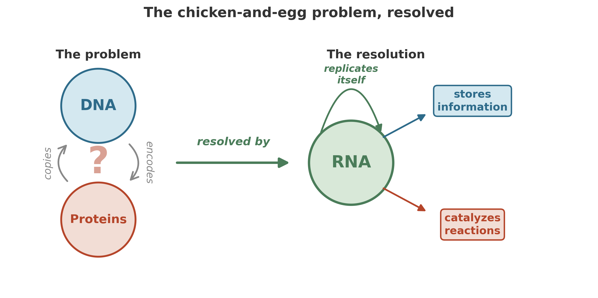

Imagine you find a book.

Not an ordinary book: this one is written in a language you have never seen, on fragile molecular pages that must be copied by a machine. The instructions for building the machine are in the book. Without a working copier, the record is lost. Without the record, the copier cannot be rebuilt.

That paradox sits at the center of origin-of-life research, and for decades it stalled progress.

{#fig-rna-world}

In modern cells, the division of labor is clean. DNA stores the instructions. Proteins do the work -- catalyzing reactions, building structures, transporting molecules across membranes. But proteins cannot copy themselves; they need DNA's blueprint. And DNA cannot do anything useful without the proteins that read it, unwind it, and replicate it. Which came first? The question is not rhetorical. It is a genuine engineering bottleneck: you cannot bootstrap a system that requires two specialized components if each component depends on the other for its existence.

A possible way around this dependence came from a molecule known chiefly as an intermediary.

## The middleman steps forward

RNA sits between DNA and proteins in modern cells. It carries genetic messages from DNA to ribosomes, the protein-making machinery built from RNA and proteins. For much of the twentieth century, researchers treated RNA chiefly as a carrier of information.

Then, in the early 1980s, Thomas Cech and Sidney Altman independently discovered that certain RNA molecules could catalyze chemical reactions.[^ch03-ribozyme-discovery] They were not just carrying information; they were *doing chemistry*. These catalytic RNAs were named ribozymes, and their discovery earned Cech and Altman the Nobel Prize in 1989.[^nobel1989]

If RNA can both store information *and* catalyze reactions, then perhaps you do not need two separate molecular systems to get replication started. A single type of molecule might fill both roles: an autocatalytic loop of replicating RNA, with ribozymes helping synthesize new copies.[^markov2010a][^cech1986] That is the proposed escape from the paradox. Catalytic RNA by itself does not establish a self-copying system.

The RNA world hypothesis proposes an early stage in which RNA supplied both heredity and catalysis, before the modern division of labor between DNA and proteins.[^orgel2004] The discovery makes that combination chemically plausible. The remaining challenge is to assemble a system that keeps copying itself with the available materials and energy.

The standard RNA alphabet is small: four bases -- adenine (A), guanine (G), cytosine (C), and uracil (U). A base attached to ribose forms a nucleoside; a phosphate-bearing nucleoside is a nucleotide.[^markov2010b][^rna_bases] With just these letters, RNA can fold into elaborate three-dimensional shapes, creating pockets and surfaces that perform particular catalytic tasks. That capacity is established. Whether it was enough to start a self-sustaining evolutionary process is the open question.

## Where it happened

Where did RNA chemistry first ignite? Three settings are proposed, and they are not mutually exclusive.

Ice can concentrate supplied reactants into liquid pockets between crystals; laboratory-selected RNA polymerase ribozymes can operate there below freezing.[^markov2010c]

Alkaline hydrothermal vent hypotheses instead emphasize geological supplies of H$_2$ and mineral catalysts, including iron and nickel.[^mineral_catalyst] A continuous supply of CO or HCN cannot simply be assumed from those ingredients. Miller-type spark experiments test a different setting: electrical discharge through prepared reduced gases and water, not vent fluids.[^johnson2008][^miller1953]

A third option -- wet-dry cycling on land, in volcanic hot springs or tidal flats -- repeatedly concentrates reactants by dehydration. Experiments with supplied mononucleotides and lipids have produced RNA-like polymers and encapsulated them on rehydration; the larger hot-spring origin scenario remains a hypothesis.[^ch03-wet-dry-experiment][^damer2020]

These experiments establish useful individual steps. Connecting them into a self-copying system requires compatible temperatures, reactants and successive reactions; the amount of exposed land on early Earth also constrains some settings. Different stages may have occurred in different environments.

## The phosphorus problem

Before RNA can copy itself, RNA must exist. And building RNA from scratch requires phosphorus in an available chemical form, not merely phosphorus present somewhere in a rock.

RNA's backbone is not made of the bases themselves. The bases are the informational part -- the letters. The backbone, the structural spine that holds the letters in order, is a chain of sugar molecules linked by phosphate bridges. Without phosphate, there is no RNA polymer. The RNA world hypothesis requires a route to phosphorylated building blocks.[^orgel2004]

Where did it come from? In 2005, Matthew Pasek and Dante Lauretta proposed one striking answer: iron meteorites.[^pasek2005]

The early Earth was under heavy bombardment.[^lhb] Among the arriving meteorites were iron-rich bodies containing the mineral schreibersite -- an iron-nickel phosphide.[^schreibersite] When phosphides corrode in water, they release a mixture of phosphorus compounds, including reduced and condensed forms. Pasek and Lauretta tested this chemistry in prepared aqueous solutions, making meteorites a plausible source of prebiotic phosphorus, rather than establishing the source that actually fed the first RNA.[^pasek2005]

Researchers no longer have to lean on the meteorite pathway alone. Laboratory heating of dried phosphate and iron(II) mixtures can generate phosphite or short-chain polyphosphates under particular temperature and gas conditions.[^baidya2024] Those are precursor-producing conditions, not conditions shown to sustain RNA. Carbonate-rich lake experiments and geochemical models suggest a route to concentrated dissolved phosphate; observations of a modern soda lake show that such concentration can occur today.[^tonercatling2020][^haas2024] Lightning offers another possibility: schreibersite has been identified in a modern fulgurite, while its contribution on early Earth is estimated by extrapolation.[^hess2021] These are distinct routes with distinct requirements, not a demonstrated sequence leading to life.

The chemistry of life did not arise in isolation from geology. Meteorites could have provided one route. Heated minerals could have provided another. Evaporative lakes may have provided yet another. Minerals provided surfaces. Water provided the solvent. Life did not invent its raw materials; it inherited them from a planet with more than one possible way of making them available.

## Metals at the active site

The ancient ocean was a different solvent than the one we know. Anoxic waters could sustain more dissolved iron than oxygenated waters, but availability depended on the element and the local chemistry. That does not make tungsten, molybdenum, and vanadium universally more abundant than today.[^markov2010d][^metal_ocean]

Many of the enzymes that drive modern biochemistry are not pure protein. They are metalloproteins, with metal cofactors contributing to catalysis or electron transfer.[^metalloproteins] The protein does more than provide a scaffold: it shapes the chemical environment around the cofactor. Metal and protein work together.

Why would proteins evolve to depend on metals? One proposed answer is that they inherited part of their chemistry from mineral catalysts. Iron-sulfur surface metabolism is one such origin hypothesis.[^ironsulfur_world] It offers a possible connection between geology and biochemistry, not an observed chronology of the first catalysts.

A gradual transition from mineral-assisted chemistry to protein catalysis has been proposed.[^mineral_catalyst] Short peptides that helped position a metal ion might have gained a catalytic advantage. Over time, proteins could have become better partners for the metals.[^markov2010e]

## LUCA was early, and not alone

The geological and evolutionary clocks now meet. If the debated biological interpretation of the 3.8-billion-year-old carbon signals is accepted, life was already present by that time. A separate 2024 phylogenomic reconstruction places the last universal common ancestor, LUCA, roughly 4.2 billion years ago, only a few hundred million years after Earth formed.[^moody2024]

In that reconstruction, LUCA looks more like a prokaryote-grade anaerobe than a barely assembled protocell: metabolically capable and genetically substantial. Moody and colleagues estimate a genome of about 2.75 megabases encoding around 2,600 proteins, with metabolic potential consistent with hydrogen- and CO$_2$-fed acetogenesis.[^moody2024] These are model-dependent inferences from living descendants. LUCA denotes their last universal ancestral lineage or population, not the first life. Inferred Cas-related proteins suggest an early defense system, not a fully reconstructed modern adaptive immune system.

Viruses belong in the story as a hypothesis about that early ecology. If LUCA carried antiviral defenses, genetic parasites may already have been present. Krupovic, Dolja, and Koonin propose a complex LUCA virome by tracing present-day viral groups backward; no virome from LUCA has been sampled.[^krupovic2020] Cells exchanging metabolites, competing for resources, and defending themselves against infection are a possible early ecological picture, not a fossil observation.

Some researchers push the entanglement further. Forterre has argued that viruses may have helped install DNA itself into cellular evolution, making the first DNA genomes part of an arms race rather than a clean cellular invention.[^forterre2006] The proposal remains contested. If correct, infection and heredity were tangled together before LUCA.

By the time we can plausibly speak of LUCA, these reconstructions suggest an ecological setting: cells, their resources, and possibly their parasites. We now need to ask how such a system could keep obtaining materials and disposing of its products.

## The recycling problem

The origin story is usually told as a single lineage: first RNA, then proteins, then DNA, then cells. A lonely molecule in a puddle, gradually becoming more complex. That version captures something real, but it misses a critical constraint.

Consider what a living system actually does. It takes in raw materials, transforms them, and produces waste. A finite stock can run out, and products can accumulate. But whether that happens depends on consumption, geological supply, product removal, and storage. It is a balance to be checked, not a thermodynamic proof that a solitary lineage must fail.[^markov2010f][^braakman2013]

Biological recycling can extend access to resources. One organism's waste can become another organism's food. Carbon fixation and oxidation can become linked, as can sulfur reduction and oxidation. The relevant question is how much of each element returns, how much enters from outside, and how much leaves or is buried. A biosphere need not close every elemental cycle through biology alone.

A single type of organism need not carry out all those transformations on its own. Geological processes can supply some of them.

```{=latex}
\begingroup
\interfootnotelinepenalty=10000
```

An organism that plugs into geological supply and sinks can persist without a biological recycling partner while those fluxes meet its needs. A hydrothermal flow-through setting is one candidate. Intensifying metabolism may exceed local supply, but no universal threshold forces geological buffering to fail or complementary organisms to appear.[^markov2010f][^braakman2013]

```{=latex}
\endgroup
```

For life that grows, diversifies, and reshapes its environment, biological recycling creates further possibilities. Its importance is a question of scale and flux, not an automatic consequence of growth.

The popular narrative usually starts with a solitary replicator and adds cooperation later. The biogeochemical argument gives us a reason to consider communities early, without proving that they were necessary from the start. A single metabolic strategy can occupy a geological niche. Multiple strategies using each other's outputs can expand the network.

The earliest communities may have been simple. Perhaps methanogenic archaea reduced CO$_2$ to CH$_4$ using hydrogen, while other organisms oxidized the methane or consumed other waste products. Perhaps sulfate reducers and sulfur oxidizers formed a recycling pair. These are candidate interactions, contingent on suitable reactants and energy sources, not an established roster of the first community. The network could have helped life outgrow an initial niche and reshape the planet's chemistry.

## The circuit redrawn

We can see this through the lens we built in the first two chapters. Think of the earliest biosphere as a primitive electrical circuit.

Each metabolic type is a different wire connecting a different pair of terminals. Methanogens connect the CO$_2$/CH$_4$ couple. Sulfate reducers connect the SO$_4^{2-}$/H$_2$S couple. Iron oxidizers connect the Fe$^{2+}$/Fe$^{3+}$ couple. Wire compatible reactions together -- let the products of one become the reactants of another -- and you can build multiple loops. But loops do not supply their own driving force. Continuing current requires energy and suitable reactants from outside.

In thermodynamic terms, a community is an open network. Electrons move, products accumulate, and other organisms can take those products up. Recycling matter does not recycle the energy dissipated along the way.

The rock record adds evidence, with limits. Stromatolites in the Strelley Pool Formation date to 3.43 billion years ago and have been interpreted as microbial reef structures.[^stromatolites] They do not tell us what the first organisms looked like. Nor do their shapes identify a particular multi-species mat, its lineages, or its metabolic layers.[^microbial_mats] They support an ancient microbial ecosystem; reconstructing its detailed organization takes a further step.

## From spark to city

RNA offered a possible way past the chicken-and-egg paradox by carrying information and performing chemistry. But catalytic RNA alone does not make a biosphere. Persistent life also requires an energy supply and a balance between material supply, use, and removal. Communities can change that balance through recycling. Their necessity at the very beginning remains an open question.

The next question is: what did those first communities look like? How did they organize themselves physically? And how did their organization shape the planet?

One enduring architecture is the microbial mat. Layered cities of microbes, stacked by function and connected by chemistry, form the subject of the next chapter. How closely their modern organization resembles the first communities is a separate question.

The spark has caught. Now it builds.

## Takeaway

- The chicken-and-egg paradox (DNA needs proteins, proteins need DNA) motivates the RNA world hypothesis: RNA can store information and catalyze reactions, but catalytic activity does not by itself establish self-replication.
- Ice, hydrothermal systems, and wet-dry environments offer different proposed steps. Laboratory successes under specified conditions do not identify the setting where life began.
- Meteorite phosphides, heated phosphate-bearing materials, carbonate-rich lakes, and lightning offer possible phosphorus routes with different evidence and requirements.
- Metal availability depends on local chemistry. A mineral-to-protein catalytic transition is a hypothesis, not an established universal sequence.
- Geological supply and sinks can sustain an open system. Biological recycling can expand its possibilities, while the earliest community structure remains uncertain.

[^ch03-ribozyme-discovery]: Kelly Kruger et al., "Self-splicing RNA: autoexcision and autocyclization of the ribosomal RNA intervening sequence of Tetrahymena," *Cell* 31 (1982): 147--157, DOI:10.1016/0092-8674(82)90414-7, cited below; Cecilia Guerrier-Takada et al., "The RNA Moiety of Ribonuclease P Is the Catalytic Subunit of the Enzyme," *Cell* 35 (1983): 849--857, [DOI:10.1016/0092-8674(83)90117-4](https://doi.org/10.1016/0092-8674(83)90117-4). These establish self-splicing and RNA-catalyzed precursor cleavage, respectively. [@Kruger1982; @GuerrierTakada1983]

[^ch03-wet-dry-experiment]: Sudha Rajamani et al., "Lipid-assisted synthesis of RNA-like polymers from mononucleotides," *Origins of Life and Evolution of Biospheres* 38 (2008): 57--74, [DOI:10.1007/s11084-007-9113-2](https://doi.org/10.1007/s11084-007-9113-2). The experiment supplies mononucleotides and lipids and alternates dry heated and hydrated conditions. The product is described as RNA-like polymer; it is not a demonstrated autonomous replicator. [@Rajamani2008]

[^markov2010a]: Kelly Kruger et al., "Self-splicing RNA: autoexcision and autocyclization of the ribosomal RNA intervening sequence of Tetrahymena," *Cell* 31 (1982): 147--157, [DOI:10.1016/0092-8674(82)90414-7](https://doi.org/10.1016/0092-8674(82)90414-7); Walter Gilbert, "Origin of life: The RNA world," *Nature* 319 (1986): 618, [DOI:10.1038/319618a0](https://doi.org/10.1038/319618a0). Self-splicing is an observation; a replicating RNA world is the proposed historical step. [@Kruger1982; @Gilbert1986]

[^markov2010b]: Adenosine, guanosine, cytidine, uridine, and inosine are nucleosides. Inosine contains the base hypoxanthine; its residue is a modified RNA letter, not a fifth canonical base. See Bruce Alberts et al., *Molecular Biology of the Cell*, 6th ed. (Garland Science, 2015), for standard molecular terminology. [@Alberts2015]

[^markov2010c]: James Attwater, Aniela Wochner, and Philipp Holliger, "In-ice evolution of RNA polymerase ribozyme activity," *Nature Chemistry* 5 (2013): 1011--1018, [DOI:10.1038/nchem.1781](https://doi.org/10.1038/nchem.1781). Selected ribozymes, supplied primers, templates, nucleotides, and buffer were tested in ice; activity reached -19 C. This is not an unassisted origin or complete self-copying experiment. [@Attwater2013]

[^orgel2004]: Leslie E. Orgel, "Prebiotic Chemistry and the Origin of the RNA World," *Critical Reviews in Biochemistry and Molecular Biology* 39 (2004): 99--123, [DOI:10.1080/10409230490460765](https://doi.org/10.1080/10409230490460765). This review treats unresolved steps toward an RNA world; it does not establish that RNA was the first or only early polymer. [@LeslieE:2004jz]

[^pasek2005]: Matthew A. Pasek and Dante S. Lauretta, "Aqueous Corrosion of Phosphide Minerals from Iron Meteorites: A Highly Reactive Source of Prebiotic Phosphorus on the Surface of the Early Earth," *Astrobiology* 5 (2005): 515--535, [DOI:10.1089/ast.2005.5.515](https://doi.org/10.1089/ast.2005.5.515). Laboratory corrosion products support a candidate phosphorus source, not a demonstrated RNA-producing pathway. [@Pasek2005]

[^johnson2008]: Adam P. Johnson et al., "The Miller volcanic spark discharge experiment," *Science* 322 (2008): 404, [DOI:10.1126/science.1161527](https://doi.org/10.1126/science.1161527). Archived products from discharge experiments with methane, ammonia, hydrogen, and water were reanalyzed. These results do not measure precursor supply at ocean vents. [@Johnson2008]

[^cech1986]: Thomas R. Cech, "A Model for the RNA-Catalyzed Replication of RNA," *Proceedings of the National Academy of Sciences* 83 (1986): 4360--4363, [DOI:10.1073/pnas.83.12.4360](https://doi.org/10.1073/pnas.83.12.4360). This proposes a replication mechanism based on catalytic RNA activity; it is not the original discovery paper or a demonstrated self-replicator. [@Cech1986]

[^nobel1989]: The [Nobel Foundation's 1989 Chemistry award record](https://www.nobelprize.org/prizes/chemistry/1989/summary/) names Sidney Altman and Thomas R. Cech for the discovery of catalytic RNA. The award concerns catalysis, not proof of an origin-of-life scenario.

[^rna_bases]: Bruce Alberts et al., *Molecular Biology of the Cell*, 6th ed. (Garland Science, 2015). Canonical RNA uses ribose and uracil; canonical DNA uses deoxyribose and thymine. These definitions do not establish a historical order of origin. [@Alberts2015]

[^lhb]: Patrick Boehnke and T. Mark Harrison, "Illusory Late Heavy Bombardments," *Proceedings of the National Academy of Sciences* 113 (2016): 10802--10806, [DOI:10.1073/pnas.1611535113](https://doi.org/10.1073/pnas.1611535113). Impact rates were high early, but lunar age spectra do not uniquely require a sharp late spike. No particular bombardment interval is assumed here. [@BoehnkeHarrison2016]

[^schreibersite]: Schreibersite $(\mathrm{Fe},\mathrm{Ni})_{3}\mathrm{P}$ is a meteoritic phosphide. For aqueous corrosion experiments and their mixed products, see Pasek and Lauretta, "Aqueous Corrosion of Phosphide Minerals from Iron Meteorites" (2005), DOI:10.1089/ast.2005.5.515, cited above. Reactivity depends on the species and the subsequent chemistry. [@Pasek2005]

[^metal_ocean]: Christopher L. Dupont et al., "History of biological metal utilization inferred through phylogenomic analysis of protein structures," *Proceedings of the National Academy of Sciences* 107 (2010): 10567--10572, [DOI:10.1073/pnas.0912491107](https://doi.org/10.1073/pnas.0912491107). Redox state affects availability: dissolved $\mathrm{Fe}^{2+}$ can persist in anoxic water, while oxidation promotes $\mathrm{Fe}^{3+}$ oxide precipitation. Sulfide and other local sinks also matter. The paper does not measure a uniformly metal-rich ancient ocean. [@Dupont2010]

[^metalloproteins]: For catalytic, structural, and electron-transfer roles, see Dupont et al. (2010), DOI:10.1073/pnas.0912491107, identified in the metal-ocean note. [@Dupont2010]

[^ironsulfur_world]: Günter Wächtershäuser, "Before Enzymes and Templates: Theory of Surface Metabolism," *Microbiological Reviews* 52 (1988): 452--484, [DOI:10.1128/mr.52.4.452-484.1988](https://doi.org/10.1128/mr.52.4.452-484.1988). The proposed surface-metabolism scenario invokes FeS oxidation to $\mathrm{FeS}_{2}$ (pyrite); it is a theory of origin, not an observed historical sequence. [@Wachtershauser1988]

[^mineral_catalyst]: William Martin and Michael J. Russell, "On the Origins of Cells: A Hypothesis for the Evolutionary Transitions from Abiotic Geochemistry to Chemoautotrophic Prokaryotes, and from Prokaryotes to Nucleated Cells," *Philosophical Transactions of the Royal Society B* 358 (2003): 59--85, [DOI:10.1098/rstb.2002.1183](https://doi.org/10.1098/rstb.2002.1183). This proposes mineral compartments and a geochemical-to-biological transition at alkaline vents. It does not demonstrate every core metabolic reaction or continuous HCN delivery. [@MartinRussell2003]

[^stromatolites]: Abigail C. Allwood et al., "Stromatolite reef from the Early Archaean era of Australia," *Nature* 441 (2006): 714--718, [DOI:10.1038/nature04764](https://doi.org/10.1038/nature04764). Morphology and depositional context support a biological interpretation of the 3.43 Ga Strelley Pool structures. Their detailed microbial membership and metabolism are not directly preserved. [@Allwood2006]

[^microbial_mats]: J. William Schopf, "Fossil Evidence of Archaean Life," *Philosophical Transactions of the Royal Society B* 361 (2006): 869--885, [DOI:10.1098/rstb.2006.1834](https://doi.org/10.1098/rstb.2006.1834). This review discusses biogenicity limits in the Archean record. A stromatolite alone does not identify bacteria versus archaea or the metabolic layering seen in modern mats. [@Schopf2006]

[^miller1953]: Stanley L. Miller, "A Production of Amino Acids Under Possible Primitive Earth Conditions," *Science* 117 (1953): 528--529, [DOI:10.1126/science.117.3046.528](https://doi.org/10.1126/science.117.3046.528). This electrical-discharge experiment used a prepared reduced-gas mixture and water. Its products are not observations of vent-fluid chemistry. [@Miller1953]

[^markov2010d]: Dupont et al. (2010), DOI:10.1073/pnas.0912491107, identified above, discuss low Archean molybdenum availability, contrary to blanket enrichment. [@Dupont2010]

[^markov2010e]: Dupont et al. (2010), DOI:10.1073/pnas.0912491107, identified above, infer protein-architecture histories, not a direct pre-protein catalyst chronology. [@Dupont2010]

[^braakman2013]: Rogier Braakman and Eric Smith, "The compositional and evolutionary logic of metabolism," *Physical Biology* 10 (2013): 011001, [DOI:10.1088/1478-3975/10/1/011001](https://doi.org/10.1088/1478-3975/10/1/011001). This theoretical synthesis considers metabolism at organism and ecosystem scales, including geological boundary conditions. It does not prove that every early biosphere needed multiple biological recycling partners. [@Braakman2013]

[^damer2020]: Bruce Damer and David Deamer, "The Hot Spring Hypothesis for an Origin of Life," *Astrobiology* 20 (2020): 429--452, [DOI:10.1089/ast.2019.2045](https://doi.org/10.1089/ast.2019.2045). This review and hypothesis connects proposed steps; a complete emergence of evolving life through those steps has not been demonstrated. [@Damer2020]

[^markov2010f]: The balance argument here concerns the chosen system and its boundary fluxes. Finite stocks, continuous geological supply, product export, and biological recycling are different cases. Braakman and Smith, "The compositional and evolutionary logic of metabolism" (2013), DOI:10.1088/1478-3975/10/1/011001, cited above, provides network context. No universal ecological threshold is inferred. [@Braakman2013]

[^baidya2024]: Abu Saeed Baidya, Matthew A. Pasek, and Eva E. Stüeken, "Moderate and high-temperature metamorphic conditions produced diverse phosphorous species for the origin of life," *Communications Earth & Environment* 5 (2024): 491, [DOI:10.1038/s43247-024-01657-4](https://doi.org/10.1038/s43247-024-01657-4). Dried phosphate/iron(II) mixtures were heated in specified nitrogen or hydrogen atmospheres. Product distributions varied with conditions; the study did not test RNA survival or replication at those temperatures. [@Baidya2024]

[^tonercatling2020]: Jonathan D. Toner and David C. Catling, "A carbonate-rich lake solution to the phosphate problem of the origin of life," *Proceedings of the National Academy of Sciences* 117 (2020): 883--888, [DOI:10.1073/pnas.1916109117](https://doi.org/10.1073/pnas.1916109117). Prepared brine experiments and geochemical models constrain a possible concentration mechanism, not an observed Hadean lake. [@TonerCatling2020]

[^haas2024]: Sebastian Haas, Kimberly Poppy Sinclair, and David C. Catling, "Biogeochemical explanations for the world's most phosphate-rich lake, an origin-of-life analog," *Communications Earth & Environment* 5 (2024): 28, [DOI:10.1038/s43247-023-01192-8](https://doi.org/10.1038/s43247-023-01192-8). Roughly 37 mM dissolved phosphate was a peak modern Last Chance Lake brine observation. The early-Earth application is an analogy, not a measurement of ancient conditions. [@Haas2024]

[^hess2021]: Benjamin L. Hess, Sandra Piazolo, and Jason Harvey, "Lightning strikes as a major facilitator of prebiotic phosphorus reduction on early Earth," *Nature Communications* 12 (2021): 1535, [DOI:10.1038/s41467-021-21849-2](https://doi.org/10.1038/s41467-021-21849-2). A modern fulgurite contains schreibersite; early-Earth production estimates depend on assumptions about lightning, land, and reducing conditions. [@Hess2021]

[^moody2024]: Edmund R. R. Moody et al., "The nature of the last universal common ancestor and its impact on the early Earth system," *Nature Ecology & Evolution* 8 (2024): 1654--1666, [DOI:10.1038/s41559-024-02461-1](https://doi.org/10.1038/s41559-024-02461-1). Clock calibrations and evolutionary models condition the roughly 4.2 Ga age; ancestral-gene and genome-size reconstructions condition the physiology. Inferred Cas effectors lack the full modern acquisition machinery. These are reconstructions, not a recovered genome or a dated fossil of LUCA. [@Moody2024]

[^krupovic2020]: Mart Krupovic, Valerian V. Dolja, and Eugene V. Koonin, "The LUCA and its complex virome," *Nature Reviews Microbiology* 18 (2020): 661--670, [DOI:10.1038/s41579-020-0408-x](https://doi.org/10.1038/s41579-020-0408-x). This Perspective reconstructs possible ancient virus groups from later descendants; it is not a sampled LUCA virome. [@Krupovic2020]

[^forterre2006]: Patrick Forterre, "The origin of viruses and their possible roles in major evolutionary transitions," *Virus Research* 117 (2006): 5--16, [DOI:10.1016/j.virusres.2006.01.010](https://doi.org/10.1016/j.virusres.2006.01.010). This review proposes viral contributions to DNA origins; that historical scenario remains contested. [@Forterre2006]
