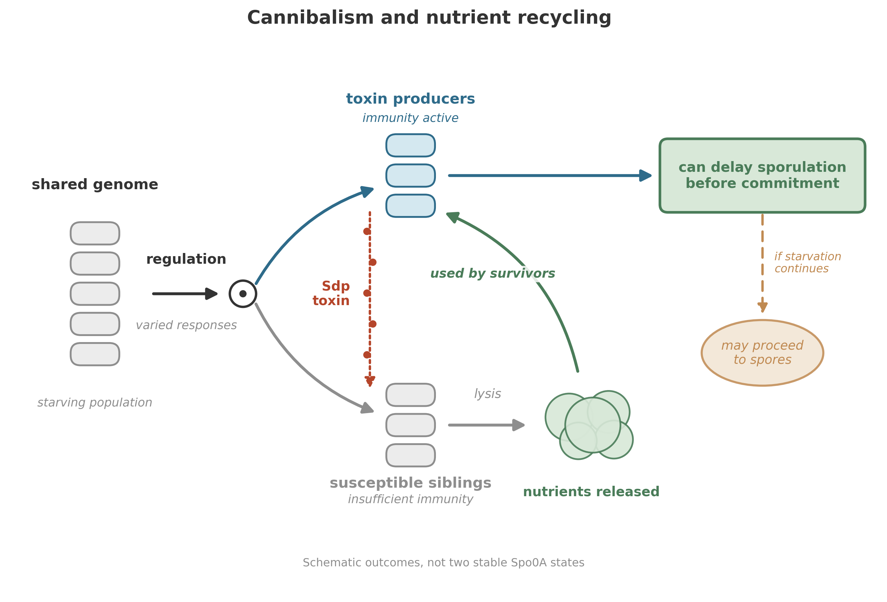

A population of *Bacillus subtilis* is starving. Instead of dying together, a fraction of the cells kill and feed on some of their siblings. The molecular machinery behind this strategy is one of the best-documented social behaviors in microbiology---and it is far from the only one.

We are leaving the physics of energy and electrons behind (temporarily) and asking a different question: **once cells exist and compete, what kinds of relationships do they build?**

The answer matters for everything that comes later. Eukaryotic cells---the kind that eventually built animals, plants, and fungi---did not arise from a single lucky mutation. They arose from mergers, and mergers are easier to stabilize in a world already full of social interactions: communication, exploitation, and occasionally, negotiated truces between former enemies. Before we can tell that story (the next chapter), we need to understand the social world that made it possible.

## The birth of altruism

Cooperative behaviors---shared public goods, coordinated gene expression, programmed cell death that benefits neighbors---are found across divergent bacterial lineages.[^social_evolution] The simplest explanation for that distribution is that cooperation is ancient---or repeatedly reinvented under similar selective pressures. It is written in the behavior of modern bacteria, which still carry the molecular toolkits of that social world.

The foundation of microbial social life is chemical communication. Bacteria secrete small molecules into their environment---signals that diffuse outward and are detected by neighboring cells. Through this chemical "dialogue," microorganisms report their condition and influence their neighbors' behavior.[^social_evolution] The signals are not noise. They encode information: *I am starving*. *I am dividing*. *There are many of us here*. *There are few*.

And from these signals, a pattern emerged that looks, functionally, like altruism---the ability to sacrifice one's own interests for the good of the community.[^social_evolution]

That word---altruism---makes biologists nervous when applied to bacteria, and rightly so. A bacterium does not "decide" to be generous. It carries genetic circuits that, under certain conditions, cause it to produce costly public goods, or to die so that its neighbors may feed. The altruism is encoded, not chosen. But the functional outcome is the same: individual cells pay a fitness cost so that the group benefits. And the evolutionary logic that maintains these behaviors is surprisingly sophisticated.

To see how sophisticated, consider a single species that can grow flagella and swim, assemble into packs, communicate by quorum sensing, share public goods, build spore-forming fortresses, and---when all else fails---murder a substantial fraction of its own population. That species is *Bacillus subtilis*.

## *Bacillus subtilis*: the bacterium that does everything

*Bacillus subtilis* is a soil bacterium, a gram-positive rod that has been studied in laboratories for over a century. It was one of the first bacteria to have its genome sequenced.[^kunst_genome] It is the workhorse of bacterial genetics, the *E. coli* of the gram-positive world. And yet, for decades, most of that research was done on well-fed cells growing in shaking flasks---conditions under which *B. subtilis* behaves like the simple, solitary creature of the textbook picture.

Take it out of the flask. Put it in soil, on a root surface, in a biofilm, or in a colony on an agar plate where nutrients are running low. Now it transforms.

When conditions demand it, *B. subtilis* can grow flagella and acquire motility, swimming toward nutrients or away from toxins. It can collect into organized "packs" with consistent, coordinated movement. It can secrete enzymes that break down complex molecules in the environment---a costly investment that benefits all nearby cells, not just the producer. It can form biofilms: dense, structured communities encased in a self-produced matrix of proteins and polysaccharides.[^flemming_biofilm] And it can make "decisions"---or more precisely, its genetic circuits can switch it into distinct behaviors---based on chemical signals received from relatives.[^social_evolution]

The mechanism that coordinates many of these transitions is **quorum sensing**: bacteria secrete small signaling molecules (autoinducers) into the surrounding medium and simultaneously detect them.[^quorum_sensing_review][^bassler_bacterial] Each cell contributes signal; each cell measures the local concentration. When the concentration crosses a threshold---when the quorum is reached---the population's behavior shifts. (The process is often described as "voting," though as the sidebar notes, density-sensing or even diffusion-sensing may be more accurate.)

::: {.callout-note}
## Sidebar --- How quorum sensing works

Quorum sensing is not a single system. Different bacterial species use different signal molecules, different receptors, and different downstream circuits. But the basic logic is shared:

1. **Signal production**: Each cell constitutively produces a small signaling molecule (an autoinducer) at a low basal rate.
2. **Signal accumulation**: The autoinducer diffuses into the environment. At low cell density, the molecule diffuses away faster than it accumulates. At high cell density, it builds up.
3. **Threshold detection**: When the local concentration exceeds a threshold, receptor proteins inside (or on the surface of) each cell become activated.
4. **Coordinated response**: The activated receptors trigger a transcriptional program that changes the cell's behavior---biofilm formation, toxin production, sporulation, or dozens of other responses.

The elegance is in the coupling: because each cell both produces and detects the signal, the system functions as a distributed sensor for population density. The "decision" emerges from the sum of individual contributions, and no central authority is needed.

The voting metaphor captures the logic of density-dependent coordination but simplifies: real autoinducer concentrations reflect not just cell number but diffusion geometry, flow regime, and the spatial arrangement of producers---what Redfield called "diffusion sensing" rather than quorum sensing.[^redfield_qs]
:::

Through quorum sensing and other regulatory circuits, *B. subtilis* populations can build structured communities in which not every cell does the same job.

The most dramatic social behavior of *B. subtilis* is cannibalism.

## The cannibalism strategy

Imagine a population of *B. subtilis* in soil. Nutrients have been declining for hours. The cells have already tried the obvious responses: ramping up enzyme secretion to scavenge what remains, adjusting their metabolic pathways, slowing growth. Nothing has worked. Starvation is now severe.

The cell has one remaining option that offers its best chance of long-term survival: sporulation. A *B. subtilis* spore is one of nature's most resilient structures---resistant to heat, desiccation, UV radiation, and chemical assault.[^setlow_spore] A spore can wait for decades, even centuries, and germinate when conditions improve.

But sporulation is expensive.

The decision to commit to spore formation is not taken lightly. Sporulation requires the coordinated control of well over a hundred genes over several hours.[^stragier_sporulation] The process involves a complete reorganization of the cell: an asymmetric division that produces a smaller forespore and a larger mother cell, followed by engulfment of the forespore by the mother cell, assembly of a multi-layered protective coat, and finally, programmed death of the mother cell to release the mature spore. The irreversible commitment is a developmental transition, not a universal two-hour alarm. Nutrient-restoration experiments place it after asymmetric division, with compartment-specific gene expression helping prevent a return to ordinary growth.[^sporulation_commitment]

Given this investment of time and energy, it should not surprise us that *B. subtilis* treats sporulation as a last resort. Before committing, the cell exhausts every alternative. It searches for new nutrients. It adjusts its metabolism. It waits.

And then, as a penultimate measure---the step just before the final, irreversible commitment to spore formation---it turns to cannibalism.

{#fig-cannibalism}

Here is how it works.[^ellermeier_cannibalism]

When starvation activates the master sporulation regulator, a transcription factor called Spo0A, something unexpected happens: its activity does not rise uniformly across the population. Cells differ in when and how strongly they respond. Experiments that track Spo0A-responsive genes reveal broad variation, sometimes a continuous spread rather than two sharply separated groups. The active form, Spo0A~P, matters, but variation in its output is not by itself evidence of a bistable switch.[^spo0a_heterogeneity]

Cells with enough Spo0A activity to turn on the cannibalism program begin producing **SdpC**, the precursor of a secreted toxin. This can happen before the higher activity needed to activate early sporulation genes. Susceptible siblings without sufficient immunity are killed and lysed; their cellular contents spill into the surroundings, releasing nutrients a starving cell can use.[^spo0a_thresholds][^ellermeier_cannibalism]

The killers eat the dead.

The nutrients released by the lysed cells are taken up by the surviving, toxin-producing population. Fed by the remains of their siblings, the cannibals can delay sporulation---and, if nutrients return before commitment, resume growth.[^ellermeier_cannibalism]

The cannibalism system requires a precise answer to a lethal question: how does a toxin-producing cell avoid killing itself? The answer is a three-protein signaling pathway that couples toxin exposure to immunity. The SdpC-derived toxin, called SdpC here for short, is produced by Spo0A-active cells before commitment. A membrane protein, SdpI, protects the cell from the toxin. A repressor, SdpR, limits transcription of the immunity genes when the toxin signal is absent.[^ellermeier_cannibalism]

The elegant twist: SdpI is not only an immunity protein but also a signal-transduction protein. Experiments support a model in which toxin exposure enables SdpI to sequester SdpR at the membrane, lifting repression and increasing immunity. The proposed direct protein contacts were not established. There is also a second lock: Spo0A relieves repression by another regulator, AbrB. Toxin exposure and relief of that repression together permit the response; susceptibility is not simply a matter of non-producers reacting too slowly.[^ellermeier_cannibalism]

For this strategy to help, toxin must reach susceptible neighbors and the released nutrients must reach survivors. Local crowding and the physical environment can therefore matter. The toxin and immunity experiments establish the mechanism, however, not a universal minimum population density or an energetic break-even threshold for cannibalism.[^ellermeier_cannibalism]

The population-level accounting is stark. Different responses to starvation, coupled to toxin production and immunity, can divide a population into killers and victims. The survivors gain time by recycling material from their siblings. If new nutrients arrive before commitment, growth may resume. If they do not, sporulation remains the last resort. This division of outcomes does not require us to assume two stable Spo0A states.[^ellermeier_cannibalism][^spo0a_heterogeneity]

## *Myxococcus xanthus*: the social predators

*Bacillus subtilis* eats its own. *Myxococcus xanthus* eats everyone else---and it does so cooperatively.

*Myxococcus xanthus* is the best-characterized species of soil-dwelling myxobacteria, a group distinguished by two remarkable properties: cooperative predation and social development.[^berleman_predation][^kaiser_fruiting] Where most predatory bacteria act alone---a single cell encountering a single prey---*M. xanthus* hunts in packs.

Predation is accomplished by swarming groups of cells that secrete toxic and lytic metabolites---antibiotics, enzymes, and other compounds that kill and degrade prey organisms.[^berleman_predation] The killing agents diffuse outward from the swarm, creating a zone of destruction around the advancing pack. The prey cells lyse, and their contents form an extracellular public pool of nutrients that the entire swarm shares. No individual *M. xanthus* cell could produce enough antibiotics or lytic enzymes to kill prey efficiently on its own. The predatory strategy works best when the costs are shared and the benefits are pooled.

This is cooperative predation in the truest sense: a hunting behavior that depends on group size, coordinated movement, and the production of extracellular public goods.

But the social life of *M. xanthus* does not end with feeding. When amino acids become scarce---when the hunting has failed or the prey is exhausted---*M. xanthus* enters its most dramatic phase: the construction of fruiting bodies.[^kaiser_fruiting]

Upon amino-acid deprivation, individual cells begin to aggregate. They stream toward central collection points, piling up into mounds that grow into elaborate, species-specific structures: the fruiting bodies. A typical *M. xanthus* fruiting body contains roughly 100,000 cells, assembled through coordinated movement and the exchange of intercellular chemical signals.[^kaiser_fruiting][^kaiser_c_signal]

Inside the fruiting body, a fraction of the cells differentiate into stress-resistant spores---the myxobacterial equivalent of the *B. subtilis* endospore. But here is the grim arithmetic: **many cells die during development**. In one laboratory study, most cells lysed, and some survivors remained as nonaggregating peripheral rods rather than becoming spores. The lysed cells' contents presumably help fuel the survivors.[^ch06_lee_cell_fates]

Access to the limited spore positions inside a fruiting body is a key part of fitness during development, which is why developmental cheaters matter.[^fiegna_myxo] If you are a cell entering a fruiting body, your odds of becoming a spore depend on your genotype, your position, your signaling interactions with neighbors, and the social composition of the aggregate. Cheaters---mutant cells that contribute less to the public good but sporulate at higher rates---are a constant evolutionary threat. And yet, cooperation persists, even when close relatives can be antagonists.[^velicer_myxo]

::: {.callout-note}
## Sidebar --- The cheater problem and evolutionary stability

The existence of cooperative behaviors in microbes raises a classic evolutionary puzzle: why don't cheaters take over? A cheater mutant that enjoys the benefits of group predation (shared nutrients) without paying the costs (producing expensive lytic enzymes) should, in the short term, outcompete cooperators.

And indeed, cheater mutants have been isolated in *M. xanthus*. They arise readily, they exploit cooperators, and they can spread within populations.

The resolution involves several mechanisms:

- **Kin selection**: in structured environments (soil, biofilms), cells tend to interact with close relatives. Helping relatives indirectly promotes copies of one's own genes.[^hamilton_kin][^west_kin]
- **Population structure**: cheaters that destroy the cooperative group they depend on ultimately destroy themselves. Spatial structure can help cooperative groups outlast cheater-dominated ones, although crowding relatives together also intensifies competition among them.[^griffin_cooperation]
- **Policing mechanisms**: some cooperative systems include active enforcement against non-kin or non-cooperators---for example, bacteriocins that target competing strains.[^travisano_policing] (*B. subtilis* cannibalism, by contrast, can be viewed as bet-hedging: the "victims" are not necessarily cheaters, and heterogeneous developmental responses need not be a bistable switch.)

The upshot is that microbial cooperation is not naive. It is enforced, policed, and maintained by mechanisms that punish free riders. The "altruism" is real, but it is not unconditional.
:::

The parallels between *M. xanthus* and *B. subtilis* are instructive. Both species use quorum sensing to coordinate group behavior. Both form complex multicellular structures under stress. Both sacrifice a fraction of their population so that the rest may survive. And both face---and have solved, at least partially---the problem of cheaters.

But the parallels extend further than any two species. These social behaviors are not oddities confined to a few laboratory favorites. Chemical signaling, quorum sensing, biofilm formation, and programmed cell death have been documented in many bacterial species across diverse lineages.[^miller_quorum][^nadell_biofilm] The social life of microbes is not an exception. It is the rule.

## How cells "decide": the metabolic logic

To understand microbial social behavior, we need to understand how a single cell makes a "decision." Not a conscious decision---a physical one. A cell does not deliberate. It integrates chemical signals through molecular circuits and arrives at a discrete output state: divide or stop, swim or stick, cooperate or defect, sporulate or eat.

The machinery that enables these decisions begins with the most fundamental currency of cellular life: **ATP**.

The ATP supply in a typical bacterial cell is on the order of millions of molecules, and the pool turns over on a timescale of seconds---the exact numbers vary with cell size, growth rate, and conditions.[^karp_atp] A cell does not "have" energy the way a battery has charge. The pool is a steady state held far from chemical equilibrium, with synthesis and consumption matched so tightly that the total count stays roughly constant even as individual molecules are consumed and regenerated within seconds.

The cell tunes its enzymes through phosphorylation, allosteric modulation, and feedback inhibition---layered mechanisms that allow it to continuously adjust its metabolic state in response to internal and external signals.[^monod_allosteric] But the key question for our story is how the cell reads its own energy status.

In bacteria, falling energy charge---sensed directly by metabolic enzymes that respond to the ATP-to-AMP ratio---activates catabolic pathways and suppresses biosynthesis.[^atkinson_energy] AMP is a more sensitive indicator than ATP: a small decrease in ATP causes a proportionally larger increase in AMP, amplified by the adenylate kinase reaction ($2\,\text{ADP} \rightleftharpoons \text{ATP} + \text{AMP}$). (In eukaryotes, an analogous role is played by AMP-activated protein kinase, AMPK.[^hardie_amp])

Under nutrient starvation, a second alarm fires: the stringent response, mediated by the signaling nucleotides (p)ppGpp, which reprograms transcription wholesale---shutting down ribosome synthesis, activating amino-acid scavenging, and preparing the cell for survival mode.[^stringent_response]

This metabolic regulation is not "decision-making" in the way we usually mean the phrase. It is feedback control---the same logic that governs a thermostat. But when you layer multiple feedback loops on top of each other, wire them to external signals (like quorum-sensing molecules), and allow them to interact through shared intermediates, the system can produce something more interesting than gradual adjustment.

It can produce switches.

## Bistability: one route to cellular memory

Some cellular decisions are not graded. They are all-or-none.

A cell may divide or not, die or survive, finish sporulation or return to growth. Those distinct outcomes make the language of switches useful. But a binary outcome does not tell us whether the underlying circuit has two stable steady states. A developmental sequence can also cross a point of no return.[^ferrell_bistable][^sporulation_commitment]

One possible mechanism is **bistability**. Its logic has been worked out in considerable detail, and carefully designed synthetic circuits show how it can create cellular memory.[^gardner_toggle]

At fixed conditions, a bistable system has two stable steady states. In the simplest picture, an unstable boundary separates their basins of attraction. A small disturbance fades; a large enough push carries the system into the other basin. But removing the push can also change the conditions. Persistence after withdrawal requires that the new state remain stable under those restored conditions.[^ferrell_bistable]

Two basic circuit architectures can produce bistable switching. In **positive feedback**, a regulator promotes its own production.[^becskei_bistable] In **double-negative feedback**, two regulators repress each other.[^gardner_toggle] Neither wiring diagram guarantees bistability: response strength, nonlinearity, and the balance between production and loss matter. The same mutual-inhibition design can have one stable state rather than two.

Memory must be tested, not read off a diagram. **Hysteresis** means that the response at the same input depends on its history, with different switching thresholds on the way up and down. Persistence after complete signal withdrawal is a stronger, separate claim. In one synthetic *E. coli* toggle, high and low expression states persisted through 22 hours without inducer; that measured interval is not a promise of permanent memory in every cellular circuit.[^gardner_toggle][^ferrell_bistable]

*B. subtilis* makes the distinction important. Its Spo0A-responsive reporters can show broad, unimodal distributions, and individual cells can enter sporulation at different times under the same supplied conditions. These observations support heterogeneous activation, not the claim that the native Spo0A phosphorelay has been shown to occupy exactly two stable states. Later events, including compartment-specific sigma-factor activation, help determine whether development proceeds to a spore.[^spo0a_heterogeneity][^sporulation_commitment]

So why does only part of a starving *B. subtilis* population produce toxin? A uniform external signal does not make the cells identical inside. Their histories, regulatory activity, and responses to that signal can differ.

Different Spo0A targets also turn on at different activity levels: the Sdp program can respond before early sporulation genes do.[^spo0a_thresholds] Differences in phosphorelay activity and timing can therefore produce different behaviors without a sharp two-state split. A mixed population can be interpreted as bet-hedging, keeping several options open. That evolutionary interpretation is not proof of a bistable circuit or a direct measurement of its fitness advantage.[^spo0a_heterogeneity]

Bistability remains an important possibility in cellular regulation. Synthetic switches demonstrate that cells can retain a history of past inputs. For any natural developmental decision, however, an all-or-none output, a mixed population, and two stable attractors are different claims. Each needs its own evidence.[^ferrell_bistable][^gardner_toggle]

The principle can extend to richer dynamics. A theoretical family of multisite phosphorylation systems can support more than two stable steady states.[^thomson_multi] In that family, the possible number has no fixed ceiling as the number of sites is increased. A particular finite-site system does not acquire infinitely many stable states, and its many chemical configurations are not automatically stable attractors. This is a mathematical result under specified kinetic assumptions, not evidence of unlimited memory in the Spo0A phosphorelay.

## The ecology of decision

The pieces fit together.

A single bacterial cell contains metabolic feedback loops that adjust its energy state in real time. Layered on top are regulatory circuits that can generate thresholds, delays, and different developmental outcomes. Some circuits can be bistable; the label has to be earned experimentally. External signals, nutrient conditions, and cell-cell contacts can all influence these circuits.

The result is not a collection of isolated automata bumping through liquid. It is an ecology of decision-makers, each one integrating local information and producing behaviors that depend on what their neighbors are doing.

Consider the sequence of events when a *B. subtilis* population faces starvation:

1. Nutrient limitation changes cellular physiology, and several regulatory inputs reach the sporulation phosphorelay.
2. Spo0A activity varies among cells; different targets respond at different activity levels.
3. Local extracellular signals can influence the response, but the Sdp mechanism does not establish a compulsory high-density quorum.
4. Spo0A-active cells can produce Sdp toxin before commitment. Susceptible siblings die and release nutrients; immunity regulation helps protect survivors.
5. If the nutrient pulse is sufficient and commitment has not been passed, survivors can postpone sporulation and resume growth. Otherwise, they may continue toward spores.

The sequence combines internal regulation with local interactions. Who lives, who dies, and who sporulates depends on a cell's state and on the environment its neighbors help create. No single bistable switch has to explain every step.

The outcome resembles a vote, as a metaphor: cells contribute to a shared chemical environment and respond to it. No central authority dictates the outcome. But shared behavior is not evidence that every cell casts the same signal or that the population passes one universal quorum threshold.

## The ancient social contract

Altruism, cooperation, voting, and organized social behavior are not human inventions. They are not even animal inventions. They are microbial inventions, and the molecular toolkits behind them---quorum-sensing circuits, toxin-immunity systems, programmed cell death---are found across divergent bacterial lineages, suggesting great antiquity.

When we watch a colony of *B. subtilis* split into killers and victims, we are watching a social contract enforced by chemistry: a population-level strategy in which individual sacrifice produces collective survival. When we watch *M. xanthus* swarms hunt prey and build fruiting bodies, we are watching cooperative predation and division of labor---behaviors we associate with wolves and ants, not with single-celled organisms.[^crespi_comparison]

The molecular details differ from anything in the animal world. There are no neurons, no hormones, no immune cells in the mammalian sense. But the functional logic---the game theory, the evolutionary pressures, the tension between cooperation and cheating---is analogous. Natural selection does not care whether a social contract is executed by neurons or by transcription factors. It cares only whether the strategy persists.

And these strategies have persisted. The quorum-sensing circuits, the bistable switches, the toxin-immunity systems, the programmed cell death pathways---all of them are found across divergent lineages. Their distribution is consistent with long maintenance, repeated origin, or both. Today, they underpin the astonishing variety of microbial social behaviors we observe.

This has a practical consequence for the rest of the book. When we reach the great mergers described in the next chapter---the endosymbiotic events that produced mitochondria and chloroplasts, the construction of the eukaryotic cell from archaeal and bacterial partners---we will not be describing a sudden, miraculous leap from solitude to cooperation. We will be describing the latest chapter in a social history that was already ancient.

The bacteria had been signaling, cooperating, and consuming each other long before the first eukaryote stirred.

## Where we go next

In the next chapter, we turn from social strategies to the most consequential social event in the history of life: the merger. An archaeal cell and a bacterial partner became intimately associated; how the bacterium came to live inside its host remains uncertain. The birth of the eukaryotic cell was not an invention. It was an alliance---forged by organisms that already competed, cooperated, and killed.

## Takeaway
- Bacteria are social organisms: they communicate, cooperate, compete, and make collective "decisions" through chemical signaling.
- Quorum sensing functions as a distributed density-inference system---often described as "voting"---allowing populations to coordinate behavior.
- *Bacillus subtilis* cannibalism can buy time before sporulation: heterogeneous regulatory activity, toxin production, and immunity divide a population into survivors and susceptible siblings, without proving a bistable Spo0A switch.
- *Myxococcus xanthus* hunts cooperatively and builds multicellular fruiting bodies; development can produce spores, lysed cells, and surviving peripheral rods.
- Cellular "decisions" arise from metabolic feedback (ATP/AMP sensing), covalent modification, allosteric regulation, and genetic circuits. Some circuits are bistable; distinct cell fates alone do not establish it.
- Altruism, cooperation, and social behavior are not animal inventions---their molecular toolkits span divergent bacterial lineages, consistent with long maintenance, repeated origin, or both.

[^social_evolution]: For a review of social evolution theory applied to microorganisms -- including cooperation, altruism, and public goods -- see West et al. (2006). [@West2006]

[^quorum_sensing_review]: For a comprehensive review of quorum-sensing architectures and their role in coordinating population-level behavior, see Waters and Bassler (2005). [@WatersBassler2005]

[^ellermeier_cannibalism]: Ellermeier et al., "A Three-Protein Signaling Pathway Governing Immunity to a Bacterial Cannibalism Toxin," *Cell* 124 (2006), 549-559, [doi:10.1016/j.cell.2005.11.041](https://doi.org/10.1016/j.cell.2005.11.041). Table 1 and Figures 2-7 connect toxin susceptibility, SdpI-dependent protection, SdpR localization, and AbrB regulation in PY79-derived strains. The direct protein contacts in the sequestration model remained unresolved. These assays do not establish a universal density threshold. [@Ellermeier2006]

[^karp_atp]: Gerald Karp, *Cell and Molecular Biology: Concepts and Experiments*, 7th edition (2013). [@Karp2008]

[^ferrell_bistable]: James Ferrell, "Self-perpetuating states in signal transduction: positive feedback, double-negative feedback and bistability," *Current Opinion in Cell Biology* 14 (2002), 140-148, [doi:10.1016/S0955-0674(02)00314-9](https://doi.org/10.1016/S0955-0674(02)00314-9). Figure 2 (p. 141) distinguishes hysteresis from persistence after withdrawal; pp. 142-144 discuss the kinetic conditions needed for bistability. This is an explanatory review, not a native Spo0A experiment. [@Ferrell2002]

[^gardner_toggle]: Gardner, Cantor, and Collins, "Construction of a genetic toggle switch in *Escherichia coli*," *Nature* 403 (2000), 339-342, [doi:10.1038/35002131](https://doi.org/10.1038/35002131). Box 1 and Figure 2 set out parameter conditions; Figure 4 and pp. 340-342 report pulse/withdrawal experiments in strain JM2.300. The synthetic pTAK117 states persisted for 22 hours after inducer removal, whereas the same mutual-inhibition architecture in pIKE105 was monostable. Neither result establishes native Spo0A hysteresis or permanent memory. [@Gardner2000]

[^becskei_bistable]: Becskei, Seraphin, and Serrano, "Positive feedback in eukaryotic gene networks: cell differentiation by graded to binary response conversion," *The EMBO Journal* 20 (2001), 2528-2535, [doi:10.1093/emboj/20.10.2528](https://doi.org/10.1093/emboj/20.10.2528). Figures 2-4 compare constitutive and autoregulatory synthetic rtTA circuits in *Saccharomyces cerevisiae* under doxycycline. The binary population response is not a demonstration of indefinite persistence after complete inducer withdrawal, nor a test of native Spo0A. [@Becskei2001]

[^thomson_multi]: Thomson and Gunawardena, "Unlimited multistability in multisite phosphorylation systems," *Nature* 460 (2009), 274-277, [doi:10.1038/nature08102](https://doi.org/10.1038/nature08102). Equations 2-3 and Figure 2 concern a theoretical model family with fixed totals and specified enzyme mechanisms; a four-site example has three stable states. "Unlimited" refers to the family as site number grows, not one finite protein, and modification configurations are not all stable states. No such memory capacity was measured in *B. subtilis*. [@Thomson2009]

[^fiegna_myxo]: Fiegna et al. (2006) describe *M. xanthus* fruiting-body development and show that developmentally defective cheaters can exploit cooperators in mixed groups, and that a cheater lineage evolved into a superior cooperator. [@Fiegna2006]

[^kunst_genome]: The complete genome sequence of *Bacillus subtilis* (4.2 Mb, ~4,100 genes) was published by Kunst et al. (1997), making it one of the first gram-positive bacteria to be fully sequenced. [@Kunst1997]

[^flemming_biofilm]: The biofilm matrix is composed of extracellular polysaccharides, proteins, and DNA that encases cells in a self-produced structure; see Flemming and Wingender (2010) for a comprehensive review. [@Flemming2010]

[^bassler_bacterial]: Bassler and Losick (2006) provide an accessible overview of bacterial cell-cell communication systems, including quorum sensing and its role in coordinating collective behavior. [@BasslerLosick2006]

[^setlow_spore]: *Bacillus subtilis* endospores exhibit extreme resistance to wet heat (surviving temperatures that rapidly kill growing cells), radiation (withstanding UV and gamma rays at doses lethal to vegetative cells), and chemical assault (including oxidizers, aldehydes, and detergents); see Setlow (2006). [@Setlow2006]

[^stragier_sporulation]: Sporulation in *B. subtilis* is controlled by a cascade of sigma factors controlling more than 125 genes in a temporal and spatial sequence; see Stragier and Losick (1996). [@Stragier1996]

[^velicer_myxo]: Vos and Velicer (2009) found strong developmental antagonisms even among genetically similar *M. xanthus* isolates from a single centimeter-scale soil population. [@VelicerVos2009]

[^berleman_predation]: *Myxococcus xanthus* produces a cocktail of secondary metabolites including antibiotics, bacteriolytic enzymes, and biosurfactants that collectively kill and lyse prey cells; see Berleman and Kirby (2009). [@BerlemanKirby2009]

[^kaiser_fruiting]: Lee et al. (2012), Introduction, describe aggregation into mounds of approximately 10^5 cells before sporulation. Kaiser (2004) reviews the developmental signaling program. [@Lee2012CellFates; @Kaiser2004]

[^kaiser_c_signal]: The C-signal is a surface-associated protein that requires direct cell-cell contact and coordinates aggregation and sporulation during fruiting body development; see Kaiser (2004). [@Kaiser2004]

[^hamilton_kin]: Hamilton's rule (rB > C) formalizes kin selection: altruistic behavior is favored when the benefit to relatives (B), weighted by relatedness (r), exceeds the cost to the actor (C); see Hamilton (1964). [@Hamilton1964a; @Hamilton1964b]

[^west_kin]: West et al. (2007) review the application of kin selection theory to microbial systems, showing that relatedness structure in biofilms and colonies can maintain cooperation. [@West2007]

[^griffin_cooperation]: Griffin et al. (2004) showed experimentally in *Pseudomonas aeruginosa* that higher relatedness favors cooperative siderophore production, while more local competition among relatives selects against it. [@Griffin2004]

[^travisano_policing]: Travisano and Velicer (2004) outline a range of hypothetical mechanisms by which microbial cheaters might be constrained. [@TravisanoVelicer2004]

[^miller_quorum]: Quorum sensing is used by both Gram-negative and Gram-positive bacteria to regulate diverse activities, from virulence and competence to sporulation and biofilm formation; see Miller and Bassler (2001). [@MillerBassler2001]

[^nadell_biofilm]: Nadell et al. (2016) review the ecological and evolutionary dynamics of biofilm formation across bacterial taxa, emphasizing the prevalence of matrix production as a cooperative trait. [@Nadell2016]

[^monod_allosteric]: The concept of allosteric regulation was formalized by Monod, Changeux, and Jacob (1963), describing how regulatory molecules binding at sites distinct from the active site can modulate enzyme activity. [@MonodChangeuxJacob1963]

[^hardie_amp]: AMP-activated protein kinase (AMPK) is the master regulator of energy homeostasis in eukaryotes, activated by rising AMP/ATP ratios; see Hardie (2007). In bacteria, energy-charge sensing operates through direct AMP binding to metabolic enzymes rather than through a single master kinase. [@Hardie2007]

[^stringent_response]: The stringent response, mediated by (p)ppGpp, is the primary transcriptional reprogramming mechanism bacteria use under nutrient stress. It redirects resources from growth to survival. Hauryliuk et al. (2015) provide a comprehensive review. [@Hauryliuk2015]

[^redfield_qs]: Redfield (2002) argued that quorum sensing may often function as "diffusion sensing" -- measuring how well secreted molecules accumulate locally -- rather than as a true census of cell number. [@Redfield2002]

[^atkinson_energy]: The "energy charge" concept, defined as ([ATP] + 0.5[ADP]) / ([ATP] + [ADP] + [AMP]), was introduced by Atkinson (1968) to describe cellular energy status; AMP is a sensitive indicator because adenylate kinase amplifies small ATP changes. [@Atkinson1968]

[^crespi_comparison]: Crespi (2001) draws explicit parallels between microbial social behaviors (quorum sensing, cooperative predation, altruistic cell death) and the eusocial insects, arguing that similar selective pressures produce convergent social strategies. [@Crespi2001]

[^spo0a_thresholds]: Fujita, Gonzalez-Pastor, and Losick, "High- and Low-Threshold Genes in the Spo0A Regulon of *Bacillus subtilis*," *Journal of Bacteriology* 187 (2005), 1357-1368, [doi:10.1128/JB.187.4.1357-1368.2005](https://doi.org/10.1128/JB.187.4.1357-1368.2005). Table 3 and Figure 5 distinguish low-threshold Sdp regulation from high-threshold sporulation genes in PY79-derived strains. Spo0A abundance, inducible expression, reporters, and binding assays constrain the interpretation; they do not directly measure every cell's Spo0A~P or prove two attractors. [@Fujita2005]

[^spo0a_heterogeneity]: Chastanet et al., "Broadly heterogeneous activation of the master regulator for sporulation in *Bacillus subtilis*," *PNAS* 107 (2010), 8486-8491, [doi:10.1073/pnas.1002499107](https://doi.org/10.1073/pnas.1002499107), Figure 4, report broad, non-bimodal Spo0A-target reporter distributions after nutrient downshift. Russell et al., "Noise in a phosphorelay drives stochastic entry into sporulation in *Bacillus subtilis*," *The EMBO Journal* 36 (2017), 2856-2869, [doi:10.15252/embj.201796988](https://doi.org/10.15252/embj.201796988), Figures 2-4 and 7, follow NCIB3610-derived cells under continuously supplied microfluidic starvation conditions. Their trajectories differ from previously reported multi-cycle pulses on agarose pads. Strain, medium, history, and observation method matter; reporters are activity proxies, and these studies do not test native Spo0A hysteresis. [@Chastanet2010; @Russell2017]

[^sporulation_commitment]: Dworkin and Losick, "Developmental Commitment in a Bacterium," *Cell* 121 (2005), 401-409, [doi:10.1016/j.cell.2005.02.032](https://doi.org/10.1016/j.cell.2005.02.032), Figures 1-4, test whether PY79-derived cells return to growth after transfer to rich medium. Compartment-specific sigma-factor activity and downstream genes constrain that return after asymmetric division. Narula et al., "Ultrasensitivity of the *Bacillus subtilis* sporulation decision," *PNAS* 109 (2012), E3513-E3522, [doi:10.1073/pnas.1213974109](https://doi.org/10.1073/pnas.1213974109), Figures 2-5, distinguish graded Spo0A response, ultrasensitive sigma-factor responses, and developmental completion in inducible-KinA and starvation experiments. Sigma-F activation alone does not guarantee a spore; sigma-E is a stronger predictor in these experiments, not an unconditional guarantee. Commitment is not proof of two stable Spo0A states. [@DworkinLosick2005; @Narula2012]

[^ch06_lee_cell_fates]: Lee, Holkenbrink, Treuner-Lange, and Higgs, "Myxococcus xanthus Developmental Cell Fate Production," *Journal of Bacteriology* 194 (2012), 3058-3068, [doi:10.1128/JB.06756-11](https://doi.org/10.1128/JB.06756-11). In submerged starvation cultures of strain DZ2, Figure 1B and the Results section report about 64% lysis between 24 and 48 h, after an initial increase in cell number. The abstract and Introduction distinguish spores, lysed cells, and peripheral rods. Figures 4-5 show that deleting mazF does not significantly reduce lysis in DZ2 or DK1622; the strong effect in the DK101 background is strain-dependent. These experiments do not establish a universal death fraction or a required nutrient-transfer mechanism. [@Lee2012CellFates]
