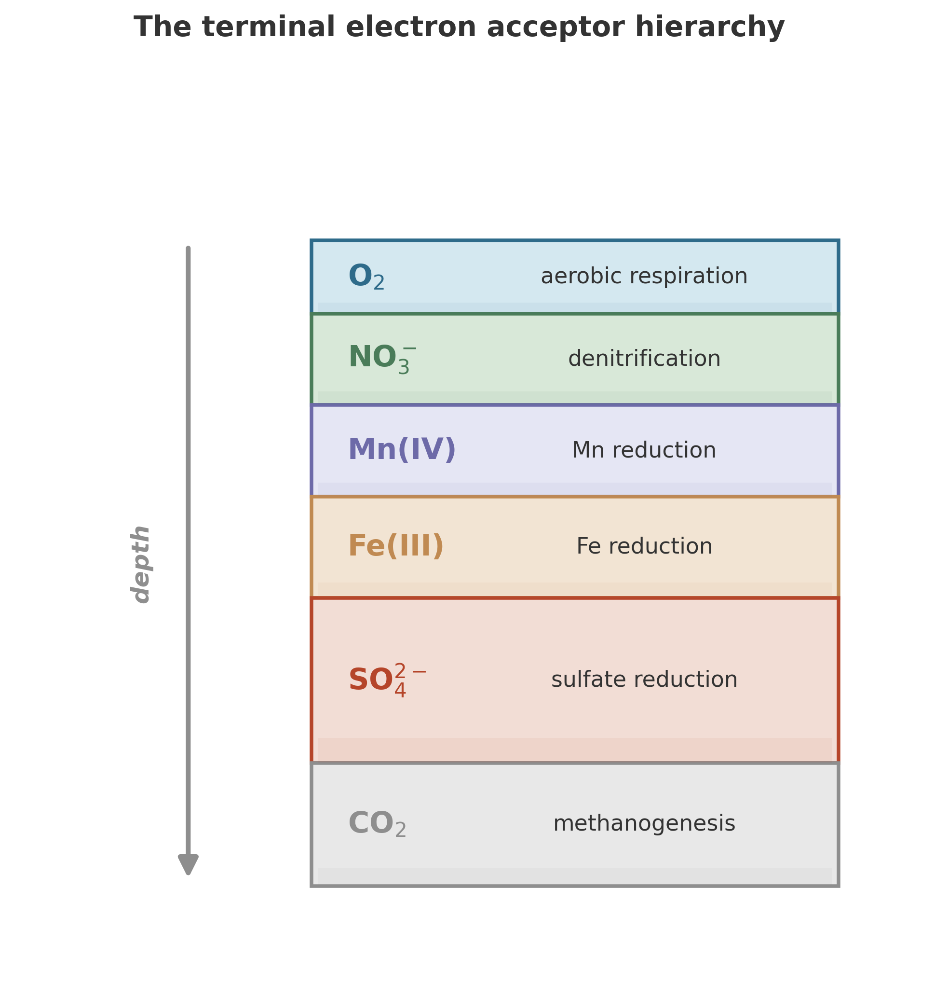

Somewhere in the Earth's crust, a fracture-water population turns over on a timescale estimated in decades to centuries. That estimate is not a film of a cell dividing. It comes from chemical inventories, inferred water residence times, and assumptions about growth and death. The setting is dark, but not chemically energy-poor: hydrogen and sulfate can support a favorable reaction. The puzzle is why inferred activity is so slow when the reaction has so much to offer.[^lin2006]

The organism at the center of this story is *Candidatus* Desulforudis audaxviator. The fracture-water samples came from the Mponeng gold mine in South Africa, 2.8 kilometers below the surface, in 2002. Lin and colleagues reported the geochemistry and dominant bacterial phylotype in 2006; Chivian and colleagues reconstructed and named its genome in 2008.[^lin2006][^chivian2008]

The water was hot, initially above 60 degrees Celsius and later about 52 degrees during sampling, alkaline, and rich in dissolved sulfate, molecular hydrogen, methane, and small organic molecules such as formate and acetate. The enclosing rock was Archean metabasalt. Noble gases and water chemistry pointed to old subsurface fluids, with residence-time and mixing interpretations. They did not date the cells, or establish that one unchanged community had lived in a perfectly sealed fracture for millions of years.[^lin2006]

And it was alive.

Not teeming, not a jungle. But when Li-Hung Lin and colleagues analyzed that fracture water, they found a microbial community dominated by one bacterial phylotype affiliated with thermophilic sulfate reducers.[^lin2006] Isotopes of dissolved light hydrocarbons were consistent with an abiogenic origin. The proposed geological supply included hydrogen from radiolytic chemistry and sulfate associated with mineral sources, including pyrite oxidation and barite dissolution. This was evidence for support by rock and water chemistry, with no apparent reliance on photosynthetically produced substrates, rather than a demonstration that every organic compound was abiotic.

The evidence pointed to life borrowing from the Earth's interior, with no apparent reliance on food made in sunlight.[^lin2006]

## The brave wanderer

One organism dominated Chivian's filtered fracture-water DNA sample. From metagenomic reads, the authors estimated that it represented more than 99.9 percent of the microorganisms in that particular fluid sample. It received one of the more literary names in microbiology: *Candidatus* Desulforudis audaxviator. The name comes from a Latin phrase in Jules Verne's *Journey to the Center of the Earth*: "Descende, audax viator, et terrestre centrum attinges", "Descend, brave traveler, and you will reach the center of the Earth".[^chivian2008]

Chivian's conclusion concerned the fluid phase captured on a 0.2-micrometer filter; the authors could not exclude organisms on fracture surfaces or smaller than the filter pores.[^chivian2008]

The name was earned. The reconstructed genome encoded a remarkable potential for self-sufficiency: sulfate reduction, hydrogen use, inorganic carbon assimilation, and nitrogen fixation. Genes identify capabilities, not rates measured in the fracture. In particular, the authors noted that available dissolved ammonia could supply nitrogen without nitrogen fixation. Lin's calculations placed hydrogen-driven sulfate reduction ahead of the other reactions they compared under the sampled conditions, with energy yields well above their chosen ATP-coupling threshold. Mponeng was not their example of a reaction barely paying for life.[^lin2006][^chivian2008]

What the genome lacks is also informative. Chivian and colleagues found an incomplete system for resistance to oxygen, which they interpreted as evidence consistent with long isolation from oxygen. That is an inference from an annotated genome, not a direct observation of the organism's entire environmental history.[^chivian2008]

The sampling details matter. Lin's 2002 series contained minor bacterial and archaeal phylotypes whose status as resident organisms or relics was unresolved. Chivian's DNA was collected from 27 to 30 September 2002, overlapping the date of one Lin sample, by filtering a much larger volume of fracture water. Different library and metagenomic methods need not give interchangeable abundance estimates. These papers do not establish a fixed cast of 25 active partners.[^lin2006][^chivian2008]

The water's geological history is long. Lin's discussion used a 3-to-25-million-year interval for possible isolation or colonization, informed by fluid ages and mixing interpretations. That interval is not the age of an individual cell or proof of an unchanged community. The evidence points toward a system supported by geological chemistry rather than a steady rain of photosynthetic food. No sunlight in the fracture. Rock, water, heat, and the patient rearrangement of electrons.[^lin2006]

*D. audaxviator* no longer looks like a South African oddity. Westmeijer and colleagues found a related dominant population in water from a 975-meter-deep fracture in Sweden, sampled in September 2022. That was a different site and a diverse community, studied with genome-resolved metagenomics and marker-gene methods. Its abundance and encoded metabolic potential extend the organism's story; they do not establish a universal single-species ecosystem or directly measure its division rate.[^westmeijer2024]

The phrase "single-species ecosystem" therefore needs its sampling boundary. Chivian's particular fluid sample was overwhelmingly dominated by one genome and suggested the potential for an independent lifestyle. Unsampled attached or very small organisms could still have been present. Neither that possibility nor diversity at another site proves that the Mponeng population required a supporting cast.[^chivian2008][^westmeijer2024]

## What counts as "deep"

The Mponeng discovery is dramatic, but it is not an isolated curiosity. By the mid-1990s, evidence was accumulating that microbial life extends far deeper into the Earth's crust than anyone had assumed. The question was how to think about it systematically.

Derek Lovley and Francis Chapelle proposed a framework that remains useful today.[^lovley1995] For microbiological studies of water-saturated systems, they argued that "deep" should not be defined by depth alone. As an illustration, a sample from 500 meters in one geological setting might be more connected to the surface than a sample from 50 meters in another. What matters is the hydrology -- how water moves through the subsurface.

Lovley and Chapelle described three scales of groundwater flow, with typical ranges rather than fixed classification thresholds:

- **Local flow systems**: typical surface recharge of 1--30 cm/yr and relatively rapid groundwater movement of 1--100 m/yr. Surface influence is strong, although local systems can extend hundreds of meters below ground.
- **Intermediate flow systems**: weaker connection to the surface, with typical recharge of 0.01--1 cm/yr and groundwater movement of 0.1--1 m/yr.
- **Regional flow systems**: recharge near the groundwater divide and discharge near the basin bottom, with very low recharge and often sluggish flow. Surface influence is weaker.

For studies of water-saturated systems, Lovley and Chapelle proposed restricting the "deep subsurface" to intermediate and regional flow systems. This is a functional definition, not a geometric one: it emphasizes weaker surface connection rather than a fixed depth. It does not imply zero recharge or independence from buried organic matter.

Lovley and Chapelle argued that microorganisms dominate most deep subsurface habitats because typical pore spaces restrict larger forms of life.[^lovley1995] A pore throat that admits a bacterium may stop a nematode, let alone anything with a circulatory system. In such pores, smallness is not a limitation. It is the entry ticket.

And one absence is absolute: "Light is not available in the deep subsurface".[^lovley1995] No photosynthesis. The local energy supply must come from chemical reactions -- from the oxidation of organic matter buried with the sediment, from reduced compounds like Fe(II), Mn(II), ammonia, or sulfide carried in by recharge water, or, potentially, from reduced minerals that supply abiotic electron donors.[^lovley1995_serpentin]

## The terminal electron acceptor hierarchy

Without sunlight, the deep subsurface runs on the same fundamental principle as the redox ladder we met in earlier chapters -- but stripped to its essentials. Organisms oxidize electron donors (organic carbon, hydrogen, reduced metals) and pass the electrons to whatever acceptor is available. The most common terminal electron acceptors, in order of the energy they typically yield, are:

$$
\text{O}_2 > \text{NO}_3^- > \text{Mn(IV)} > \text{Fe(III)} > \text{SO}_4^{2-} > \text{CO}_2
$$

{#fig-redox-ladder}

Each acceptor supports a distinct metabolic community: aerobic respirers, denitrifiers, manganese reducers, iron reducers, sulfate reducers, methanogens. These are the Terminal Electron Accepting Processes, or TEAPs, and in an idealized system they appear in sequence as the more energetically favorable acceptors are exhausted. Nitrate reduction includes pathways beyond the denitrification label used in the schematic.[^lovley1995] Bethke and colleagues compare energy conserved in ATP per mole of electron donor, rather than reaction Gibbs energies. That comparison does not establish one energy ratio for every field community.[^bethke2011]

In practice, the deep subsurface is messier. Lovley and Chapelle criticized geochemical models that treat microorganisms as catalysts and infer their reactions from thermodynamic favorability -- as if the bugs are just black boxes that speed up whatever chemistry the Gibbs energy landscape demands.[^lovley1995] This shorthand works surprisingly often, but it fails in important cases.

The reason is that thermodynamic favorability is necessary but not sufficient. A reaction can be favorable on paper and still not happen because no organism present carries the right enzymes. A reaction can be favorable and fast in a beaker but starved in a pore because transport cannot supply reactants. Lovley and Chapelle argued that equilibrium models alone can fail to explain or predict important geochemical processes, even in comparatively stable ancient subsurface settings.[^lovley1995]

The practical consequence is stark: in the groundwater systems they discussed, microbial catalysis and cellular energy conservation constrain the rates and extent of important redox processes.[^lovley1995] In these systems, biology is not a detail layered on top of chemistry. The cells help decide what chemistry actually happens on observable timescales.

## Respiration in the deep

The rate expressions from Chapter 8 -- dual-Monod kinetics throttled by both electron donor and acceptor -- apply here without modification.[^jin2005_deep][^thullner2007_deep] What changes is the context.

In well-oxygenated deep-sea surface sediments, where the supply of organic matter is low, aerobic respiration accounts for most of the organic carbon degraded.[^rabouille1991] But oxygen becomes scarce in many deeper settings. In anoxic, nitrate-depleted sedimentary settings, a division of labor can emerge: hydrolysis and fermentation provide small substrates such as acetate and hydrogen, which other microbes can use as electron donors while reducing the remaining acceptors.[^lovley1995] One group's products can feed another's metabolism, even though complementary roles do not rule out competition.

Many of the communities described here divide the work of processing organic matter among partners. Mponeng supplies a different caution: dominance by a genome with the potential for metabolic independence does not establish all the reactions occurring throughout a fracture, but minor DNA signals do not establish necessary partners either. We need evidence of activity and exchange before assigning ecological jobs to the organisms a sequence survey detects.[^lin2006][^chivian2008]

## When the electrons move directly

Not every partnership in the subsurface is mediated by a diffusible molecule like hydrogen or acetate. In some communities, the electrons themselves are exchanged directly.

Electromicrobiology studies that exchange. *Geobacter* and related lineages can transfer electrons to iron and manganese minerals outside the cell, using conductive pili and cytochromes to push respiration beyond the cell membrane.[^rotaru2014] In mixed communities, that capacity can become a social technology. Rather than releasing hydrogen for a partner to consume, one organism can pass electrons directly to another -- a process called direct interspecies electron transfer, or DIET.[^rotaru2014]

DIET extends the syntrophic logic from Chapters 7 and 8 into literal electrical contact. One organism's waste is still another's fuel, but the handoff can be a current rather than a molecule diffusing through porewater. In sedimentary environments the same principle appears at larger scales in cable bacteria, which link sulfide oxidation at depth to oxygen reduction near the surface by moving electrons across centimeter distances. The old redox ladder is still there. More wires connect it than we once knew.

## Life at the thermodynamic edge

The deep subsurface pushes microbial life to its energetic limits. How slow can metabolism get before it ceases to be metabolism?

The answer is extraordinarily slow. Douglas LaRowe and Jan Amend compiled data on microbial turnover times across a range of natural settings and found that in aquifers, sedimentary rocks, marine sediments, and ice cores, biomass turnover times can exceed 1,000 years.[^larowe2015_deep] In Antarctic photosynthetic communities -- admittedly a surface environment, but one where conditions are extreme -- biomass turnover times reach up to 19,000 years.

A community can remain metabolically active in aggregate while replacing its biomass once every thousand years. That turnover time does not measure how long any individual cell lives. Whether individual cells are continuously active at vanishing rates or cycling between dormancy and rare bursts of activity remains an open question.

The range of metabolic rates is staggering even within one realm. In the measured and modeled rates that LaRowe and Amend compiled for marine environments at and below the sediment-water interface, catabolic rates vary over twelve orders of magnitude, from approximately $6 \times 10^{-9}$ to $6.66 \times 10^{3}$ nmol cm$^{-3}$ day$^{-1}$.[^larowe2015_deep] Twelve orders of magnitude. The fastest sediment communities process substrate a trillion times faster per unit volume than the slowest. And yet the slowest are still alive.

Slow biomass turnover leaves a separate question: how much energy does a cell need just to stay alive without growing? We call this minimum energy flux maintenance energy. In laboratory cultures, maintenance energy can be measured: you starve a culture, track its decline, and calculate the energy cost of keeping the lights on.

To compare those requirements with conditions in the deep subsurface, we need energy flux per cell. In deep subsurface settings, these fluxes are "several orders of magnitude lower than maintenance energies predicted from laboratory cultures".[^larowe2015_deep]

Either the cells are dying and being replaced by slow turnover -- possible, but hard to reconcile with such low energy fluxes -- or our laboratory-derived maintenance estimates are wrong for these conditions. LaRowe and Amend argue for the latter: maintenance energy is not a constant. It depends on growth conditions, temperature, community structure, and the specific stresses a cell faces. It should be treated as a variable, not a parameter.[^larowe2015_deep]

The implication reshapes how we model deep life. A laboratory maintenance measurement need not transfer unchanged to a fracture. Temperature, chemical stress, and the supply of substrates all matter. But the Mponeng papers did not measure a complete maintenance bill for individual cells or show that most costs had disappeared. Their combination of favorable chemistry and slow inferred activity leaves the limiting processes open.[^lin2006]

This is the satisficing principle as I use the term in this book. Simon coined it for bounded choice, not for microbes.[^simon1956_deep] Ecologists later used the concept against strict optimal-foraging models, and Carmel and Ben-Haim found that a robust-satisficing model matched much of that field literature better than optimization did.[^carmel2005] Brennan and Lo then showed, in a formal evolutionary model, that selection can preserve bounded strategies when information and computation carry costs.[^brennanlo2012] I am extending that vocabulary to microbial communities.

*D. audaxviator* is compatible with a satisficing interpretation, but it does not prove that interpretation. Its encoded sulfate-reducing machinery fits the substrates found in the fracture, and Lin's comparison also favored hydrogen-driven sulfate reduction energetically. Those observations do not identify a measured optimization rule, or show that genome erosion left only a minimum toolkit. The genome instead contains a substantial repertoire, including capabilities acquired through horizontal gene transfer.[^lin2006][^chivian2008]

The genome contains genes for flagellar motility, chemotaxis, and sporulation. Chivian and colleagues proposed that such capabilities could help colonization, persistence, and movement along chemical gradients. Those are plausible roles, not behavior directly observed in the collected fracture water. The genome tells us what to test, not everything the cells were doing.[^chivian2008]

## Competing or cooperating?

One of the persistent questions in deep subsurface microbiology is whether organisms in these communities are competing for scarce resources or somehow cooperating to optimize the overall energy harvest. The answer matters for modeling, because competition and cooperation lead to different predictions about which organisms persist and at what rates.

Craig Bethke and colleagues examined this question through the lens of the thermodynamic ladder.[^bethke2011] They noted an apparent paradox: iron reducers and sulfate reducers conserve four to five times more energy in their ATP pools per mole of electron donor consumed than methanogens do. If competition were purely about energy yield, methanogens should be consistently outcompeted wherever iron or sulfate is available. Yet iron reduction and sulfate reduction have been observed together in aquifer sediments, and the three groups do not fall into a fixed thermodynamic sequence.

Bethke and colleagues resolved the paradox with usable energy, the energy in excess of what a cell must hold in its own stores. In near-neutral groundwater the three groups see roughly equivalent amounts, partly because methanogens trap little energy per mole of donor. In their bioreactors, iron and sulfate reducers balanced their respiration in a mutualistic relationship instead of competing, and the authors concluded that ecologic and physiologic factors, not thermodynamics alone, control where these groups are active.[^bethke2011] Another conceivable resolution is that the community as a whole tends toward a state that maximizes the total usable energy extracted from all available reactions -- a kind of collective optimization. Under this view, the community composition is not determined solely by pairwise competition but by a global optimization problem: given the available electron donors and acceptors, what combination of metabolisms extracts the most energy?

The data in this book fit a third possibility: neither individual optimization nor collective optimization, but satisficing. Each organism runs the metabolism its enzymes permit, at the rate the local concentrations support, without reference to any global objective. The community structure that results is not optimal in any formal sense; it is *viable*. A guild persists where its reaction, at the local supply, pays for maintenance and replaces lost cells. Thermodynamics sets the outer limit, but slow growth, poor population viability or a missing partner can still exclude a guild, as Bethke's bioreactors showed.[^bethke2011] The coexistence of iron reducers, sulfate reducers, and methanogens in the same aquifer is not paradoxical under this view. Where all three can cover these costs, all three may persist. The boundaries are fuzzy because the constraints are fuzzy.

This is an active area of research, and the models are not yet settled. Critics of satisficing make a fair charge: once you price search and information costs into the objective function, you may have optimization again under another name.[^callebaut2007] Microbial communities give that critique less force because no organism surveys the whole landscape and no shared objective ties unrelated lineages into one maximization problem. The test stays empirical. If the framework cannot explain fuzzy coexistence, field rates, and persistent low-yield metabolisms better than the optimization stories do, it does not deserve the name.

## Growth, decay, and the meaning of yield

To connect microbial energetics to quantitative models, we need an equation for biomass:

$$
\frac{d[B]}{dt} = Y \cdot R_{\text{resp}} - \mu_{\text{dec}} \cdot [B]
$$

Biomass grows in proportion to the respiration rate (scaled by the yield coefficient $Y$) and decays at a rate proportional to the current biomass (scaled by the decay constant $\mu_{\text{dec}}$).[^thullner2007_deep][^dale2010]

The yield coefficient $Y$, the biomass produced per mole of electron donor consumed when $R_{\text{resp}}$ is in moles of donor per volume per time, is not a constant. Across 123 published yield determinations covering 38 catabolic pathways, Roden and Jin found that yield increases roughly linearly with the catabolic free energy available per mole of donor, with most pathways within a factor of two of the fitted line.[^roden2011_yield] Theoretical frameworks derive yield from thermodynamic first principles;[^rittmann2001][^heijnen1992] LaRowe and Amend relate catabolic power to biomass through an energy-based yield coefficient that depends on the conditions under which biomolecules are synthesized.[^larowe2015_deep]

But in the deep subsurface, growth is only half the story. Much of the biomass at any given time may be dormant -- alive but metabolically inactive. Models that explicitly track dormant and active cell fractions show that the transition between states can dramatically affect community dynamics and apparent geochemical rates.[^stolpovsky2011] Cells do not respond instantaneously to environmental changes; there is a lag phase between perturbation and metabolic response.[^blanch1981_deep] For stable deep subsurface settings, quasi-steady-state assumptions may hold. For perturbed systems, they do not.

The honest summary: yield, growth rate, and maintenance energy are not constants. They are functions of thermodynamics, environment, and history.

## The scale of the hidden world

How much life is down there? The estimates have been revised repeatedly as sampling improved, and recent compilations are lower than early ones. Current assessments suggest that the deep subsurface -- the rock, the sediments, the aquifers below the reach of sunlight -- may harbor a significant fraction of Earth's total microbial biomass. The numbers are uncertain, but even conservative estimates place billions of tons of carbon in subsurface microorganisms.[^magnabosco2018_deep]

Life down here looks nothing like a forest or a coral reef. Cells are distributed through rock at low densities -- perhaps a few thousand cells per cubic centimeter of rock, compared to billions per cubic centimeter in surface soil. But the volume of habitable rock is enormous, and thin populations summed over vast volumes become significant.

The deep biosphere also represents a different mode of existence. Surface food webs often recycle solar energy rapidly. Some deep populations have very slow inferred biomass turnover, potentially on century or longer timescales, while others receive more active supplies of carbon and energy. Population turnover inferred from chemical budgets is not a stopwatch on individual division. The slow, dark economy still has to balance its books: energy must flow and electrons must move.[^lin2006]

## What the brave wanderer teaches

Return, for a moment, to the Mponeng fracture. A particular water sample, 2.8 kilometers down, was overwhelmingly dominated by one genome. The water carried evidence of a long geological history, and its hydrogen and sulfate could support microbial metabolism. No sunlight in the fracture. But neither the water's age nor the dominance of a fluid sample tells us how long a particular cell lived or how completely the surrounding rock was sampled.[^lin2006][^chivian2008]

*Desulforudis audaxviator* makes the non-equilibrium trick concrete: a dark habitat can offer usable chemical energy without an apparent supply of photosynthetic food. The Mponeng evidence joins favorable reaction energetics, biological potential, and slow inferred long-term activity. It does not establish an arbitrarily small minimum energy requirement. Energy per reaction, substrate throughput, and population turnover remain different quantities.[^lin2006][^chivian2008]

The mathematics of this chapter -- the Monod kinetics, the yield coefficients, the diagenetic equations -- are not decorations. They are the tools that let us ask quantitative questions about this alien world. How fast can *D. audaxviator* grow on the hydrogen flux available? What yield does its sulfate reduction support? How does the community partition the available energy? What happens when the hydrogen flux changes on geological timescales?

These are answerable questions. The models exist. The parameters are being measured. And the answers, when they come, will tell us something profound not just about life in the deep Earth, but about life anywhere that chemistry and thermodynamics permit it -- including, perhaps, the subsurface oceans of Europa or the ancient aquifers of Mars.

The brave wanderer descended into the dark and found a way to live there. The equations are our way of following it down.

## Takeaway

- Some deep microbial communities, including the studied Mponeng fracture-water population, appear supported by geological sources of hydrogen and sulfate without apparent reliance on photosynthetic substrates; this is not a claim about every deep habitat.[^lin2006]
- For water-saturated systems, Lovley and Chapelle proposed a hydrological definition of "deep": intermediate and regional flow systems with weaker surface connection, rather than a fixed depth.
- The terminal electron acceptor hierarchy governs energy metabolism in the subsurface, but biology is not a passive catalyst -- organisms determine which thermodynamically favorable reactions actually occur.
- Electromicrobiology extends syntrophy beyond shared metabolites: in laboratory co-cultures and engineered methanogenic systems, some microbes exchange electrons directly through conductive pili, cytochromes or conductive materials; how widespread this is in the deep subsurface remains open.
- Catabolic rates in marine sediments span twelve orders of magnitude; some subsurface populations have biomass turnover times exceeding 1,000 years and per-cell energy fluxes far below maintenance energies predicted from laboratory cultures.
- Quantitative models (dual-Monod kinetics, biomass growth-decay equations, yield coefficients) connect the biology to measurable geochemical processes -- but parameters like yield and maintenance energy must be treated as variables, not constants.

[^lin2006]: Li-Hung Lin et al., "Long-Term Sustainability of a High-Energy, Low-Diversity Crustal Biome," *Science* 314 (2006): 479 to 482, [doi:10.1126/science.1127376](https://doi.org/10.1126/science.1127376). Table 1 identifies the 2002 water samples; p. 481 and Table 2 cover community composition, fluid-age interpretations, and reaction energetics; p. 482 gives mineral-source interpretations and the conditional 45-to-300-year turnover estimate. [@Lin2006]

[^chivian2008]: Dylan Chivian et al., "Environmental Genomics Reveals a Single-Species Ecosystem Deep Within Earth," *Science* 322 (2008): 275 to 278, [doi:10.1126/science.1155495](https://doi.org/10.1126/science.1155495). Figure 1 and pp. 276 to 277 distinguish metagenomic dominance, fluid/filter coverage, and encoded metabolic capabilities. Supporting Online Material, "Collection of DNA," p. 7, dates collection to 27 to 30 September 2002. [@Chivian2008]

[^lovley1995]: Derek R. Lovley and Francis H. Chapelle, "Deep Subsurface Microbial Processes," *Reviews of Geophysics* 33 (1995): 365--381. [@Lovley1995] The proposed hydrological definition and typical flow ranges are on p. 366; pore constraints and light on p. 367; the critique of geochemical models on pp. 365--366; TEAPs and their segregation on pp. 367 and 370--371; fermentation on p. 369.

[^larowe2015_deep]: Douglas E. LaRowe and Jan P. Amend, "Catabolic rates, population sizes and doubling/replacement times of microorganisms in natural settings," *American Journal of Science* 315 (2015): 167--203. Table 2 compiles catabolic rates in marine environments at and below the sediment-water interface, spanning twelve orders of magnitude (p. 171); long turnover times are reviewed on p. 170 and maintenance energies on pp. 177-178. [@LaRowe:2015dt]

[^bethke2011]: Craig M. Bethke et al., "The thermodynamic ladder in geomicrobiology," *American Journal of Science* 311 (2011): 183--210. [@Bethke2011]

[^lovley1995_serpentin]: Lovley and Chapelle discussed possible abiotic electron donors, including hydrogen generated by reactions with reduced minerals in basalt (p. 375). Their discussion does not establish this mechanism for every deep habitat. [@Lovley1995]

[^jin2005_deep]: Qusheng Jin and Craig M. Bethke, "Predicting the Rate of Microbial Respiration in Geochemical Environments," *Geochimica et Cosmochimica Acta* 69 (2005): 1133--1143. [@Jin2005]

[^thullner2007_deep]: Martin Thullner, Pierre Regnier, and Philippe Van Cappellen, "Modeling Microbially Induced Carbon Degradation in Redox-Stratified Subsurface Environments: Concepts and Open Questions," *Geomicrobiology Journal* 24 (2007): 139--155. [@Thullner2007]

[^rabouille1991]: C. Rabouille and J.-F. Gaillard, "A coupled model representing the deep-sea organic carbon mineralization and oxygen consumption in surficial sediments," *Journal of Geophysical Research* 96 (1991): 2761--2776. [@Rabouille1991]

[^dale2010]: A. W. Dale et al., "Pathways and regulation of carbon, sulfur and energy transfer in marine sediments overlying methane gas hydrates on the Opouawe Bank (New Zealand)," *Geochimica et Cosmochimica Acta* 74 (2010): 5763--5784. [@Dale2010]

[^rittmann2001]: Bruce E. Rittmann and Perry L. McCarty, *Environmental Biotechnology: Principles and Applications* (McGraw-Hill, 2001). [@Rittmann2001]

[^heijnen1992]: J. J. Heijnen and J. P. Van Dijken, "In search of a thermodynamic description of biomass yields for the chemotrophic growth of microorganisms," *Biotechnology and Bioengineering* 39 (1992): 833--858. [@Heijnen1992]

[^roden2011_yield]: Eric E. Roden and Qusheng Jin, "Thermodynamics of Microbial Growth Coupled to Metabolism of Glucose, Ethanol, Short-Chain Organic Acids, and Hydrogen," *Applied and Environmental Microbiology* 77 (2011): 1907--1909, [doi:10.1128/AEM.02425-10](https://doi.org/10.1128/AEM.02425-10). Fig. 1A gives $Y = 2.08 + 0.0211\,(-\Delta G')$ with $r^2 = 0.949$, $Y$ in grams of dry cells per mole of electron donor and $-\Delta G'$ in kJ per mole of electron donor; growth-rate and maintenance effects are not included. [@Roden2011]

[^stolpovsky2011]: Konstantin Stolpovsky et al., "Incorporating dormancy in dynamic microbial community models," *Ecological Modelling* 222 (2011): 3092--3102. [@Stolpovsky2011]

[^blanch1981_deep]: Harvey W. Blanch, "Invited Review: Microbial Growth Kinetics," *Chemical Engineering Communications* 8 (1981): 181--211. [@Blanch1981]

[^magnabosco2018_deep]: Cara Magnabosco et al., "The biomass and biodiversity of the continental subsurface," *Nature Geoscience* 11 (2018): 707--717. [@Magnabosco2018]

[^westmeijer2024]: George Westmeijer et al., "Candidatus Desulforudis audaxviator dominates a 975 m deep groundwater community in central Sweden," *Communications Biology* 7 (2024): 1332, [doi:10.1038/s42003-024-07027-2](https://doi.org/10.1038/s42003-024-07027-2). Table 1 dates samples to 3 September 2022; community results and the groundwater-sampling/DNA methods distinguish genomic potential and abundance from measured metabolic or division rates. [@Westmeijer2024]

[^rotaru2014]: Alexandra-Elena Rotaru et al., "Direct interspecies electron transfer between Geobacter metallireducens and Methanosarcina barkeri," *Applied and Environmental Microbiology* 80 (2014): 4599--4605. A key experimental demonstration of DIET between a metal-reducing bacterium and a methanogen. [@Rotaru2014]

[^simon1956_deep]: Herbert A. Simon, "Rational Choice and the Structure of the Environment," *Psychological Review* 63 (1956): 129--138. Simon introduced satisficing for bounded decision-making under real limits. [@Simon1956]

[^carmel2005]: Yohay Carmel and Yakov Ben-Haim, "Info-gap robust-satisficing model of foraging behavior: do foragers optimize or satisfice?," *The American Naturalist* 166 (2005). Carmel and Ben-Haim tested robust satisficing against optimal foraging predictions across field studies and found stronger support for the satisficing model. [@CarmelBenHaim2005]

[^brennanlo2012]: Thomas J. Brennan and Andrew W. Lo, "An evolutionary model of bounded rationality and intelligence," *PLOS ONE* 7 (2012): e50310. Brennan and Lo show how bounded strategies can persist under selection when information and computation carry costs. [@BrennanLo2012]

[^callebaut2007]: Werner Callebaut, "Herbert Simon's silent revolution," *Biological Theory* 2 (2007): 76--86. Callebaut reviews the attempt to fold bounded rationality back into optimization and argues that the reduction misses what Simon was trying to explain. [@Callebaut2007]

