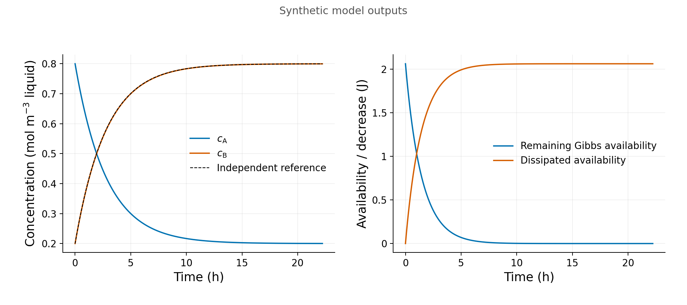

Imagine two dissolved states interconverting in a well-mixed batch. At equilibrium, their concentrations remain constant while forward and reverse conversions balance. Gross exchange continues, yet supplies no net available work. This separates four quantities we often blur: net change, gross exchange, energy per reaction and power.

[Chapter 1](https://github.com/pycckuu/the-book/blob/e39402c05fe22473009cb1e6bb57097a9ab42680/chapters/01-budget-of-the-universe.md) supplies the distinction between free energy, reaction energy and energy supply rate. Here we isolate those ideas in one fictional reaction, $A\rightleftharpoons B$. A and B are neutral solute states sharing one declared convertible equivalent. They are not a natural redox couple. Parameters are teaching assumptions, and saved outputs are synthetic model results. They are not measurements or fitted biological properties.

## The batch and its reference

The batch is closed to matter, ideal dilute and homogeneous. A thermal reservoir fixes temperature $T$; pressure is fixed. The modeled liquid volume $V_l$ is constant under an incompressible-solvent/equal-solute-volume approximation. This is a fixed-$T,p$ Gibbs model, not a genuinely rigid fixed-$T,V$ vessel, for which Helmholtz energy would be the corresponding potential.

Concentrations $c_A,c_B$ are mol of declared equivalent per cubic meter of liquid. Amounts are $n_i=V_lc_i$, in mol. The conserved total is $C=c_{A0}+c_{B0}$ and $N=V_lC$. This accounts for that equivalent, without asserting unspecified elemental, charge or electron balances.

For the written forward reaction $A\rightarrow B$,

$$
\begin{gathered}
a_i=c_i/c^\circ,\qquad Q=a_B/a_A,\qquad K_{\mathrm{eq}}>0,\\
\Delta_rG=\Delta_rG^\circ+RT\ln Q,\qquad
\Delta_rG^\circ=-RT\ln K_{\mathrm{eq}}.
\end{gathered}
$$

Temperature is in K and $R$ is the gas constant in J mol$^{-1}$ K$^{-1}$. The standard concentration $c^\circ$ has the same units as $c_i$. Activities, $Q$ and $K_{\mathrm{eq}}$ are dimensionless. $\Delta_rG$ is J per mol of the written reaction; it is neither total energy nor power. The common standard concentration $c^\circ$ cancels from this one-to-one ratio. This example teaches dimensionless activities, but does not demonstrate standard-state dependence of $K_{\mathrm{eq}}$ or $\Delta_rG^\circ$.

These are chemical, unprimed quantities. A transformed biochemical $\Delta_rG^{\circ\prime}$ needs its matching $Q'$ and specified reservoirs, such as buffered proton activity. It cannot be substituted into the equation merely by adding a prime, or by counting that proton reservoir again inside $Q'$. No pH, Mg binding or biochemical transform is calculated here.[^energy_science_convention]

## A reversible rate with the right equilibrium

Choose first-order one-way rates and their signed difference:

$$
\begin{gathered}
r_+=k_fc_A,\qquad r_-=k_rc_B,\qquad r=r_+-r_-,\\
\frac{dc_A}{dt}=-r,\qquad \frac{dc_B}{dt}=r,\qquad
\frac{k_f}{k_r}=K_{\mathrm{eq}}.
\end{gathered}
$$

The coefficients are s$^{-1}$ and the rates are mol m$^{-3}$ s$^{-1}$. Set $\lambda=k_f+k_r>0$. Changing $\lambda$ at fixed $K_{\mathrm{eq}}$ changes the relaxation speed, not the equilibrium ratio or energy per reaction. For this closure, net forward conversion has negative $\Delta_rG$; net reverse conversion has positive $\Delta_rG$ for the written forward reaction. Detailed balance connects kinetics to the thermodynamic reference; its sign alone does not supply a rate law.[^energy_science_balance]

Signed net extent is $\xi=V_l\int r\,dt$. Gross forward and reverse throughputs are $\Xi_+=V_l\int r_+\,dt$ and $\Xi_-=V_l\int r_-\,dt$, both nonnegative, with $\xi=\Xi_+-\Xi_-$. At nonempty equilibrium, gross rates remain positive and equal while the net rate is zero. These throughputs are model quantities. Equilibrium concentrations alone do not identify $\lambda$ or measure gross exchange; additional tracer or exchange observations would be needed.

The independent analytical reference is

$$
\begin{gathered}
c_{A,\mathrm{eq}}=\frac{C}{1+K_{\mathrm{eq}}},\qquad
c_{B,\mathrm{eq}}=\frac{CK_{\mathrm{eq}}}{1+K_{\mathrm{eq}}},\\
c_B(t)=c_{B,\mathrm{eq}}+(c_{B0}-c_{B,\mathrm{eq}})e^{-\lambda t},\qquad
c_A(t)=C-c_B(t).
\end{gathered}
$$

A nonequilibrium deviation approaches zero exponentially, without vanishing at a finite mathematical time. This reference is separate from stepping the numerical solution. The saved package also uses independently integrated one-way rates to check gross throughputs.

Rewriting the same process as $2A\rightleftharpoons2B$ doubles reaction energy and halves reaction extent and the corresponding extent rate. Physical power stays unchanged. This changes bookkeeping, not the reaction mechanism or kinetic order.

## Availability is not harvested energy

For $C>0$, relative Gibbs availability is

$$
G_{\mathrm{ex}}=RTV_l\sum_{i=A,B}
\left[c_i\ln\!\left(\frac{c_i}{c_{i,\mathrm{eq}}}\right)-c_i+c_{i,\mathrm{eq}}\right].
$$

It is nonnegative and has units J. Its minimum is zero at the constrained equilibrium. The numerical diagnostic uses this direct compensated two-species expression, with equilibrium concentrations fixed from the initial $C$. It does not reset equilibrium from a drifting numerical total. A binary relative-entropy expression is a separate check at analytical reference states with exact conserved total.

Along the exact model balance,

$$
\frac{dG_{\mathrm{ex}}}{dt}=V_lr\Delta_rG\leq0,\qquad
P_{\mathrm{diss}}=-V_lr\Delta_rG\geq0.
$$

$P_{\mathrm{diss}}$ is W, and $P_{\mathrm{diss}}/T$ is entropy production rate. The drop $D(t)=G_{\mathrm{ex}}(0)-G_{\mathrm{ex}}(t)$ is dissipated availability in J. Remaining $G_{\mathrm{ex}}$ bounds reversible nonexpansion work to the same equilibrium under these reservoir conditions. The unforced batch contains no work-extraction device. Its Gibbs drop is not harvested ATP, a heat inventory or a growth yield.

## Read the model through its graphs

Before looking, predict the forward case: the initial ratio is below equilibrium, so A decreases and B increases while their sum stays fixed. Reducing the imbalance should reduce the remaining Gibbs availability and the dissipation power. The synthetic initial availability is approximately 2.06 J, with initial dissipation power 0.412 mW. These are calculated model quantities, not measured energy yields.

Read the concentration panel as two coupled inventories: gaining B does not create a new equivalent. Read the energy panel as availability being dissipated during unforced relaxation, with no extraction device. Similar-looking lines do not establish numerical accuracy; inspect the matched tabulated errors and refinement checks. Printed calculated values use about three significant figures; the saved data retain full precision.

The left panel prevents a common mistake: adding gross turnover to the net amount converted. At nonempty equilibrium, balanced exchange can continue without net progress or continuing available work. The right panel shows why energy per reaction, finite energy and power require different units and observations. Its curve is a native saved diagnostic, not a separately measured heat or ATP flux.

## Boundaries and finite steps

Use the continuous limit $0\ln0=0$ in $G_{\mathrm{ex}}$; it does not make $\ln a_i$ finite at zero activity. With $B=0,A>0$, $Q=0$ is a valid ratio but reaction energy and initial dissipation power have no finite value. With $A=0,B>0$, $Q$ is also undefined. Those entries stay blank/null with reasons, without an epsilon concentration or a fake zero. Initial availability remains finite. For a nonempty batch, both concentrations become positive at every $t>0$.

The completely empty batch is a separate stationary branch: amounts, rates, $G_{\mathrm{ex}}$ and $D$ are zero, while $Q$, reaction energy and power are undefined. It is not an observation of $Q=K_{\mathrm{eq}}$.

For actual step length $h$, backward Euler updates both concentrations:

$$
\begin{gathered}
c_{A,\mathrm{new}}=\frac{(1+hk_r)c_{A,\mathrm{old}}+hk_rc_{B,\mathrm{old}}}{1+h\lambda},\\
c_{B,\mathrm{new}}=\frac{hk_fc_{A,\mathrm{old}}+(1+hk_f)c_{B,\mathrm{old}}}{1+h\lambda}.
\end{gathered}
$$

The independent gross increments are $\Delta\Xi_+=V_lhk_fc_{A,\mathrm{new}}$ and $\Delta\Xi_-=V_lhk_rc_{B,\mathrm{new}}$. Their signed difference can be checked against both inventory changes, rather than supplied from an inventory-derived ledger. The separate endpoint proxy is $W_{\mathrm{end}}=hP_{\mathrm{diss,new}}$, and convexity gives, in exact arithmetic,

$$
G_{\mathrm{ex,old}}-G_{\mathrm{ex,new}}\geq W_{\mathrm{end}}\geq0.
$$

The saved `endpoint_power_energy` uses `actual_h_s` and the current positive-time endpoint power. At a boundary start, initial power stays null; the first step uses its finite new power. The gap is a numerical dissipation diagnostic, not extra biological energy. State drops telescope by construction, so their sum alone does not verify energy accuracy. Analytical references and comparisons on the same physical times are also required.

The fixed 100 s policy passed the declared numerical checks. The actual 200 s pass and 400 s failure are retained; 100 s is not claimed to be the coarsest passing step. The auxiliary large steps test positivity and domain handling, not production accuracy. [Saved tables](../model/saved-results.zip) and the [companion notes](../model/README.md) preserve the supports, null reasons and execution history. This is numerical verification of the illustrative closure, not organism or field validation.

## What this leaves out

No organism growth, maintenance threshold, ATP coupling, nonideal activity model, speciation, transport or full redox network is included. A microbial respiration law that couples reaction drive to phosphorylation has additional mechanism-specific assumptions and a different zero-drive condition.[^energy_science_coupling] The two-state example isolates the accounting needed before those mechanisms can be added.

[^energy_science_convention]: IUBMB-IUPAC Joint Commission on Biochemical Nomenclature, "Recommendations for Nomenclature and Tables in Biochemical Thermodynamics (Recommendations 1994)," *Pure and Applied Chemistry* 66 (1994): 1641--1666, [DOI:10.1351/pac199466081641](https://doi.org/10.1351/pac199466081641). Official HTML: [§4.1, equations 11 and 17](https://iubmb.qmul.ac.uk/thermod/th41.html), [§4.2, equation 34](https://iubmb.qmul.ac.uk/thermod/th42.html), and [§5.1](https://iubmb.qmul.ac.uk/thermod/th5.html). These are reference conventions, not a measured A/B property table. [@IUPACIUBMB1994]

[^energy_science_balance]: Riccardo Rao and Massimiliano Esposito, "Nonequilibrium Thermodynamics of Chemical Reaction Networks: Wisdom from Stochastic Thermodynamics," *Physical Review X* 6 (2016): 041064, [DOI:10.1103/PhysRevX.6.041064](https://doi.org/10.1103/PhysRevX.6.041064). [Author version, arXiv:1602.07257v3](https://arxiv.org/abs/1602.07257v3), §II and §III B, D, E, supplies the ideal-dilute detailed-balance and Gibbs-dissipation framework. The exponential reference and two-state inequalities here are specialized analytical consequences of the declared closure. [@RaoEsposito2016]

[^energy_science_coupling]: Qusheng Jin and Craig M. Bethke, "A New Rate Law Describing Microbial Respiration," *Applied and Environmental Microbiology* 69 (2003): 2340--2348, [DOI:10.1128/AEM.69.4.2340-2348.2003](https://doi.org/10.1128/AEM.69.4.2340-2348.2003). [Primary reprint](https://www.gwb.com/pdf/pubs/AEM_reprint.pdf), page2341, equations 6 and 8--11, distinguishes coupled remaining drive from the uncoupled reaction energy. No organism parameters or captured-work claim are transferred to this batch. [@Jin2003]
