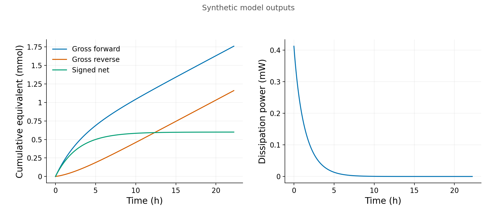

A useful model connects a question to something we can observe. It states what is stored, what crosses a boundary, what changes inside, and which details we can afford to leave out. Equations then make those choices testable. Four worked examples below follow that path: oxygen in sediment, a dissolved pulse in flowing water, substrate depletion in a batch, and reversible conversion with an energy budget.

The examples use illustrative parameters and saved simulated or synthetic results. [Source notes and companion locations](#sources-and-companions) identify their saved tables. Their numerical checks test their stated equations. Testing a real sediment, enzyme assay or reaction system needs independent observations and an observation rule that matches the calculation.

For orientation, take one example at a time: read its question, declared system, boundary conditions and prediction, then the graph-reading paragraphs with the complete captions. Return to the reference calculations, refinement studies and reproduction instructions when checking how the result was obtained. Keep the stated units, assumptions and inference limits in both readings. This is a choice of reading depth for the guide; the assigned module tasks remain unchanged.

## Choose the system and observable

Start with a question small enough to answer. “What controls this ecosystem?” has no single measurable output. “Can diffusion and a fixed oxygen demand explain this depth profile?” names a system, an observable and a proposed explanation.

Draw the boundary before writing the rate law. A sediment slab exchanges oxygen with its surroundings. A sealed liquid batch does not exchange substrate with an inlet or outlet. A batch closed to matter can still exchange heat with a reservoir. The boundary determines which terms belong in the balance.

Next state the observation rule. A concentration inside porewater, the amount collected at an outlet and an average concentration over a sampling interval are different quantities. A sensor averages over a spatial footprint and a time window; a numerical cell may also average, but usually over a different support. Agreement means comparing the same quantity on the same support, not putting two similar curves on one axis.

## Build an inventory before a mechanism

For a dissolved concentration $C$ per volume of porewater and constant water-filled porosity $\phi$, inventory per bulk sediment volume is $\phi C$. In a slab of thickness $dx$ and unit bulk area, the stored amount is $\phi C\,dx$. If $F$ is flux through that bulk area, the balance is

$$
\frac{\partial(\phi C)}{\partial t}=-\frac{\partial F}{\partial x}+R.
$$

Here $R$ is a signed source per bulk volume. Flux divergence records the difference between what enters and leaves. A negative $R$ removes the tracked species. This equation explains the bookkeeping, but it does not yet explain transport or reaction. Those require closures such as Fickian diffusion or a first-order sink.

In a well-mixed liquid of fixed volume $V_\ell$, remaining amount is $V_\ell S$. There is no porosity factor. An equation with the right dimensions can still be wrong if it combines a rate per liquid volume with an inventory per bulk sediment volume.

Chemical labels are upright: $\mathrm{O}_{2}$, $\mathrm{SO}_{4}^{2-}$, $\mathrm{CH}_{4}$ and $\mathrm{H}^{+}$. A concentration variable such as $C$ or $S$ is italic; its unit is upright, for example $\mathrm{mol\,m^{-3}}$. An exercise label is an identifier, never a chemical formula. The artificial states $\mathrm{A}$ and $\mathrm{B}$ in the energy example represent declared equivalents, not identified natural chemical species.

## Declare the simplification and a way to challenge it

A closure answers a specific unresolved question. A constant diffusivity replaces pore-scale motion with a bulk transport description. A fixed capacity replaces changing enzyme or biomass dynamics with one rate parameter. These choices help isolate a question, but their omitted processes remain possible explanations for a mismatch.

State the consequence of each simplification. With a fixed first-order sink, changing surface concentration scales the oxygen profile. With growing biomass, that proportionality may fail. With one mobile water region, a constant dispersion coefficient describes spreading; delayed release from immobile pores may require another state. A good assumption is one whose consequences can be checked, not one that sounds plausible.

## Separate the equation from the algorithm

An independent reference makes a computer result interpretable. Use a closed-form solution where available, or solve an integrated scalar relation by a method independent of time stepping. Match its boundary and initial conditions to the comparison. A steady reference tests a steady calculation; it is not the exact transient solution at a finite time.

Numerical support matters as much as numerical values. A backward-Euler rate is evaluated at the new endpoint. Its interval increment uses the actual step length, including shortened last steps. A snapshot interpolated between endpoints is suitable for a graph comparison, but does not become another budget interval. Summing endpoint increments and applying a trapezoid to a plotted curve answer different questions.

Visible results below use three significant digits. Input settings, tolerances, formulas and raw saved data retain their specified precision. A fraction displayed as $1.00$ can still leave a small nonzero inventory. Rounded equality is never proof of exact closure or complete washout.

## Oxygen in a sediment slab

### Question and conceptual box

Can a fixed surface supply, diffusion and an aggregate oxygen demand explain a dissolved $\mathrm{O}_{2}$ profile? Picture a dark, fully water-saturated sediment slab. Depth $x$ increases downward. Oxygen enters at the top, moves between adjacent layers and disappears through a lumped sink. The lower face is sealed in this example.

The observable $C(x,t)$ is dissolved oxygen in $\mathrm{mol\,m^{-3}}$ of porewater. The homogeneous model has constant $\phi$, tortuosity-corrected diffusivity $D_s$ and demand coefficient $k$. It omits flow, irrigation, photosynthesis and explicit donors, products and biomass. Thus its loss ledger cannot distinguish respiration from oxidation of reduced compounds, or establish a carbon mineralization rate.

### Equation and boundary choices

Diffusion moves oxygen down its concentration gradient:

$$
\begin{gathered}
F=-\phi D_s C_x,\\
\partial_t(\phi C)=-\partial_x F-\phi kC,\\
C_t=D_sC_{xx}-kC\quad\text{for constant coefficients}.
\end{gathered}
$$

$D_s$ has units $\mathrm{m^2\,s^{-1}}$ and excludes the porosity prefactor. If concentration falls downward, $C_x<0$ and $F>0$: flux enters the sediment. Constant porosity cancels from the concentration equation, but still scales inventory and flux.

The complete problem is

$$
C(0,t)=C_0\ (t>0),\qquad C_x(L,t)=0,\qquad C(x,0)=0\ (0<x<L).
$$

A fixed surface concentration assumes negligible unresolved resistance between overlying water and the sediment surface. A zero lower gradient means zero lower diffusive flux. Imposing $C(L)=0$ would describe a different experiment. The instantaneous top switch creates a discontinuity at the initial boundary corner, so that startup is unsuitable for claiming smooth time convergence.

Use $L=0.03\,\mathrm{m}$, $D_s=10^{-9}\,\mathrm{m^2\,s^{-1}}$, $k=10^{-5}\,\mathrm{s^{-1}}$, $\phi=0.8$ and $C_0=0.2\,\mathrm{mol\,m^{-3}}$. The latter is $200\,\mu\mathrm{mol\,L^{-1}}$, not a concentration per litre of sediment.

### Reference and prediction

The penetration scale $\ell=\sqrt{D_s/k}=0.0100\,\mathrm{m}$ compares transport with consumption. Setting accumulation to zero gives

$$
C_*(x)=C_0\frac{\cosh((L-x)/\ell)}{\cosh(L/\ell)},\qquad
F_*(0)=\phi C_0\sqrt{D_sk}\tanh(L/\ell).
$$

Differentiating verifies the equation and both boundaries. Integrating verifies that steady inward flux equals integrated consumption. The finite-domain formula matters: the deep-domain exponential approximation does not enforce the sealed bottom.

The analytical bottom concentration is $19.9\,\mu\mathrm{mol\,L^{-1}}$ and inward flux is $1.38\,\mathrm{mmol\,m^{-2}\,d^{-1}}$. A $1\,\mu\mathrm{mol\,L^{-1}}$ detection threshold is not crossed within the $3\,\mathrm{cm}$ domain. A positive first-order steady profile has no exact oxygen-free front. Doubling $k$ reduces $\ell$ by $\sqrt{2}$; doubling $C_0$ doubles concentration and flux. Those are conditional predictions of this closure.

### Numerical calculation and graph reading

The saved startup uses 80 equal cells and $\Delta t=1000\,\mathrm{s}$, with profiles at $10000$, $100000$ and $1000000\,\mathrm{s}$. Finite volumes balance each layer. The top flux uses the half-cell distance; internal shared fluxes cancel when summed. Backward Euler evaluates diffusion and consumption at the new time level. It preserves nonnegative states here without clipping, while large steps can still give inaccurate transients.


Predict first: diffusion replenishes the surface layers while the fixed sink removes oxygen. The startup profile grows toward the steady curve. Read this growth as accumulation; only near steady state can inward flux be equated directly to total consumption. No boundary sample at zero depth is invented. Sulfate and methane are not coupled states in this calculation.

The steady grid errors at 20, 40, 80 and 160 cells are $5.07\times10^{-4}$, $1.34\times10^{-4}$, $3.43\times10^{-5}$ and $8.68\times10^{-6}\,\mathrm{mol\,m^{-3}}$. They approach second-order spatial convergence. A separate smooth discrete eigenmode gives first-order time convergence: errors decrease from $2.50\times10^{-5}$ at $1000\,\mathrm{s}$ to $3.14\times10^{-6}\,\mathrm{mol\,m^{-3}}$ at $125\,\mathrm{s}$.

At fixed grid, the continuum comparison error plateaus near $2.20\times10^{-5}\,\mathrm{mol\,m^{-3}}$; decreasing the time step cannot remove spatial error. Keep the discrete eigenmode and continuum references distinct. This is a real limit of the refinement experiment, not evidence that the time method lost its order. The saved oxygen evidence reports convergence studies and a fixed-grid error plateau, rather than a failed solver run.

### Reproduce or inspect saved output

From `courses/oxygen-diffusion/en`, the archived command is

```sh
python3 model/oxygen_model.py --out my-run
```

Use a fresh output directory. Without Python, open `profiles.csv` and `verification.json` in `model/results/`, then read `verification-report.md` in `model/`. A spreadsheet can compare the saved concentrations with the stated steady formula and read the separate grid and time studies. That is analysis of supplied output, not an independent solver execution.

A steady normalized profile constrains $k/D_s$, not $k$ and $D_s$ separately. Scaling both by the same factor preserves its shape. An independently measured flux or transient response can add information, if surface concentration, porosity and boundaries are known. Field tests should also examine boundary-layer resistance and lateral structure before assigning a profile's sink to a microbial pathway.

## A dissolved pulse in flowing water

### Question and conceptual box

Does a lower outlet peak mean parent loss, spreading or material still inside the column? Imagine injecting a pulse into a saturated column and collecting the exiting water. The observable is the outlet concentration history together with the integrated exported amount. A spatial resident profile answers a related but different question.

This rigid one-dimensional column has one mobile water region, constant porosity $\phi$, porewater velocity $u>0$, combined longitudinal dispersion $D_L$ and aggregate parent-loss coefficient $k$. It omits sorption, immobile exchange, products and microbial dynamics. Darcy flux is $v_D=\phi u$, not $u$.

### Equation and experiment

Flow carries solute forward and dispersion redistributes it:

$$
\begin{gathered}
F=\phi(uC-D_LC_x),\qquad
\partial_t(\phi C)=-\partial_xF-\phi kC,\\
C_t=D_LC_{xx}-uC_x-kC.
\end{gathered}
$$

$C$ is resident porewater concentration; $F$ is $\mathrm{mol\,m^{-2}\,s^{-1}}$ through bulk cross-sectional area. $D_L$ already includes the represented molecular and mechanical spreading, with no porosity prefactor. Adding $D_s$ from the oxygen example would double count represented diffusion.

Start from zero concentration. The inlet supplies known total flux, while the exit permits advective export:

$$
\begin{gathered}
F(0,t)=\phi uC_{\mathrm{in}}(t),\qquad C_x(L,t)=0,\\
C_{\mathrm{in}}(t)=C_{\mathrm{ref}}\quad (0\leq t<T_p),
\qquad C_{\mathrm{in}}(t)=0\quad(t\geq T_p).
\end{gathered}
$$

Do not also prescribe resident inlet concentration. Flux-normalized concentration $C_F=F/(\phi u)$ equals resident concentration at this zero-gradient exit, but generally differs inside the column. The terminal numerical cell average approximates the exit trace; it is not an observed point concentration at $L$.

Use $L=1\,\mathrm{m}$, $\phi=0.30$, $u=10^{-5}\,\mathrm{m\,s^{-1}}$, $D_L=10^{-6}\,\mathrm{m^2\,s^{-1}}$, $C_{\mathrm{ref}}=1\,\mathrm{mol\,m^{-3}}$ and $T_p=20000\,\mathrm{s}$. Four saved cases are conservative, reactive with $k=10^{-5}\,\mathrm{s^{-1}}$, conservative at $2u$, and conservative at $2D_L$. Pulse duration stays fixed. Faster flow doubles supplied dose from $0.0600$ to $0.120\,\mathrm{mol\,m^{-2}}$.

### Reference, budget and solution strategy

Inventory $M=\phi\int_0^L C\,dx$, input $I$, export $O$ and parent disappearance $B$ all use $\mathrm{mol\,m^{-2}}$ of bulk area:

$$
M(t)-M(0)=I(t)-O(t)-B(t).
$$

This is why a peak alone cannot establish loss. Spreading lowers a peak without removing parent, and a finite observation window can end before all parent leaves. $B$ is missing tracked parent, not demonstrated mineralization or safe water.

A separate constant-feed steady reference solves $D_LC_*''-uC_*'-kC_*=0$ with the same total-flux inlet and zero-gradient exit. Its exponential characteristic roots satisfy $D_Lr^2-ur-k=0$. The saved reference table uses analytical cell averages, so comparisons match the finite-volume support. A periodic smooth reference separately isolates time error and artificial spreading. Neither is the exact finite-pulse experiment.

The saved pulse default uses 400 cells, $\Delta t=100\,\mathrm{s}$ and a $600000\,\mathrm{s}$ window. Upwind advection and backward Euler are generally first order; diffusion-only spatial order from the oxygen example does not transfer. Input increments use the exact interval overlap with the half-open feed. Outlet and loss increments use the right endpoint:

$$
\Delta O_n=\Delta t_n\phi uC_N^{n+1},\qquad
\Delta B_n=\Delta t_n kM^{n+1}.
$$

The inlet component split is a half-cell diagnostic reconstructed from known total flux and the first cell. It is not another boundary condition or an independently measured inlet state.

### Read the outlet and budget graphs


Predict first: faster flow shifts export earlier, dispersion spreads timing, and loss removes tracked parent. The peak is a density of exported dose here, not concentration. The table below supplies the corresponding outlet concentrations. All curves share the same physical time axis; the faster-flow case received twice the dose. The reactive exported fraction has an earlier median because loss reweights the surviving material; water velocity did not change.

| Saved case | Peak concentration ($\mathrm{mol\,m^{-3}}$ water) | Exported-mass median ($\mathrm{s}$) | Export/input | Parent disappearance/input | Remaining storage/input |
| --- | ---: | ---: | ---: | ---: | ---: |
| Conservative | 0.224 | $1.02\times10^5$ | 1.00 | 0 | $2.71\times10^{-7}$ |
| Reactive | 0.108 | $8.97\times10^4$ | 0.398 | 0.602 | $7.66\times10^{-10}$ |
| Faster flow | 0.517 | $5.80\times10^4$ | 1.00 | 0 | $9.62\times10^{-25}$ |
| More dispersion | 0.193 | $9.68\times10^4$ | 1.00 | 0 | $3.25\times10^{-5}$ |

Each fraction uses its own dose. The median and $t_{10},t_{90}$ condition on mass exported within this finite window. Temporal width has units seconds and describes exported timing; resident spatial width has units metres and describes material still inside at a specified time. They must not share a label or axis. Rounded export $1.00$ does not mean exactly complete washout.

The stacked fractions close the finite-window bookkeeping. The reactive case loses about 60.2% of its supplied parent; its remaining storage is much smaller. The conservative cases retain tiny nonzero storage, even when their displayed export is 1.00. The disappearance bar does not identify a product or prove mineralization. To reconstruct the full amount history, use complete interval increments in the saved ledgers. Integrating a displayed curve by a trapezoid does not reproduce the saved backward-Euler ledger.

Independent grid-only and time-only comparisons passed the declared 2% scale-aware profile/peak/timing targets and absolute fraction-change tolerance $0.005$. The initial $400000\,\mathrm{s}$ window left too much more-dispersion storage for the declared $0.001$ retained-fraction target; extending to $600000\,\mathrm{s}$ and checking $800000\,\mathrm{s}$ addressed that limitation. The first periodic auxiliary attempt also failed because its cyclic matrix assembly swapped advection corner coefficients. Retained failure evidence and corrected references expose the error; the finite-column solver followed a different, unaffected path. No tolerance was relaxed to conceal that failure.

### Reproduce or inspect saved output

From `courses/advection-dispersion/model`, the documented full packet command is

```sh
python3 verify_advection.py --out reproduced-results
```

Without Python, use `results/scenario-summary.csv`, the complete pulse ledgers, profile tables, `model-interface.md` and `no-python-readback.md`. Sum supplied interval increments and compare storage with the profile integral, keeping porewater concentration and bulk area distinct. This route inspects supplied numerical results.

Eight supplied outlet observations are noiseless synthetic interval averages from a finer grid. Three candidates vary only $k$ with known transport and feed. Even the matching-$k$ candidate has a small nonzero residual because its resolution differs. This comparison is not field calibration, an optimizer or a confidence interval. Independent conservative-tracer transport and matched outlet sampling could test the transport closure before parent attenuation is attributed to reaction.

## Substrate depletion with a fixed capacity

### Question and conceptual box

When is substrate disappearance nearly constant, and when does it become proportional to remaining substrate? Picture a sealed, well-mixed liquid batch with a fixed processing capacity. Follow available dissolved substrate concentration $S$ per liquid volume. No inlet, outlet, porosity or transport belongs in this box.

A Michaelis-Menten reduction can describe an enzyme mechanism under specified assumptions; empirical Monod $\mu(S)$ describes biomass-specific growth, $\mu=d\ln X/dt$ for positive biomass $X$, in $\mathrm{s^{-1}}$. An enzyme mechanism also distinguishes free substrate from substrate bound in an enzyme complex. A similar saturation shape does not make those observables equivalent. Here $q_{\max}$ is substrate-depletion capacity, not growth rate or liquid volume. Biomass growth, maintenance, energy regulation and enzyme adaptation are deferred.

### Equation and independent reference

With fixed liquid volume $V_\ell$, positive half-saturation concentration $K$ and capacity $q_{\max}$,

$$
\begin{gathered}
q(S)=q_{\max}\frac{S}{K+S},\qquad \frac{dS}{dt}=-q(S),\\
\frac{dZ}{dt}=q(S),\qquad S(0)=S_0,\ Z(0)=0.
\end{gathered}
$$

$S,K,Z$ use $\mathrm{mol\,m^{-3}}$ of liquid; $q_{\max}$ uses $\mathrm{mol\,m^{-3}\,s^{-1}}$. $Z$ accumulates depleted substrate equivalents. $V_\ell(S+Z)=V_\ell S_0$ balances those equivalents, without specifying biomass or product stoichiometry.

Separate variables to obtain

$$
S_0-S+K\ln(S_0/S)=q_{\max}t,\qquad
 t_f=\frac{S_0(1-f)+K\ln(1/f)}{q_{\max}},\quad 0<f<1.
$$

The logarithm has a dimensionless argument. Positive $K$ leaves a positive analytical tail at every finite time. “Exhausted” therefore requires a specified threshold. The independent reference bisects the integrated equation in $y=\ln(S/S_0)$; its residual and log-bracket criteria are $10^{-12}$. It is independent of the time-stepping algorithm.

Inputs are $V_\ell=10^{-3}\,\mathrm{m^3}$, $K=0.1\,\mathrm{mol\,m^{-3}}$ and $q_{\max}=10^{-5}\,\mathrm{mol\,m^{-3}\,s^{-1}}$. Low and high starts use $S_0/K=0.01$ and $100$. The transition start at $1$ is additional verification support. Each trajectory ends at its own analytical $t_{0.01}$; these are different-duration experiments.

### Prediction and numerical support

At low concentration, $q\approx(q_{\max}/K)S$; at high concentration, $q\approx q_{\max}$. Their relative instantaneous excesses over the exact rate are $S/K$ and $K/S$, respectively. A 5% criterion therefore requires $S/K\leq0.05$ or $S/K\geq20$. It bounds rate approximation, not whole-trajectory error. The high-start trajectory ends analytically at $S=K$, before entering the 5% linear-rate regime.

Backward Euler solves the positive root of $S_{n+1}+\Delta t_nq(S_{n+1})=S_n$. The independent depleted increment is $\Delta B_n=V_\ell\Delta t_nq(S_{n+1})$. Accumulate these increments separately and compare with remaining amount; do not define the cumulative ledger solely as initial minus remaining.

The accepted default is $100\,\mathrm{s}$. Fixed-window snapshots number 401 per case, using labeled interpolation of numerical endpoint states. Event times retain their enclosing endpoint brackets and a separate fixed extension window. Null or censored threshold entries are not zeros. Auxiliary large steps include actual shortened intervals; they demonstrate bounded positivity/domain behavior, not production accuracy.

### Read rate and trajectory graphs


Predict first: low substrate produces a curved declining tail, while a high start initially depletes almost at fixed capacity. At $S=K$, the exact rate is half capacity. That statement alone does not measure enzyme affinity, a binding dissociation constant or a microbial growth half-saturation.

The two trajectory clocks differ: $T=4.62\times10^4$ s for the low start and $T=1.04\times10^6$ s for the high start. Equal $t/T$ positions are equal fractions of different physical windows. Each ends at 1% of its own initial substrate. The high case therefore ends at $S=K$ and has not entered the 5% linear-rate regime. Its saved numerical curve lies close to its dashed independent reference on this scale; overlapping curves cannot establish exact agreement. The separate threshold-event extension is not part of this graph.

The low-case fixed-snapshot error normalized by $S_0$ is $0.00723$ at $400\,\mathrm{s}$, exceeding the declared $0.005$ trajectory threshold. At $200$ and $100\,\mathrm{s}$ it is $0.00363$ and $0.00182$. The transition case passes the trajectory criterion at $400\,\mathrm{s}$ but fails event/refinement criteria; the high case passes those coarse controls. Retain these differences instead of labeling every coarse case a failure. Balance and nonnegativity can pass even when accuracy fails. Error normalized by initial substrate is not a small-tail relative accuracy guarantee.

### Reproduce or inspect saved output

From `courses/saturation-kinetics/model`:

```sh
python3 saturation.py new-results
```

Without Python, extract `saved-results.zip`, inspect the small rate, threshold and refinement CSVs, and follow the model README using a complete case step ledger. Use actual intervals and right-endpoint rates for amount increments. The selected blank worksheet has nonconsecutive final rows; cumulative sums need all intervening complete-ledger increments. OPEN worked values remain separately available for comparison after a first attempt.

Low-substrate rates mainly constrain $q_{\max}/K$; high-substrate rates mainly constrain capacity. Data around the transition help separate them, conditional on fixed capacity and the observation rule. Even an enzyme interpretation of $k_{\mathrm{cat}}E_T$ does not separate its two factors. Time-resolved substrate measurements and independent checks of capacity stability could challenge the fixed-capacity closure; a growing biomass culture requires a different state model.

## Reversible conversion and an energy budget

### Question and conceptual box

Can a system exchange molecules rapidly while providing no net driving power? Picture fictional neutral dissolved states $\mathrm{A}\rightleftharpoons\mathrm{B}$, each carrying one declared convertible equivalent. The batch is closed to matter, ideal dilute and well mixed. A thermal reservoir fixes $T$ and pressure is fixed. Constant modeled liquid volume is an incompressible/equal-solute-volume approximation, not a genuinely rigid fixed-$T,V$ vessel.

Observe $c_{\mathrm{A}},c_{\mathrm{B}}$ per liquid volume and their amounts $n_i=V_\ell c_i$. Energy per written reaction, total availability and power are separate observables or model diagnostics. The batch contains no work-extraction device, organism, ATP mechanism or natural redox network.

### Gibbs reference and rate law

For the written forward reaction, use chemical, unprimed quantities:

$$
\begin{gathered}
a_i=c_i/c^\circ,\quad Q=a_{\mathrm{B}}/a_{\mathrm{A}},\quad
\Delta_rG^\circ=-RT\ln K_{\mathrm{eq}},\\
\Delta_rG=RT\ln(Q/K_{\mathrm{eq}}).
\end{gathered}
$$

Activities, $Q$ and $K_{\mathrm{eq}}$ are dimensionless; $\Delta_rG$ is $\mathrm{J\,mol^{-1}}$ of the written reaction. The common standard concentration cancels in this one-to-one ratio. A transformed biochemical convention needs its matching $Q'$ and reservoirs; a prime cannot simply be added to this equation or its proton reservoir counted twice.

Choose one-way rates and their signed difference:

$$
\begin{gathered}
r_+=k_fc_{\mathrm{A}},\quad r_-=k_rc_{\mathrm{B}},\quad r=r_+-r_-,\\
\dot c_{\mathrm{A}}=-r,\quad\dot c_{\mathrm{B}}=r,\quad
k_f/k_r=K_{\mathrm{eq}},\quad \lambda=k_f+k_r.
\end{gathered}
$$

Detailed balance makes the kinetic equilibrium agree with the Gibbs reference. Reaction energy constrains direction; it does not determine speed. Changing $\lambda$ at fixed $K_{\mathrm{eq}}$ changes relaxation speed without changing the equilibrium ratio.

Initial total $C_{\mathrm{tot},0}=c_{\mathrm{A}0}+c_{\mathrm{B}0}$ fixes

$$
\begin{gathered}
c_{\mathrm{B,eq}}=C_{\mathrm{tot},0}K_{\mathrm{eq}}/(1+K_{\mathrm{eq}}),\\
c_{\mathrm{B}}(t)=c_{\mathrm{B,eq}}+(c_{\mathrm{B}0}-c_{\mathrm{B,eq}})e^{-\lambda t},\\
c_{\mathrm{A}}(t)=C_{\mathrm{tot},0}-c_{\mathrm{B}}(t).
\end{gathered}
$$

This is the independent concentration reference. Net extent $\xi=\Xi_+-\Xi_-$ changes inventory, while gross $\Xi_\pm=V_\ell\int r_\pm\,dt$ continue increasing at nonempty equilibrium. Equal equilibrium concentrations over time do not measure gross exchange or identify $\lambda$; tracer/exchange observations would add that information.

### Total availability and power

Relative Gibbs availability, in J, is

$$
G_{\mathrm{ex}}=RTV_\ell\sum_{i=\mathrm{A},\mathrm{B}}
\left[c_i\ln(c_i/c_{i,\mathrm{eq}})-c_i+c_{i,\mathrm{eq}}\right].
$$

The numerical diagnostic uses this direct compensated two-species expression with equilibrium fixed from initial total. Recomputing equilibrium from a drifting numerical total would hide matter errors. The independent binary reference check uses exact conserved total.

Along the exact balance,

$$
P_{\mathrm{diss}}=-V_\ell r\Delta_rG\geq0,\qquad
\frac{dG_{\mathrm{ex}}}{dt}=-P_{\mathrm{diss}}.
$$

Power has units W. $D(t)=G_{\mathrm{ex}}(0)-G_{\mathrm{ex}}(t)$ is dissipated availability in J. Remaining availability bounds reversible nonexpansion work to the same equilibrium and reservoirs. Neither it nor the unforced batch's decrease is measured heat, harvested ATP or a growth yield. Rewriting the same conversion as $2\mathrm{A}\rightleftharpoons2\mathrm{B}$ doubles energy per written reaction and halves extent rate; physical power remains unchanged, with no change in kinetic order.

### Saved calculation and endpoint arithmetic

Use $T=298.15\,\mathrm{K}$, $p=100000\,\mathrm{Pa}$, $V_\ell=0.001\,\mathrm{m^3}$, $c^\circ=1000\,\mathrm{mol\,m^{-3}}$. Also $K_{\mathrm{eq}}=4$ and $\lambda=10^{-4}\,\mathrm{s^{-1}}$. Use the specified gas constant $R=8.31446261815324\,\mathrm{J\,mol^{-1}\,K^{-1}}$.

Then $k_f=8\times10^{-5}$ and $k_r=2\times10^{-5}\,\mathrm{s^{-1}}$. Nonempty initial total is $1\,\mathrm{mol\,m^{-3}}$. Forward, reverse and equilibrium starts have initial B fractions $0.2$, $0.95$ and $0.8$; all run to $80000\,\mathrm{s}$. A-only, B-only, empty and partial-step cases are bounded auxiliary controls, making seven cases in total.

Backward Euler updates both concentrations independently. For actual interval length $h$,

$$
\begin{gathered}
c_{\mathrm{A,new}}=
\frac{(1+hk_r)c_{\mathrm{A,old}}+hk_rc_{\mathrm{B,old}}}{1+h\lambda},\\
c_{\mathrm{B,new}}=
\frac{hk_fc_{\mathrm{A,old}}+(1+hk_f)c_{\mathrm{B,old}}}{1+h\lambda}.
\end{gathered}
$$

Independent gross increments are $V_\ell hk_fc_{\mathrm{A,new}}$ and $V_\ell hk_rc_{\mathrm{B,new}}$. Compare their difference with both amount changes. The endpoint proxy $W_{\mathrm{end}}=hP_{\mathrm{diss,new}}$ obeys $G_{\mathrm{ex,old}}-G_{\mathrm{ex,new}}\geq W_{\mathrm{end}}$ in exact arithmetic. Its gap is a discretization diagnostic, not extra biological energy. Telescoping state drops alone do not verify energy accuracy.

For the saved forward run at $100\,\mathrm{s}$, the first endpoint has $c_{\mathrm{B}}=0.206\,\mathrm{mol\,m^{-3}}$, $G_{\mathrm{ex}}=2.02\,\mathrm{J}$ and $P_{\mathrm{diss}}=4.03\times10^{-4}\,\mathrm{W}$. Over that interval, the availability drop is $0.0406\,\mathrm{J}$ and endpoint proxy is $0.0403\,\mathrm{J}$. The gap displays as $2.69\times10^{-4}\,\mathrm{J}$ and remains at raw precision in the ledger. Use raw digits for subtraction rather than subtracting rounded graph labels.

### Read state and energy graphs


Predict first: A decreases, B increases and their sum stays fixed. Initial availability is 2.06 J; the state approaches equilibrium and loses that availability. The two energy curves partition the initial availability, rather than showing a device harvesting work. The reverse start approaches the same equilibrium from the other side in its separate saved case.



Gross throughputs keep increasing as net inventory change levels off. This is the model's equilibrium exchange, which concentration measurements alone do not observe. Initial forward power is 0.412 mW and decays toward zero. Power and availability have separate units and panels; do not add gross conversion to net conversion or read either energy curve as ATP or measured heat. The saved verification tables compare errors on matched supports, because curves can overlap while still failing a declared accuracy criterion.

The genuine corrected refinement history is $400\,\mathrm{s}$ FAIL, $200\,\mathrm{s}$ PASS and fixed $100\,\mathrm{s}$ PASS. Forward amplitude-normalized snapshot errors display as $0.00731$, $0.00365$ and $0.00183$ against the declared $0.005$ bound. The $100\,\mathrm{s}$ default is a predeclared policy, not the coarsest passing step. Original boundary-support rejection and fine equilibrium roundoff failures remain recorded; they were not silently converted to successes. These checks do not promise relative accuracy near an arbitrarily small tail.

At an A-only start, $Q=0$ but reaction energy and initial power have no finite value. At a B-only start, $Q$ is also undefined. Availability stays finite using the limit $0\ln0=0$; that limit does not make logarithmic force finite. The first positive-time endpoint has finite power, and its proxy uses that new endpoint and actual interval, never a preceding null or fabricated zero. In the empty branch amounts and availability are zero, while $Q$, force and power remain null. Empty is not a measurement of equilibrium. No epsilon repair is appropriate.

### Reproduce or inspect saved output

From `courses/energy-constraints/model`:

```sh
python3 run.py --output fresh-results
```

Without Python, extract `saved-results.zip`.

Open four files in `results-r2/`: `case-settings.csv`, `step-ledger.csv`, `comparison.csv` and `verification.csv`. Use local blank and OPEN worksheet views for the first two consecutive forward intervals only. Supplied actual intervals, states, stable availability and endpoint power support independent amount/gross-increment arithmetic. Keep initial no-interval cells null; keep true initial gross totals zero. Do not sum selected rows across gaps or derive gross cumulative throughputs from final inventories.

A real test would require concentration time series under known reservoir conditions to constrain relaxation, and separate exchange observations to constrain gross conversion. Heat measurements need a heat/enthalpy balance and cannot be compared directly with this Gibbs drop. ATP or growth observations require additional coupled mechanisms. None is supplied by renaming artificial A/B as natural species.

## Use graphs to test a prediction

Before interpreting a curve, state the direction of change the model predicts and why. Oxygen responds to diffusion versus demand; the column responds to transport, dose and loss; a saturation batch responds to capacity versus supply; reversible conversion responds to relaxation speed versus equilibrium driving. Reading the curve then becomes a test of that reasoning.

Read axes before shapes. Identify units, volume or area basis, linear or logarithmic scale, physical times, spatial support and whether each curve is a numerical state, analytical reference, schematic or observation. Look at differences on a separate scale if overlapping curves conceal error. A smooth line joining saved samples is a graphical convention, not extra measured data.

Verification asks whether an implementation solves its stated equations on the stated support. Calibration asks which parameters explain chosen data. Inference asks what those data can distinguish; validation compares predictions with independent observations. None of the four replaces the others. A model that fails a test can still be useful if the failure points to a boundary, an observation rule or an omitted process that can be investigated.


## Sources and companions

The cases above are illustrative model calculations, not measured environmental or physiological data. Full-precision CSVs, declared settings and reproducible commands are available in the separate model companions. This guide rounds printed calculated results to three significant figures; it does not change the equations, inputs, acceptance criteria or saved results. First try reading the balance and graph yourself, then consult the openly available worked answers.

- [Oxygen model and full saved results](https://github.com/pycckuu/the-book/tree/1ac8a01aab51028cb75ad4a243f4312e1befdc35/courses/oxygen-diffusion/en/model), including grid/time verification and the finite-domain analytical reference.
- [Advection-dispersion model and full saved results](https://github.com/pycckuu/the-book/tree/1ac8a01aab51028cb75ad4a243f4312e1befdc35/courses/advection-dispersion/model), including finite-window budgets, observation support and preserved failure history.
- [Saturation model and saved-result archive](https://github.com/pycckuu/the-book/tree/1ac8a01aab51028cb75ad4a243f4312e1befdc35/courses/saturation-kinetics/model); [scientific reading and named primary sources](https://github.com/pycckuu/the-book/blob/1ac8a01aab51028cb75ad4a243f4312e1befdc35/courses/saturation-kinetics/en/scientific-reading.md).
- [Reversible energy model and saved-result archive](https://github.com/pycckuu/the-book/tree/04b31e17ef9a9a3734c9549e83d6a0b1cea44692/courses/energy-constraints/model), including null-domain controls, independent references and actual refinement outcomes.
- [Corrected chemical and transformed Gibbs conventions](https://github.com/pycckuu/the-book/blob/e39402c05fe22473009cb1e6bb57097a9ab42680/chapters/01-budget-of-the-universe.md). The thermodynamic framework follows [IUPAC-IUBMB, Recommendations for nomenclature and tables in biochemical thermodynamics (1994)](https://doi.org/10.1351/pac199466081647) and [Rao and Esposito, Nonequilibrium Thermodynamics of Chemical Reaction Networks (2016)](https://doi.org/10.1103/PhysRevX.6.041064).

These links identify exact source revisions, including open companion revisions. They do not imply publication of a new whole-book edition. No independent field observations or learner attempts have been supplied for the four examples.
