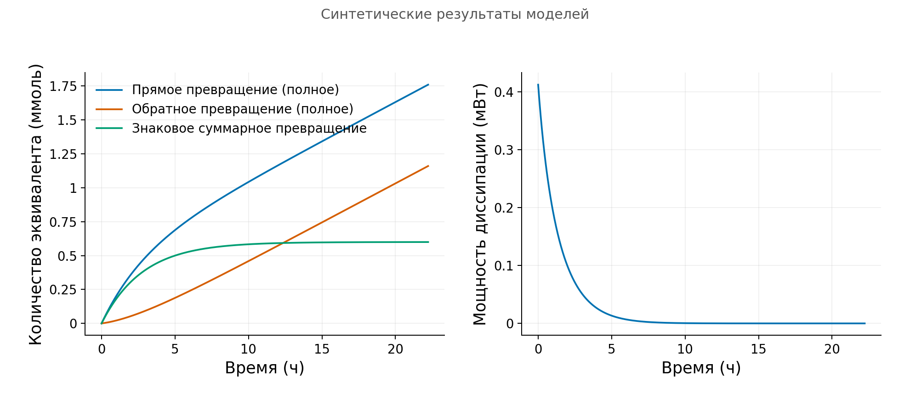

Модель связывает вопрос с тем, что можно наблюдать. Она объясняет, что хранится внутри системы, что пересекает её границу, что превращается и какие детали пока можно опустить. Уравнения делают эти решения проверяемыми. Ниже этот путь показан на четырёх примерах: кислород в осадке, растворённый импульс в потоке, истощение субстрата и обратимое превращение с энергетическим балансом.

Параметры условные, результаты сохранённых расчётов синтетические. Численные проверки относятся к заданным уравнениям. Для проверки реального осадка, ферментного опыта или реакции нужны независимые наблюдения и правило сопоставления, соответствующее расчёту. [Исходники и сопутствующие материалы](#sources-and-companions) приведены в конце.

## Выберите систему и наблюдаемую величину

Начните с вопроса, на который можно ответить. У вопроса «Что управляет экосистемой?» нет единственного измеримого результата. Вопрос «Могут ли диффузия и постоянное потребление объяснить профиль кислорода?» задаёт систему, наблюдение и предполагаемое объяснение.

Сначала нарисуйте границу. Осадок обменивается кислородом с окружением. В герметичной жидкой пробе нет входного и выходного потоков субстрата. Система, закрытая для вещества, может обмениваться теплом с резервуаром. Именно граница определяет члены баланса.

Затем уточните наблюдение. Концентрация в поровой воде, количество вещества на выходе и средняя концентрация за интервал отбора различаются. Датчик усредняет по пространству и времени; численная ячейка обычно делает это по другой области. Сравнивать нужно одну величину на одинаковом пространственном и временном носителе, а не просто две похожие кривые.

## Сначала запас, затем механизм

Если $C$ задана на объём поровой воды, а водонасыщенная пористость $\phi$ постоянна, запас на объём всего осадка равен $\phi C$. В слое толщиной $dx$ на единицу полной площади хранится $\phi C\,dx$. Для потока $F$ через эту площадь:

$$
\frac{\partial(\phi C)}{\partial t}=-\frac{\partial F}{\partial x}+R.
$$

$R$ здесь является знаковым источником на объём осадка. Расходимость потока учитывает разность входа и выхода, отрицательный источник удаляет отслеживаемое вещество. Это учёт, ещё не механизм. Для механизма нужны замыкания: например, закон диффузии и скорость потребления.

В перемешанной жидкости объёма $V_\ell$ количество оставшегося субстрата равно $V_\ell S$. Пористость сюда не входит. Даже размерностно правильное выражение может быть неверным, если смешать скорость на объём жидкости с запасом на объём осадка.

Формулы веществ набираются прямым шрифтом: $\mathrm{O}_{2}$, $\mathrm{SO}_{4}^{2-}$, $\mathrm{CH}_{4}$, $\mathrm{H}^{+}$. Число атомов является нижним индексом, заряд верхним. Переменные $C$ и $S$ набираются курсивом, единицы прямым шрифтом, например $\mathrm{mol\,m^{-3}}$. В энергетическом примере $\mathrm{A}$ и $\mathrm{B}$ обозначают вымышленные эквиваленты. Идентификатор задания и ключ CSV не являются химической формулой.

## Объявите упрощение и способ его проверить

Постоянная диффузия заменяет движение в отдельных порах усреднённым переносом. Фиксированная предельная скорость заменяет изменение ферментов или биомассы одним параметром. Это позволяет выделить вопрос, но опущенные процессы остаются возможными причинами расхождения.

Укажите следствие предположения. При постоянном потреблении первого порядка изменение поверхностной концентрации пропорционально масштабирует кислородный профиль. Рост биомассы может нарушить эту пропорциональность. Одна подвижная водная область с постоянной дисперсией описывает растекание импульса; задержка в неподвижных порах может потребовать ещё одного состояния. Предположение полезно, когда можно проверить его последствия.

## Отделите уравнение от алгоритма

Независимый эталон делает компьютерный результат понятным. Используйте аналитическое решение либо интегрированное скалярное соотношение, решаемое независимо от шага по времени. Граничные и начальные условия должны совпадать с проверяемой задачей. Стационарный эталон проверяет стационарный расчёт, а не является точным переходным решением.

В методе Эйлера назад скорость оценивается на новом конце интервала. Приращение использует фактическую длительность шага, включая укороченный последний шаг. Интерполированный снимок подходит для сравнения графиков, но не становится дополнительным интервалом баланса. Сумма исходных приращений и интеграл методом трапеций по отображённой кривой отвечают на разные вопросы.

Показанные результаты округлены до трёх значащих цифр. Параметры, допуски, формулы и исходные таблицы сохраняют точность. Доля $1.00$ может оставлять малый ненулевой запас. Округлённое равенство не доказывает точное замыкание или полный вынос. Малые ненулевые остатки записаны в научной нотации, а неопределённые значения не заменены нулями.

## Кислород в слое осадка

### Вопрос и концептуальная схема

Могут ли поверхностное снабжение, диффузия и суммарное потребление объяснить профиль растворённого $\mathrm{O}_{2}$? Представьте тёмный, полностью насыщенный водой осадок. Глубина $x$ растёт вниз. Кислород входит сверху, переходит между слоями и исчезает в обобщённом стоке. Нижняя поверхность закрыта.

Наблюдаемая величина $C(x,t)$ измеряется в $\mathrm{mol\,m^{-3}}$ поровой воды. Пористость $\phi$, диффузия с поправкой на извилистость $D_s$ и коэффициент потребления $k$ постоянны. Течение, биотурбационное орошение, фотосинтез, отдельные доноры, продукты и биомасса не представлены. Баланс потерь не различает дыхание и окисление восстановленных веществ и не определяет минерализацию углерода.

### Уравнение и границы

Диффузия переносит кислород по направлению уменьшения концентрации:

$$
\begin{gathered}
F=-\phi D_s C_x,\\
\partial_t(\phi C)=-\partial_x F-\phi kC,\\
C_t=D_sC_{xx}-kC\quad\text{при постоянных коэффициентах}.
\end{gathered}
$$

$D_s$ имеет единицы $\mathrm{m^2\,s^{-1}}$ и не включает множитель пористости. При уменьшении концентрации вниз $C_x<0$, поэтому $F>0$: кислород входит в осадок. Постоянная пористость сокращается в уравнении концентрации, но продолжает масштабировать запас и поток.

Полная постановка:

$$
C(0,t)=C_0\ (t>0),\qquad C_x(L,t)=0,\qquad C(x,0)=0\ (0<x<L).
$$

Фиксированная верхняя концентрация предполагает отсутствие существенного неразрешённого сопротивления у поверхности. Нулевой нижний градиент означает нулевой диффузионный поток. Условие $C(L)=0$ задало бы другой опыт. Мгновенное включение снабжения создаёт разрыв в начальном граничном углу, поэтому по этому запуску нельзя заявлять гладкую временную сходимость.

Параметры: $L=0.03\,\mathrm{m}$, $D_s=10^{-9}\,\mathrm{m^2\,s^{-1}}$, $k=10^{-5}\,\mathrm{s^{-1}}$, $\phi=0.8$, $C_0=0.2\,\mathrm{mol\,m^{-3}}$. Последнее равно $200\,\mu\mathrm{mol\,L^{-1}}$ поровой воды, не литра осадка.

### Эталон и предсказание

Масштаб проникновения $\ell=\sqrt{D_s/k}=0.0100\,\mathrm{m}$ сопоставляет перенос с потреблением. При нулевом накоплении:

$$
C_*(x)=C_0\frac{\cosh((L-x)/\ell)}{\cosh(L/\ell)},\qquad
F_*(0)=\phi C_0\sqrt{D_sk}\tanh(L/\ell).
$$

Дифференцирование проверяет уравнение и обе границы. Интегрирование показывает равенство стационарного входного потока суммарному потреблению. Экспонента для глубокой области не обеспечивает закрытую нижнюю границу конечного слоя.

Аналитическая концентрация у дна равна $19.9\,\mu\mathrm{mol\,L^{-1}}$, входной поток $1.38\,\mathrm{mmol\,m^{-2}\,d^{-1}}$. Порог обнаружения $1\,\mu\mathrm{mol\,L^{-1}}$ не пересекается внутри области $3\,\mathrm{cm}$. При положительном стоке первого порядка нет точного фронта нулевого кислорода. Удвоение $k$ уменьшает $\ell$ в $\sqrt{2}$ раза; удвоение $C_0$ удваивает концентрацию и поток. Это условные следствия выбранного замыкания.

### Расчёт и чтение графика

Сохранённый запуск использует 80 одинаковых ячеек и $\Delta t=1000\,\mathrm{s}$, снимки при $10000$, $100000$, $1000000\,\mathrm{s}$. Конечные объёмы балансируют каждый слой. Верхний поток использует половинное расстояние ячейки, внутренние общие потоки сокращаются в сумме. Метод Эйлера назад оценивает диффузию и сток на новом уровне. Здесь состояния неотрицательны без отсечения, но большой шаг всё равно может быть неточным.


Сначала предскажите: диффузия пополняет поверхностные слои, постоянный сток удаляет кислород. Профиль растёт к стационарному. Этот рост означает накопление; только близко к стационарности вход можно приравнять потреблению. На нулевой глубине не добавлено вымышленное значение. Сульфат и метан не являются связанными состояниями этого расчёта.

Ошибки стационарной сетки при 20, 40, 80, 160 ячейках: $5.07\times10^{-4}$, $1.34\times10^{-4}$, $3.43\times10^{-5}$, $8.68\times10^{-6}\,\mathrm{mol\,m^{-3}}$. Они приближаются ко второму пространственному порядку. Отдельная гладкая дискретная собственная мода даёт первый временной порядок: ошибка уменьшается с $2.50\times10^{-5}$ при $1000\,\mathrm{s}$ до $3.14\times10^{-6}\,\mathrm{mol\,m^{-3}}$ при $125\,\mathrm{s}$.

При фиксированной сетке ошибка относительно непрерывного эталона выходит на плато около $2.20\times10^{-5}\,\mathrm{mol\,m^{-3}}$. Уменьшение шага времени не устраняет пространственную ошибку. Дискретный и непрерывный эталоны нужно различать. Это ограничение исследования сходимости, а не потеря порядка или выдуманный неуспешный запуск решателя.

### Повторить или изучить таблицы

Из `courses/oxygen-diffusion/en`:

```sh
python3 model/oxygen_model.py --out my-run
```

Используйте новый каталог. Без Python откройте `profiles.csv` и `verification.json` в `model/results/`, затем прочитайте `verification-report.md` в `model/`. В таблице можно сравнить концентрации со стационарной формулой и прочитать отдельные сеточные и временные проверки. Это анализ предоставленных результатов, не независимый запуск решателя.

Нормированный стационарный профиль ограничивает $k/D_s$, но не оба параметра отдельно. Одинаковое масштабирование обоих сохраняет форму. Независимый поток или переходный отклик добавляют информацию, если известны поверхностная концентрация, пористость и границы. Перед приписыванием стока микробному пути нужно проверить поверхностное сопротивление и неоднородность.

## Растворённый импульс в потоке

### Вопрос и концептуальная схема

Что означает уменьшение пика: потерю исходного вещества, растекание или его остаток в колонке? Представьте ввод импульса в насыщенную колонку и сбор выходящей воды. Наблюдение включает выходную концентрацию и накопленный вынос. Профиль вещества внутри отвечает на другой вопрос.

В жёсткой одномерной колонке одна подвижная водная область, постоянные $\phi$, скорость поровой воды $u>0$, продольная дисперсия $D_L$, коэффициент исчезновения исходного вещества $k$. Сорбция, неподвижные области, продукты и микробная динамика отсутствуют. Поток Дарси $v_D=\phi u$ отличается от $u$.

### Уравнение и опыт

Течение переносит вещество, дисперсия перераспределяет его:

$$
\begin{gathered}
F=\phi(uC-D_LC_x),\qquad
\partial_t(\phi C)=-\partial_xF-\phi kC,\\
C_t=D_LC_{xx}-uC_x-kC.
\end{gathered}
$$

$C$ относится к поровой воде внутри, $F$ измеряется в $\mathrm{mol\,m^{-2}\,s^{-1}}$ полной площади сечения. $D_L$ уже включает представленное молекулярное и механическое растекание без множителя пористости. Добавлять к нему $D_s$ кислородного примера означало бы повторно учитывать диффузию.

Начальная концентрация нулевая. Вход задаёт известный общий поток, выход допускает адвективный вынос:

$$
\begin{gathered}
F(0,t)=\phi uC_{\mathrm{in}}(t),\qquad C_x(L,t)=0,\\
C_{\mathrm{in}}(t)=C_{\mathrm{ref}}\quad (0\leq t<T_p),
\qquad C_{\mathrm{in}}(t)=0\quad(t\geq T_p).
\end{gathered}
$$

Дополнительно задавать концентрацию внутри у входа нельзя. Потоковая концентрация $C_F=F/(\phi u)$ совпадает с внутренней у этого выхода с нулевым градиентом, но не обязательно внутри колонки. Среднее последней ячейки приближает выходной след, а не является точечным измерением при $L$.

Параметры: $L=1\,\mathrm{m}$, $\phi=0.30$, $u=10^{-5}\,\mathrm{m\,s^{-1}}$, $D_L=10^{-6}\,\mathrm{m^2\,s^{-1}}$, $C_{\mathrm{ref}}=1\,\mathrm{mol\,m^{-3}}$, $T_p=20000\,\mathrm{s}$. Четыре случая: без потерь, с $k=10^{-5}\,\mathrm{s^{-1}}$, без потерь при $2u$, без потерь при $2D_L$. Длительность подачи фиксирована. Быстрый поток удваивает дозу с $0.0600$ до $0.120\,\mathrm{mol\,m^{-2}}$.

### Эталон, баланс и алгоритм

Запас $M=\phi\int_0^L C\,dx$, ввод $I$, вынос $O$, исчезновение $B$ измеряются на полной площади в $\mathrm{mol\,m^{-2}}$:

$$
M(t)-M(0)=I(t)-O(t)-B(t).
$$

Пика недостаточно для установления потерь. Дисперсия снижает пик без удаления вещества, а наблюдение может закончиться до полного выноса. $B$ означает исчезновение отслеживаемого исходного вещества, не доказанную минерализацию или безопасность воды.

Отдельный стационарный эталон постоянной подачи решает $D_LC_*''-uC_*'-kC_*=0$ при тех же границах. Корни удовлетворяют $D_Lr^2-ur-k=0$. Эталонная таблица использует аналитические средние по ячейкам, согласованные с конечными объёмами. Периодический гладкий эталон отдельно выделяет временную ошибку и искусственную дисперсию. Ни один не является точным решением данного импульсного опыта.

Рабочий импульсный расчёт использует 400 ячеек, $\Delta t=100\,\mathrm{s}$, окно $600000\,\mathrm{s}$. Адвекция против потока и Эйлер назад обычно имеют первый порядок. Второй пространственный порядок чистой диффузии нельзя перенести сюда. Приращения ввода учитывают точное пересечение интервала с полуоткрытым окном подачи; вынос и потери используют новый конец:

$$
\Delta O_n=\Delta t_n\phi uC_N^{n+1},\qquad
\Delta B_n=\Delta t_n kM^{n+1}.
$$

Разделение входа на адвекцию и дисперсию является диагностикой половины ячейки из известного общего потока. Оно не задаёт вторую границу и не является измерением состояния у входа.

### Чтение выходных кривых и баланса


Сначала предскажите: быстрое течение сдвигает вынос раньше, дисперсия растягивает его, потери удаляют исходное вещество. Здесь пик является плотностью выноса дозы, не концентрацией. Концентрации приведены ниже. Время общее физическое, но быстрый сценарий получил двойную дозу. Более ранняя медиана реактивного выноса связана с перевзвешиванием выжившего вещества, не изменением скорости воды.

| Случай | Пик ($\mathrm{mol\,m^{-3}}$ воды) | Медиана выноса ($\mathrm{s}$) | Вынос/ввод | Потери/ввод | Запас/ввод |
| --- | ---: | ---: | ---: | ---: | ---: |
| Без потерь | 0.224 | $1.02\times10^5$ | 1.00 | 0 | $2.71\times10^{-7}$ |
| С потерями | 0.108 | $8.97\times10^4$ | 0.398 | 0.602 | $7.66\times10^{-10}$ |
| Быстрый поток | 0.517 | $5.80\times10^4$ | 1.00 | 0 | $9.62\times10^{-25}$ |
| Большая дисперсия | 0.193 | $9.68\times10^4$ | 1.00 | 0 | $3.25\times10^{-5}$ |

Каждая доля относится к собственной дозе. Медиана и $t_{10},t_{90}$ условны на массу, вышедшую в конечном окне. Временная ширина имеет единицы секунд, пространственная ширина оставшегося вещества метры. Их нельзя обозначать одной осью. Вынос $1.00$ после округления не означает точный полный выход.

Столбцы замыкают учёт конечного окна: в реактивном случае исчезает около 60.2% поданного исходного вещества, остаток намного меньше. Остальные случаи сохраняют малый ненулевой запас. Потери не определяют продукт. Для восстановления всей истории используйте полные интервальные приращения; трапеции по отображённой кривой не воспроизводят исходный баланс Эйлера назад.

Независимые сеточные и временные сравнения прошли заявленные масштабированные цели 2% для профиля, пика и времени и абсолютное изменение долей $0.005$. Первое окно $400000\,\mathrm{s}$ оставляло слишком большой запас при высокой дисперсии относительно цели $0.001$. Расширение до $600000\,\mathrm{s}$ и проверка $800000\,\mathrm{s}$ устранили это ограничение. Первый периодический вспомогательный расчёт также не прошёл: сборка циклической матрицы перепутала адвективные угловые коэффициенты. Ошибка и исправленный эталон сохранены; решатель конечной колонки использовал другой, незатронутый путь. Допуски не ослаблялись.

### Повторить или изучить таблицы

Из `courses/advection-dispersion/model`:

```sh
python3 verify_advection.py --out reproduced-results
```

Без Python используйте `results/scenario-summary.csv`, полные импульсные балансы, профили, `model-interface.md`, `no-python-readback.md`. Суммируйте предоставленные приращения и сравнивайте запас с интегралом профиля, различая поровую воду и полную площадь.

Восемь выходных наблюдений являются синтетическими средними по интервалам без шума из более мелкой сетки. Три кандидата меняют только $k$ при известном переносе и вводе. Даже кандидат с правильным $k$ имеет малый ненулевой остаток из-за различной сетки. Это не полевая калибровка, оптимизатор или доверительный интервал. Независимый консервативный трассер и согласованный отбор могли бы проверить перенос до приписывания ослабления реакции.

## Истощение субстрата при фиксированной предельной скорости

### Вопрос и концептуальная схема

Когда исчезновение почти постоянно, а когда пропорционально остатку? Рассмотрим закрытую перемешанную жидкость с постоянной перерабатывающей способностью. $S$ является доступным растворённым субстратом на объём жидкости. Вход, выход, пористость и перенос отсутствуют.

Приближение Михаэлиса-Ментен описывает ферментный механизм при определённых предположениях; эмпирическая зависимость Моно $\mu(S)$ описывает удельный рост биомассы, $\mu=d\ln X/dt$ при $X>0$, в $\mathrm{s^{-1}}$. Ферментная схема различает свободный и связанный субстрат. Одинаковая форма насыщения не делает эти наблюдения эквивалентными. $q_{\max}$ здесь предельная скорость истощения, не скорость роста или объём. Рост, поддержание, энергетическая регуляция и адаптация ферментов отложены.

### Уравнение и независимый эталон

При постоянном $V_\ell$, положительных $K$ и $q_{\max}$:

$$
\begin{gathered}
q(S)=q_{\max}\frac{S}{K+S},\qquad \frac{dS}{dt}=-q(S),\\
\frac{dZ}{dt}=q(S),\qquad S(0)=S_0,\ Z(0)=0.
\end{gathered}
$$

$S,K,Z$ измеряются в $\mathrm{mol\,m^{-3}}$ жидкости, $q_{\max}$ в $\mathrm{mol\,m^{-3}\,s^{-1}}$. $Z$ учитывает истощённые эквиваленты. Баланс $V_\ell(S+Z)=V_\ell S_0$ не задаёт стехиометрию продуктов или биомассы.

Разделение переменных даёт:

$$
S_0-S+K\ln(S_0/S)=q_{\max}t,\qquad
 t_f=\frac{S_0(1-f)+K\ln(1/f)}{q_{\max}},\quad 0<f<1.
$$

Аргумент логарифма безразмерен. Положительное $K$ сохраняет положительный аналитический хвост при любом конечном времени. Поэтому истощение требует порога. Независимый эталон делит пополам интегрированное уравнение в $y=\ln(S/S_0)$; критерии невязки и логарифмической скобки равны $10^{-12}$. Он независим от временных шагов.

Входы: $V_\ell=10^{-3}\,\mathrm{m^3}$, $K=0.1\,\mathrm{mol\,m^{-3}}$, $q_{\max}=10^{-5}\,\mathrm{mol\,m^{-3}\,s^{-1}}$. Низкий и высокий старты имеют $S_0/K=0.01$ и $100$. Переходный старт при $1$ служит дополнительной проверкой. Каждая траектория заканчивается при собственном аналитическом $t_{0.01}$, поэтому длительности различаются.

### Предсказание и численный расчёт

При малом субстрате $q\approx(q_{\max}/K)S$, при большом $q\approx q_{\max}$. Относительное завышение мгновенной скорости равно соответственно $S/K$ и $K/S$. Для 5% нужны $S/K\leq0.05$ или $S/K\geq20$. Это ограничение скорости, не ошибки всей траектории. Высокий старт заканчивается при $S=K$, до линейного режима с ошибкой 5%.

Эйлер назад решает положительный корень $S_{n+1}+\Delta t_nq(S_{n+1})=S_n$. Независимое приращение истощения $\Delta B_n=V_\ell\Delta t_nq(S_{n+1})$ накапливается отдельно и сравнивается с оставшимся количеством. Нельзя определять накопленный баланс только как начальное минус оставшееся.

Принятый шаг $100\,\mathrm{s}$. На каждое окно приходится 401 снимок с явно обозначенной интерполяцией конечных состояний. Времена событий сохраняют охватывающие интервалы и отдельное фиксированное расширение окна. Неопределённые или цензурированные пороги не являются нулями. Большие вспомогательные шаги включают фактически укороченные интервалы: они проверяют положительность и область определения, не рабочую точность.

### Чтение скорости и траекторий


Сначала предскажите: малый субстрат даёт изогнутый хвост, высокий сначала расходуется почти с постоянной скоростью. При $S=K$ скорость равна половине предельной. Это само по себе не измеряет сродство фермента, константу диссоциации или ростовое полунасыщение.

Окна составляют $T=4.62\times10^4$ с и $T=1.04\times10^6$ с. Одинаковое $t/T$ означает одинаковую долю разных физических окон. Конец каждой траектории равен 1% собственного начала; для высокой это $S=K$, а не 5% линейный режим. Близкие численная и штриховая эталонная кривые не доказывают точного совпадения. Расширение для пороговых событий на графике отсутствует.

Ошибка низкой траектории на снимках, делённая на $S_0$, равна $0.00723$ при $400\,\mathrm{s}$, выше цели $0.005$. При $200$ и $100\,\mathrm{s}$ она равна $0.00363$, $0.00182$. Переходный случай при $400\,\mathrm{s}$ проходит траекторный критерий, но не события и уточнение; высокий проходит эти грубые проверки. Не следует объявлять все грубые случаи неуспешными. Баланс и неотрицательность могут пройти при неверной точности. Нормирование на начальный субстрат не гарантирует относительную точность малого хвоста.

### Повторить или изучить таблицы

Из `courses/saturation-kinetics/model`:

```sh
python3 saturation.py new-results
```

Без Python распакуйте `saved-results.zip`, изучите CSV скорости, порогов и уточнения, следуйте README с полным пошаговым балансом. Для приращений нужны фактические интервалы и новые конечные скорости. В выбранном бланке последние строки не последовательны: накопленная сумма требует всех промежуточных приращений. Открытые решения предназначены для сравнения после первой попытки.

Низкие концентрации в основном ограничивают $q_{\max}/K$, высокие предельную скорость. Переходная область помогает различить параметры при условии постоянной способности и известного наблюдения. Даже ферментная интерпретация $k_{\mathrm{cat}}E_T$ не разделяет два множителя. Временные измерения субстрата и независимая проверка стабильности способности могли бы оспорить замыкание. Растущая культура требует другой модели состояний.

## Обратимое превращение и энергетический баланс

### Вопрос и концептуальная схема

Может ли система быстро обменивать молекулы без результирующей движущей мощности? Вымышленные нейтральные состояния $\mathrm{A}\rightleftharpoons\mathrm{B}$ несут по одному эквиваленту. Идеальная разбавленная перемешанная система закрыта для вещества. Резервуар фиксирует $T$, давление постоянно. Постоянный объём жидкости является приближением несжимаемости и равных объёмов растворённых состояний, не жёстким сосудом при фиксированных $T,V$.

Наблюдаем $c_{\mathrm{A}},c_{\mathrm{B}}$ на объём жидкости и количества $n_i=V_\ell c_i$. Энергия на запись реакции, полная доступная энергия и мощность различаются. Устройство извлечения работы, организм, механизм ATP и природная редокс-сеть отсутствуют.

### Эталон Гиббса и закон скорости

Для записанного прямого превращения используются химические величины без штриха:

$$
\begin{gathered}
a_i=c_i/c^\circ,\quad Q=a_{\mathrm{B}}/a_{\mathrm{A}},\quad
\Delta_rG^\circ=-RT\ln K_{\mathrm{eq}},\\
\Delta_rG=RT\ln(Q/K_{\mathrm{eq}}).
\end{gathered}
$$

Активности, $Q$, $K_{\mathrm{eq}}$ безразмерны. $\Delta_rG$ имеет единицы $\mathrm{J\,mol^{-1}}$ записанной реакции. Общая стандартная концентрация сокращается в отношении один к одному. Биохимическая преобразованная конвенция требует своих $Q'$ и резервуаров. Нельзя просто поставить штрих или дважды учесть протонный резервуар.

Прямые скорости и их знаковая разность:

$$
\begin{gathered}
r_+=k_fc_{\mathrm{A}},\quad r_-=k_rc_{\mathrm{B}},\quad r=r_+-r_-,\\
\dot c_{\mathrm{A}}=-r,\quad\dot c_{\mathrm{B}}=r,\quad
k_f/k_r=K_{\mathrm{eq}},\quad \lambda=k_f+k_r.
\end{gathered}
$$

Детальный баланс согласует кинетическое и термодинамическое равновесия. Энергия ограничивает направление, не задаёт скорость. Изменение $\lambda$ при фиксированном $K_{\mathrm{eq}}$ меняет скорость релаксации, не равновесное отношение.

Начальная сумма $C_{\mathrm{tot},0}=c_{\mathrm{A}0}+c_{\mathrm{B}0}$ определяет:

$$
\begin{gathered}
c_{\mathrm{B,eq}}=C_{\mathrm{tot},0}K_{\mathrm{eq}}/(1+K_{\mathrm{eq}}),\\
c_{\mathrm{B}}(t)=c_{\mathrm{B,eq}}+(c_{\mathrm{B}0}-c_{\mathrm{B,eq}})e^{-\lambda t},\\
c_{\mathrm{A}}(t)=C_{\mathrm{tot},0}-c_{\mathrm{B}}(t).
\end{gathered}
$$

Это независимый эталон концентрации. Нетто-степень $\xi=\Xi_+-\Xi_-$ меняет запас, валовые $\Xi_\pm=V_\ell\int r_\pm\,dt$ продолжают расти при непустом равновесии. Постоянные равновесные концентрации не измеряют обмен и не определяют $\lambda$; нужны трассерные или обменные наблюдения.

### Полная доступная энергия и мощность

Относительная доступная энергия Гиббса в J:

$$
G_{\mathrm{ex}}=RTV_\ell\sum_{i=\mathrm{A},\mathrm{B}}
\left[c_i\ln(c_i/c_{i,\mathrm{eq}})-c_i+c_{i,\mathrm{eq}}\right].
$$

Численная диагностика использует прямое выражение с компенсированным суммированием и равновесие из начальной суммы. Пересчёт равновесия из дрейфующей численной суммы скрывал бы ошибки вещества. Независимая бинарная проверка использует точно сохраняемую сумму.

Вдоль точного баланса:

$$
P_{\mathrm{diss}}=-V_\ell r\Delta_rG\geq0,\qquad
\frac{dG_{\mathrm{ex}}}{dt}=-P_{\mathrm{diss}}.
$$

Мощность измеряется в W. $D(t)=G_{\mathrm{ex}}(0)-G_{\mathrm{ex}}(t)$ является рассеянной доступной энергией в J. Оставшаяся доступность ограничивает обратимую работу без расширения до того же равновесия с теми же резервуарами. Она и её снижение не являются измеренным теплом, полученным ATP или ростовым выходом. Запись $2\mathrm{A}\rightleftharpoons2\mathrm{B}$ удваивает энергию на реакцию и уменьшает скорость степени превращения вдвое; физическая мощность и кинетический порядок не меняются.

### Сохранённый расчёт и шаг

Входы: $T=298.15\,\mathrm{K}$, $p=100000\,\mathrm{Pa}$, $V_\ell=0.001\,\mathrm{m^3}$, $c^\circ=1000\,\mathrm{mol\,m^{-3}}$. Также $K_{\mathrm{eq}}=4$, $\lambda=10^{-4}\,\mathrm{s^{-1}}$. Заданная газовая постоянная $R=8.31446261815324\,\mathrm{J\,mol^{-1}\,K^{-1}}$.

Следовательно, $k_f=8\times10^{-5}$, $k_r=2\times10^{-5}\,\mathrm{s^{-1}}$. Непустая начальная сумма равна $1\,\mathrm{mol\,m^{-3}}$. Начальные доли B прямого, обратного, равновесного случаев: $0.2$, $0.95$, $0.8$; конец при $80000\,\mathrm{s}$. Старты только A, только B, пустая система и укороченный шаг являются вспомогательными контролями. Всего семь случаев.

Эйлер назад независимо обновляет обе концентрации при фактическом шаге $h$:

$$
\begin{gathered}
c_{\mathrm{A,new}}=
\frac{(1+hk_r)c_{\mathrm{A,old}}+hk_rc_{\mathrm{B,old}}}{1+h\lambda},\\
c_{\mathrm{B,new}}=
\frac{hk_fc_{\mathrm{A,old}}+(1+hk_f)c_{\mathrm{B,old}}}{1+h\lambda}.
\end{gathered}
$$

Независимые валовые приращения: $V_\ell hk_fc_{\mathrm{A,new}}$, $V_\ell hk_rc_{\mathrm{B,new}}$. Их разность сравнивается с изменениями обоих количеств. Конечная оценка $W_{\mathrm{end}}=hP_{\mathrm{diss,new}}$ удовлетворяет $G_{\mathrm{ex,old}}-G_{\mathrm{ex,new}}\geq W_{\mathrm{end}}$ в точной арифметике. Разрыв является диагностикой дискретизации, не дополнительной биологической энергией. Телескопическая сумма падений сама не проверяет точность энергии.

Первый конец прямого шага $100\,\mathrm{s}$: $c_{\mathrm{B}}=0.206\,\mathrm{mol\,m^{-3}}$, $G_{\mathrm{ex}}=2.02\,\mathrm{J}$, $P_{\mathrm{diss}}=4.03\times10^{-4}\,\mathrm{W}$. Падение за интервал $0.0406\,\mathrm{J}$, конечная оценка $0.0403\,\mathrm{J}$, разрыв $2.69\times10^{-4}\,\mathrm{J}$. Для вычитания берите исходную точность баланса, не округлённые подписи.

### Чтение состояния и энергии


Сначала предскажите: A уменьшается, B растёт, сумма остаётся постоянной. Начальная доступность 2.06 J теряется при приближении к равновесию. Две энергетические кривые разделяют её учёт, не показывают устройство получения работы. Обратный старт приближается к тому же равновесию с другой стороны в отдельном сохранённом случае.



Валовые превращения растут, пока изменение запаса выходит на предел. Это рассчитанный равновесный обмен, которого концентрации сами не наблюдают. Начальная мощность 0.412 mW убывает к нулю. Мощность и доступная энергия имеют разные панели и единицы. Не складывайте валовое и нетто-превращения и не читайте энергию как ATP или измеренное тепло. Перекрывающиеся кривые могут не пройти критерий точности, поэтому проверки используют согласованные носители.

Реальная исправленная история: $400\,\mathrm{s}$ не проходит, $200\,\mathrm{s}$ проходит, фиксированный $100\,\mathrm{s}$ проходит. Нормированные на амплитуду ошибки прямых снимков: $0.00731$, $0.00365$, $0.00183$ при цели $0.005$. Шаг $100\,\mathrm{s}$ является заранее принятой политикой, не самым крупным успешным. Первоначальное отклонение граничного носителя и ошибки округления тонких равновесных сеток сохранены. Относительная точность произвольно малого хвоста не обещана.

При старте только A отношение $Q=0$, но энергия реакции и начальная мощность не имеют конечного значения. При старте только B $Q$ тоже не определено. Доступность конечна через предел $0\ln0=0$, который не делает логарифмическую силу конечной. Первый положительный конец имеет конечную мощность; оценка использует её и свой интервал, не предыдущий null или выдуманный ноль. В пустой ветви количества и доступность нулевые, $Q$, сила и мощность остаются null. Пустота не является измерением равновесия. Добавление epsilon недопустимо.

### Повторить или изучить таблицы

Из `courses/energy-constraints/model`:

```sh
python3 run.py --output fresh-results
```

Без Python распакуйте `saved-results.zip`. В каталоге `results-r2/` находятся четыре семейства: `case-settings.csv`, `step-ledger.csv`, `comparison.csv`, `verification.csv`. Бланк и открытые решения относятся только к первым двум последовательным прямым интервалам. Фактические интервалы, состояния, устойчивая доступность и конечная мощность позволяют независимо проверить количества и валовые приращения. Начальные поля без интервала оставьте null, реальные начальные валовые суммы нулевыми. Не суммируйте выбранные строки через пропуски и не восстанавливайте валовой обмен из конечных запасов.

Реальная проверка потребовала бы временных концентраций при известных резервуарах и отдельных наблюдений обмена. Для тепла нужен тепловой или энтальпийный баланс, его нельзя сравнить напрямую с падением Гиббса. ATP и рост требуют дополнительных сопряжённых механизмов. Переименование A/B в природные вещества их не добавляет.

## Используйте график для проверки предсказания

До чтения кривой сформулируйте направление изменения и причину. Кислород зависит от диффузии и потребления; колонка от переноса, дозы и потерь; насыщенная проба от способности и субстрата; обратимая реакция от скорости релаксации и равновесного движущего фактора. Тогда график проверяет рассуждение.

Читайте оси раньше формы: единицы, объёмную или площадную базу, линейный или логарифмический масштаб, время, пространственное усреднение и тип кривой. Численное состояние, аналитический эталон, схема и наблюдение различаются. Для скрытой ошибки нужен отдельный масштаб. Отрезок между сохранёнными точками не добавляет измеренных данных.

Численная проверка спрашивает, решает ли реализация свои уравнения. Калибровка ищет параметры для выбранных данных. Выводы требуют выяснить, что эти данные различают. Валидация сопоставляет предсказания с независимыми наблюдениями. Одно не заменяет другое. Неуспех полезен, если указывает на границу, правило наблюдения или пропущенный процесс, которые можно исследовать.

## Источники и сопутствующие материалы {#sources-and-companions}

Это условные модельные расчёты, не измеренные экологические или физиологические данные. CSV полной точности, настройки и команды доступны отдельно. Округление не меняет уравнения, параметры, критерии или результаты. Попробуйте сначала прочитать баланс и график самостоятельно, затем сравните с открытыми решениями.

- [Кислород: модель и полные результаты](https://github.com/pycckuu/the-book/tree/1ac8a01aab51028cb75ad4a243f4312e1befdc35/courses/oxygen-diffusion/en/model), сеточные и временные проверки, эталон конечной области.
- [Адвекция и дисперсия: модель и полные результаты](https://github.com/pycckuu/the-book/tree/1ac8a01aab51028cb75ad4a243f4312e1befdc35/courses/advection-dispersion/model), балансы конечного окна, носители наблюдений, сохранённая история неуспехов.
- [Насыщение: модель и архив](https://github.com/pycckuu/the-book/tree/1ac8a01aab51028cb75ad4a243f4312e1befdc35/courses/saturation-kinetics/model); [научное объяснение с именованными первоисточниками](https://github.com/pycckuu/the-book/blob/1ac8a01aab51028cb75ad4a243f4312e1befdc35/courses/saturation-kinetics/en/scientific-reading.md).
- [Обратимая энергетическая модель и архив](https://github.com/pycckuu/the-book/tree/04b31e17ef9a9a3734c9549e83d6a0b1cea44692/courses/energy-constraints/model), граничные null, независимые эталоны, фактическое уточнение.
- [Исправленные химическая и преобразованная конвенции Гиббса](https://github.com/pycckuu/the-book/blob/e39402c05fe22473009cb1e6bb57097a9ab42680/chapters/01-budget-of-the-universe.md). Термодинамическая постановка следует [IUPAC-IUBMB, Recommendations for nomenclature and tables in biochemical thermodynamics (1994)](https://doi.org/10.1351/pac199466081647) и [Rao and Esposito, Nonequilibrium Thermodynamics of Chemical Reaction Networks (2016)](https://doi.org/10.1103/PhysRevX.6.041064).

Ссылки закрепляют точные исходные ревизии, включая открытые изменения сопутствующих материалов. Они не означают выпуск новой полной редакции книги. Независимые полевые наблюдения и попытки учащихся для этих примеров не предоставлены.
