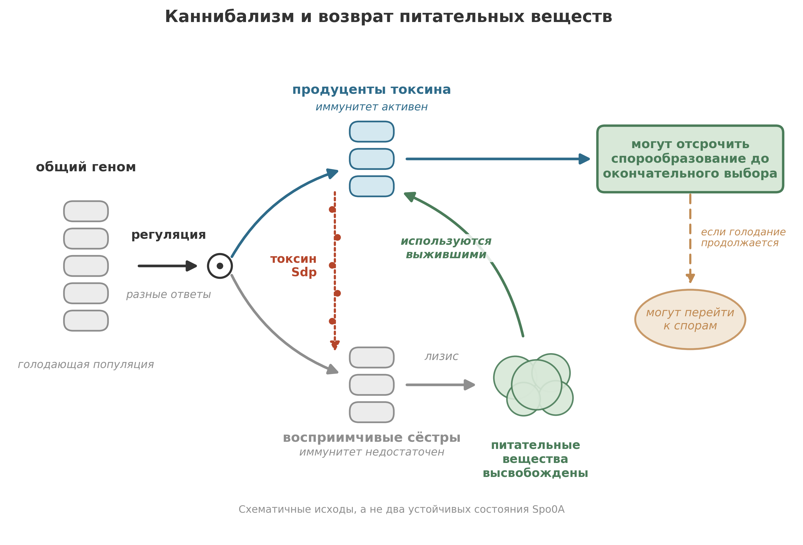

Популяция *Bacillus subtilis* голодает. Вместо того чтобы умереть вместе, часть клеток убивает некоторых из своих сестёр и питается ими. Молекулярный механизм этой стратегии принадлежит к числу самых подробно описанных форм социального поведения в микробиологии, и он далеко не единственный.

Энергетический баланс подвёл нас к вопросу о поведении: продолжают ли соседние клетки выполнять одни и те же реакции, когда питательных веществ становится мало? Они могут менять потребление и выделение веществ, расти или переходить в устойчивое состояние. Эти ответы меняют скорости, которые позднее войдут в наши модели.

Ответ важен для всего, что последует дальше. Эукариотические клетки, из которых в итоге возникли животные, растения и грибы, появились не из одной удачной мутации. Они возникли из слияний, а слияния проще закрепляются в мире, уже полном социальных взаимодействий: общения, эксплуатации и иногда договорных перемирий между бывшими врагами. Прежде чем рассказать эту историю (в следующей главе), нужно понять социальный мир, который сделал её возможной.

## Рождение альтруизма

Кооперативное поведение (общие общественные блага, согласованная экспрессия генов, программируемая клеточная смерть, приносящая пользу соседям) встречается у далёких друг от друга бактериальных линий.[^social_evolution] Проще всего объяснить такое распределение тем, что кооперация древняя или многократно возникала заново под сходным давлением отбора. Она записана в поведении современных бактерий, которые до сих пор несут молекулярные наборы инструментов того социального мира.

Основа микробной социальной жизни: химическая коммуникация. Бактерии выделяют в среду малые молекулы, сигналы, которые расходятся наружу и улавливаются соседними клетками. Через этот химический «диалог» микроорганизмы сообщают о своём состоянии и влияют на поведение соседей.[^social_evolution] Сигналы не просто шум. Они кодируют информацию: *Я голодаю*. *Я делюсь надвое*. *Нас здесь много*. *Нас мало*.

И из этих сигналов возник образец, который функционально выглядит как альтруизм: способность жертвовать собственными интересами ради общего блага.[^social_evolution]

Слово «альтруизм» заставляет биологов нервничать, когда его применяют к бактериям, и вполне справедливо. Бактерия не «решает» быть щедрой. Она несёт генетические схемы, которые при определённых условиях заставляют её производить затратные общественные блага или умирать, чтобы соседи могли питаться. Альтруизм закодирован, а не выбран. Но функциональный итог тот же: отдельные клетки несут издержки, снижающие их приспособленность, ради выгоды группы. А эволюционная логика, поддерживающая такое поведение, на удивление изощрённа.

Чтобы увидеть, насколько изощрённа, представьте один вид, который умеет отращивать жгутики и плавать, собираться в стаи, общаться с помощью чувства кворума, делить общественные блага, строить крепости из спор и, когда всё остальное не помогает, убивать значительную часть собственной популяции. Этот вид: *Bacillus subtilis*.

## *Bacillus subtilis*: бактерия, которая умеет всё

*Bacillus subtilis* представляет собой почвенную бактерию, грамположительную палочку, которую изучают в лабораториях больше века. Она была одной из первых бактерий с секвенированным геномом.[^kunst_genome] Это рабочая лошадка бактериальной генетики, «*E. coli* грамположительного мира». И всё же десятилетиями большая часть этих исследований велась на сытых клетках в колбах на лабораторной качалке, в условиях, где *B. subtilis* ведёт себя как простое одиночное существо из учебной картинки.

Выньте её из колбы. Поместите в почву, на поверхность корня, в биоплёнку или в колонию на агаре, где питательные вещества на исходе. Теперь она преображается.

Когда условия того требуют, *B. subtilis* может отрастить жгутики и приобрести подвижность, плывя к питательным веществам или прочь от токсинов. Она может собираться в организованные «стаи» с согласованным движением. Она может выделять ферменты, расщепляющие сложные молекулы в среде, а это затратные вложения, от которых выигрывают все ближайшие клетки, а не только производитель. Она может образовывать биоплёнки: плотные структурированные сообщества, заключённые в самостоятельно произведённый матрикс из белков и полисахаридов.[^flemming_biofilm] И она может «принимать решения», точнее, её генетические схемы могут переключать её в различные формы поведения на основе химических сигналов от родственников.[^social_evolution]

Один из механизмов бактериальной координации называют **чувством кворума**: клетки производят сигнальные молекулы, или аутоиндукторы, и обнаруживают их с помощью регуляторных цепей.[^quorum_sensing_review][^bassler_bacterial] Пороговый ответ может согласовывать поведение. Концентрация зависит от образования и потерь сигнала, а также от плотности клеток, поэтому образ голосования описывает локальную координацию, а не буквальную перепись.

::: {.callout-note}
## Врезка: как работает чувство кворума

Чувство кворума не сводится к одной системе. Разные виды бактерий используют разные сигнальные молекулы, разные рецепторы и разные последующие регуляторные цепи. Но базовая логика общая:

1. **Образование сигнала**: Клетки-продуценты выделяют аутоиндукторы; их образование тоже может регулироваться.
2. **Накопление сигнала**: Местная концентрация зависит от образования и потерь, включая диффузию и перенос потоком. Плотность клеток представляет один из факторов.
3. **Обнаружение сигнала**: Рецепторы отвечают на местную концентрацию сигнала через регуляторную цепь.
4. **Согласованный ответ**: В зависимости от системы ответ может менять образование биоплёнки, продукцию токсина, спорообразование или другие процессы.

Связь образования сигнала с ответом позволяет координировать поведение без центрального управления. Насколько точно концентрация отражает плотность клеток, зависит от сигнальной системы и её среды.

Метафора голосования передаёт логику плотностно-зависимой координации, но упрощает её: реальные концентрации автоиндукторов отражают не только число клеток, но также геометрию диффузии, режим течения и пространственное расположение производителей. В работе Redfield это названо «чувством диффузии», а не чувством кворума.[^redfield_qs]
:::

Благодаря чувству кворума и другим регуляторным схемам популяции *B. subtilis* могут строить структурированные сообщества, где не каждая клетка выполняет одну и ту же работу.

Самое драматичное социальное поведение *B. subtilis*: каннибализм.

## Стратегия каннибализма

Представьте популяцию *B. subtilis* в почве. Питательные вещества убывают уже несколько часов. Клетки уже испробовали очевидные ответы: усилили секрецию ферментов, чтобы собрать остатки, перестроили метаболические пути, замедлили рост. Ничего не помогло. Голод теперь тяжёлый.

Спорообразование даёт возможность пережить длительное голодание. Спора *B. subtilis* устойчива к нагреванию, высыханию, ультрафиолету и химическому воздействию и может прорасти при улучшении условий.[^setlow_spore] Но перед переходом в это устойчивое состояние некоторые клетки могут выиграть время, питаясь восприимчивыми к токсину соседями.

Но спорообразование затратно.

Решение перейти к образованию споры не принимается легко. Спорообразование требует согласованного контроля над более чем сотней генов на протяжении нескольких часов.[^stragier_sporulation] Процесс включает полную перестройку клетки: асимметричное деление, дающее меньшую предспору и большую материнскую клетку, затем поглощение предспоры материнской клеткой, сборку многослойной защитной оболочки и, наконец, программируемую гибель материнской клетки, высвобождающую зрелую спору. Момент необратимого перехода к спорообразованию определяется стадией развития, а не универсальным двухчасовым отсчётом. Эксперименты с восстановлением питательных веществ относят его к моменту после асимметричного деления, причём компартмент-специфичная экспрессия генов помогает не допустить возврата к обычному росту.[^sporulation_commitment]

Учитывая такие вложения времени и энергии, неудивительно, что *B. subtilis* считает спорообразование крайней мерой. Перед окончательным выбором клетка исчерпывает все альтернативы. Она ищет новые питательные вещества. Она перестраивает метаболизм. Она ждёт.

А затем, как предпоследнюю меру, шаг прямо перед окончательным, необратимым переходом к образованию споры, она обращается к каннибализму.

{#fig-cannibalism}

Вот как это работает.[^ellermeier_cannibalism]

Когда голод активирует главный регулятор спорообразования, транскрипционный фактор Spo0A, происходит неожиданное: его активность не растёт равномерно по популяции. Клетки различаются тем, когда и насколько сильно они отвечают. Эксперименты, прослеживающие гены, отвечающие на Spo0A, показывают широкий разброс, иногда непрерывный, а не две резко разделённые группы. Активная форма, Spo0A~P, важна, но разброс клеточного ответа сам по себе не свидетельствует о переключателе с двумя устойчивыми состояниями (бистабильном переключателе).[^spo0a_heterogeneity]

Клетки с достаточной активностью Spo0A, чтобы включить программу каннибализма, начинают вырабатывать **SdpC**, предшественник секретируемого токсина. Это может происходить раньше, чем достигается более высокая активность, нужная для включения ранних генов спорообразования. Восприимчивые сёстры без достаточного иммунитета убиваются и лизируются; их клеточное содержимое изливается в окружающую среду, высвобождая питательные вещества, которыми голодающая клетка может воспользоваться.[^spo0a_thresholds][^ellermeier_cannibalism]

Убийцы поедают мёртвых.

Питательные вещества, высвобожденные лизированными клетками, поглощает выжившая популяция, вырабатывающая токсин. Питаясь останками своих сестёр, каннибалы могут отсрочить спорообразование и, если питательные вещества вернутся до окончательного выбора, возобновить рост.[^ellermeier_cannibalism]

Система каннибализма требует точного ответа на смертельно опасный вопрос: как клетке, вырабатывающей токсин, не убить себя? Ответ: трёхбелковый сигнальный путь, связывающий воздействие токсина с иммунитетом. Токсин, производный от SdpC (здесь для краткости называемый SdpC), вырабатывается клетками с активным Spo0A до окончательного выбора. Мембранный белок SdpI защищает клетку от токсина. Репрессор SdpR ограничивает транскрипцию генов иммунитета, когда сигнала токсина нет.[^ellermeier_cannibalism]

Элегантный поворот: SdpI не только белок иммунитета, но и белок сигнальной трансдукции. Эксперименты поддерживают модель, в которой воздействие токсина позволяет SdpI связывать SdpR на мембране, снимая репрессию и усиливая иммунитет. Предполагаемые прямые белковые контакты не были установлены. Есть и второй замок: Spo0A снимает репрессию со стороны другого регулятора, AbrB. Воздействие токсина и снятие этой репрессии вместе разрешают ответ; восприимчивость не сводится просто к тому, что непроизводящие клетки реагируют слишком медленно.[^ellermeier_cannibalism]

Чтобы эта стратегия помогала, токсин должен достичь восприимчивых соседей, а высвобожденные питательные вещества должны достичь выживших. Поэтому могут иметь значение локальная теснота и физическая среда. Однако эксперименты с токсином и иммунитетом устанавливают механизм, а не универсальную минимальную плотность популяции и не энергетический порог окупаемости каннибализма.[^ellermeier_cannibalism]

Подсчёт на уровне популяции суров. Разные ответы на голод, связанные с выработкой токсина и иммунитетом, могут разделить популяцию на убийц и жертв. Выжившие выигрывают время, перерабатывая материал своих сестёр. Если новые питательные вещества придут до окончательного выбора, рост может возобновиться. Если нет, спорообразование остаётся крайней мерой. Для такого разделения исходов не требуется предполагать два устойчивых состояния Spo0A.[^ellermeier_cannibalism][^spo0a_heterogeneity]

## *Myxococcus xanthus*: социальные хищники

*Bacillus subtilis* ест своих. *Myxococcus xanthus* ест всех остальных, и делает это сообща.

*Myxococcus xanthus* является лучше всего изученным видом почвенных миксобактерий, группы, отличающейся двумя замечательными свойствами: кооперативным хищничеством и социальным развитием.[^berleman_predation][^kaiser_fruiting] Там, где большинство хищных бактерий действуют поодиночке (одна клетка встречает одну жертву), *M. xanthus* охотится стаей.

Хищничество осуществляют роящиеся группы клеток, выделяющие токсичные и литические метаболиты: антибиотики, ферменты и другие соединения, убивающие и разлагающие организмы-жертвы.[^berleman_predation] Убивающие агенты диффундируют наружу от роя, создавая зону разрушения вокруг наступающей стаи. Клетки жертвы лизируются, и их содержимое образует внеклеточный общий пул питательных веществ, которым пользуется весь рой. Ни одна отдельная клетка *M. xanthus* не смогла бы произвести достаточно антибиотиков или литических ферментов, чтобы эффективно убивать жертву в одиночку. Хищническая стратегия работает лучше всего, когда издержки делятся, а выгоды объединяются.

Это кооперативное хищничество в полном смысле слова: охотничье поведение, зависящее от размера группы, согласованного движения и выработки внеклеточных общественных благ.

Но социальная жизнь *M. xanthus* не заканчивается кормлением. Когда аминокислот становится мало, то есть когда охота не удалась или жертва исчерпана, *M. xanthus* вступает в свою самую драматичную фазу: строительство плодовых тел.[^kaiser_fruiting]

При нехватке аминокислот отдельные клетки начинают собираться вместе. Они стекаются к центральным точкам сбора, громоздясь в холмики, которые вырастают в сложные, характерные для вида структуры: плодовые тела. Типичное плодовое тело *M. xanthus* содержит около 100 000 клеток, собранных благодаря согласованному движению и обмену межклеточными химическими сигналами.[^kaiser_fruiting][^kaiser_c_signal]

Внутри плодового тела часть клеток дифференцируется в стрессоустойчивые споры, миксобактериальный аналог эндоспоры *B. subtilis*. Но вот суровая арифметика: **многие клетки погибают в ходе развития**. В одном лабораторном исследовании большинство клеток лизировалось, а некоторые выжившие остались неагрегировавшими периферическими палочками, не став спорами. Содержимое лизированных клеток, по-видимому, помогает питать выживших.[^ch06_lee_cell_fates]

Доступ к ограниченному числу мест для спор внутри плодового тела составляет ключевую часть приспособленности в ходе развития, поэтому важны обманщики в развитии.[^fiegna_myxo] Если вы клетка, входящая в плодовое тело, ваши шансы стать спорой зависят от вашего генотипа, вашего положения, ваших сигнальных взаимодействий с соседями и социального состава агрегата. Обманщики, то есть мутантные клетки, которые меньше вносят в общее благо, но спорулируют чаще, представляют постоянную эволюционную угрозу. И всё же кооперация сохраняется, даже когда близкие родственники могут быть антагонистами.[^velicer_myxo]

::: {.callout-note}
## Врезка: проблема обманщиков и эволюционная устойчивость

Существование кооперативного поведения у микробов ставит классическую эволюционную загадку: почему обманщики не берут верх? Мутант-обманщик, пользующийся выгодами групповой охоты (общими питательными веществами), не неся издержек (не производя дорогостоящие литические ферменты), должен в краткосрочной перспективе вытеснять кооператоров.

И действительно, у *M. xanthus* выделены мутанты-обманщики. Они возникают легко, эксплуатируют кооператоров и могут распространяться в популяциях.

Разрешение включает несколько механизмов:

- **Родственный отбор**: в структурированных средах (почве, биоплёнках) клетки обычно взаимодействуют с близкими родственниками. Помощь родственникам косвенно способствует сохранению копий собственных генов.[^hamilton_kin][^west_kin]
- **Структура популяции**: обманщики, разрушающие кооперативную группу, от которой зависят, в конечном счёте разрушают и себя. Пространственная структура может помочь кооперативным группам пережить группы с преобладанием обманщиков, хотя скученность родственников также усиливает конкуренцию между ними.[^griffin_cooperation]
- **Механизмы контроля**: контроль представляет один из предложенных способов ограничить эксплуатацию; его роль нужно устанавливать для каждой системы.[^travisano_policing] (Каннибализм *B. subtilis*, напротив, можно рассматривать как распределение риска за счёт разнообразия состояний (bet-hedging): «жертвы» не обязательно обманщики, а неоднородные ответы развития не обязаны быть бистабильным переключателем.)

Кооперация может сохраняться, когда родство, пространственная структура или механизмы контроля ограничивают выгоду от эксплуатации соседей. В каждой системе нужно устанавливать, какой механизм действует; при каннибализме не всякая жертва является обманщиком.
:::

Параллели между *M. xanthus* и *B. subtilis* показательны. Оба вида используют межклеточную сигнализацию при развитии, образуют сложные структуры при стрессе и дают популяции с разными судьбами клеток. При этом сигнальные системы и эволюционные условия поддержания кооперации нужно изучать отдельно у каждого вида.

Но параллели выходят за пределы двух видов. Эти социальные формы поведения не причуды, ограниченные несколькими лабораторными любимцами. Химическая сигнализация, чувство кворума, образование биоплёнок и программируемая клеточная смерть описаны у многих видов бактерий из разных линий.[^miller_quorum][^nadell_biofilm] Социальная жизнь микробов не исключение. Это правило.

## Как клетки «решают»: метаболическая логика

Чтобы понять микробное социальное поведение, нужно понять, как отдельная клетка принимает «решение». Не сознательное решение, а физическое. Клетка не размышляет. Она интегрирует химические сигналы через молекулярные схемы и приходит к дискретному выходному состоянию: делиться или остановиться, плыть или прилипнуть, сотрудничать или предать, спорулировать или поедать.

Механизм, делающий такие решения возможными, начинается с самой основной валюты клеточной жизни: **АТФ**.

Запас АТФ в типичной бактериальной клетке составляет порядка миллионов молекул, а пул обновляется за секунды; точные числа зависят от размера клетки, скорости роста и условий.[^karp_atp] У клетки нет энергии в том смысле, в каком у батареи есть заряд. Пул представляет собой стационарное состояние, поддерживаемое далеко от химического равновесия: синтез и потребление согласованы настолько тесно, что общее число остаётся примерно постоянным, хотя отдельные молекулы расходуются и регенерируют за секунды.

Клетка настраивает свои ферменты через фосфорилирование, аллостерическую модуляцию и ингибирование по принципу обратной связи: многослойные механизмы, позволяющие ей непрерывно подстраивать метаболическое состояние в ответ на внутренние и внешние сигналы.[^monod_allosteric] Но ключевой для нашей истории вопрос: как клетка считывает собственный энергетический статус.

У бактерий падение энергетического заряда, воспринимаемое непосредственно метаболическими ферментами, реагирующими на отношение АТФ к АМФ, активирует катаболические пути и подавляет биосинтез.[^atkinson_energy] АМФ служит более чувствительным индикатором, чем АТФ: небольшое снижение АТФ вызывает пропорционально большее повышение АМФ, усиленное реакцией аденилаткиназы ($2\,\text{ADP} \rightleftharpoons \text{ATP} + \text{AMP}$). (У эукариот аналогичную роль играет АМФ-активируемая протеинкиназа, AMPK.[^hardie_amp])

При голодании по питательным веществам срабатывает вторая тревога: строгий ответ, опосредуемый сигнальными нуклеотидами (p)ppGpp, который целиком перепрограммирует транскрипцию, останавливая синтез рибосом, активируя добычу аминокислот и готовя клетку к режиму выживания.[^stringent_response]

Эта метаболическая регуляция не «принятие решений» в том смысле, в каком мы обычно употребляем эту фразу. Это управление с обратной связью, та же логика, что у термостата. Но когда многие контуры обратной связи накладываются друг на друга, подключаются к внешним сигналам (например, молекулам чувства кворума) и взаимодействуют через общие промежуточные продукты, система может дать нечто более интересное, чем плавная подстройка.

Она может дать переключатели.

## Бистабильность: один из путей к клеточной памяти

Некоторые клеточные решения не плавные. Они подчиняются принципу «всё или ничего».

Клетка может разделиться или нет, погибнуть или выжить, завершить спорообразование или вернуться к росту. Эти различные исходы делают язык переключателей полезным. Но бинарный исход не говорит нам, есть ли у лежащей в основе схемы два устойчивых стационарных состояния. Последовательность развития тоже может пройти точку невозврата.[^ferrell_bistable][^sporulation_commitment]

Один из возможных механизмов: **бистабильность**. Её логика разработана довольно подробно, а тщательно сконструированные синтетические схемы показывают, как она может создавать клеточную память.[^gardner_toggle]

При фиксированных условиях бистабильная система имеет два устойчивых стационарных состояния. В простейшей картине неустойчивая граница разделяет их области притяжения. Малое возмущение затухает; достаточно большой толчок переводит систему в другую область. Но снятие толчка может также изменить условия. Сохранение после снятия требует, чтобы новое состояние оставалось устойчивым при восстановленных условиях.[^ferrell_bistable]

Две базовые архитектуры схем могут давать бистабильное переключение. При **положительной обратной связи** регулятор способствует собственному производству.[^becskei_bistable] При **двойной отрицательной обратной связи** два регулятора подавляют друг друга.[^gardner_toggle] Ни одна схема соединений не гарантирует бистабильность: имеют значение сила ответа, нелинейность и баланс между производством и потерями. Тот же дизайн взаимного ингибирования может иметь одно устойчивое состояние, а не два.

Память нужно проверять, а не считывать с диаграммы. **Гистерезис** означает, что ответ при одном и том же входе зависит от истории, с разными порогами переключения при движении вверх и вниз. Утверждение о сохранении после полного снятия сигнала сильнее и стоит отдельно. В одном синтетическом переключателе *E. coli* состояния с высокой и низкой экспрессией сохранялись 22 часа без индуктора; этот измеренный интервал не обещание постоянной памяти в любой клеточной схеме.[^gardner_toggle][^ferrell_bistable]

*B. subtilis* делает это различие важным. Её репортёры, отвечающие на Spo0A, могут показывать широкие унимодальные распределения, а отдельные клетки могут входить в спорообразование в разное время при одних и тех же заданных условиях. Эти наблюдения поддерживают неоднородную активацию, но не утверждение, что для нативной фосфорелейной системы Spo0A показано ровно два устойчивых состояния. Более поздние события, включая компартмент-специфичную активацию сигма-факторов, помогают определить, дойдёт ли развитие до споры.[^spo0a_heterogeneity][^sporulation_commitment]

Так почему же токсин вырабатывает только часть голодающей популяции *B. subtilis*? Однородный внешний сигнал не делает клетки одинаковыми внутри. Их истории, регуляторная активность и ответы на этот сигнал могут различаться.

Разные мишени Spo0A также включаются при разных уровнях активности: программа Sdp может отвечать раньше, чем ранние гены спорообразования.[^spo0a_thresholds] Поэтому различия в активности и времени работы фосфорелейной системы могут порождать разное поведение без резкого разделения на два состояния. Смешанную популяцию можно интерпретировать как распределение риска: в популяции сохраняются разные варианты поведения. Эта эволюционная интерпретация не доказывает бистабильность схемы и не служит прямым измерением её выигрыша в приспособленности.[^spo0a_heterogeneity]

Бистабильность остаётся важной возможностью в клеточной регуляции. Синтетические переключатели показывают, что клетки могут сохранять историю прошлых входов. Однако для любого природного решения в развитии утверждения о выходе по принципу «всё или ничего», о смешанной популяции и о двух устойчивых аттракторах различны. Каждое нуждается в собственных доказательствах.[^ferrell_bistable][^gardner_toggle]

Принцип можно распространить на более богатую динамику. Теоретическое семейство систем многосайтового фосфорилирования может поддерживать более двух устойчивых стационарных состояний.[^thomson_multi] В этом семействе возможное число не имеет фиксированного потолка, если увеличивать число сайтов. Конкретная система с конечным числом сайтов не приобретает бесконечно много устойчивых состояний, а её многочисленные химические конфигурации не становятся автоматически устойчивыми аттракторами. Это математический результат при заданных кинетических допущениях, а не свидетельство неограниченной памяти в фосфорелейной системе Spo0A.

## Экология решений

Части складываются.

Отдельная бактериальная клетка содержит метаболические контуры обратной связи, которые подстраивают её энергетическое состояние в реальном времени. Поверх них лежат регуляторные схемы, способные порождать пороги, задержки и разные исходы развития. Некоторые схемы могут быть бистабильными; этот ярлык нужно заработать экспериментально. На эти схемы могут влиять внешние сигналы, условия питания и контакты между клетками.

Результат не набор изолированных автоматов, толкающихся в жидкости. Это экология тех, кто принимает решения, каждый из которых интегрирует локальную информацию и производит поведение, зависящее от того, что делают его соседи.

Рассмотрим последовательность событий, когда популяция *B. subtilis* сталкивается с голоданием:

1. Ограничение питательных веществ меняет физиологию клетки, и несколько регуляторных входов достигают фосфорелейной системы спорообразования.
2. Активность Spo0A варьирует между клетками; разные мишени отвечают при разных уровнях активности.
3. Локальные внеклеточные сигналы могут влиять на ответ, но механизм Sdp не устанавливает обязательный кворум высокой плотности.
4. Клетки с активным Spo0A могут вырабатывать токсин Sdp до окончательного выбора. Восприимчивые сёстры погибают и высвобождают питательные вещества; регуляция иммунитета помогает защитить выживших.
5. Если импульс питательных веществ достаточен и окончательный выбор ещё не пройден, выжившие могут отложить спорообразование и возобновить рост. В противном случае они могут продолжить путь к спорам.

Последовательность сочетает внутреннюю регуляцию с локальными взаимодействиями. Кто живёт, кто умирает и кто спорулирует, зависит от состояния клетки и от среды, которую помогают создавать её соседи. Не обязательно, чтобы один бистабильный переключатель объяснял каждый шаг.

Образ голосования помогает представить общую химическую среду: клетки вносят сигналы и отвечают на них локально. Образование и перенос сигналов, а также чувствительность к ним различаются, поэтому согласованное поведение может возникать разными регуляторными путями.

## Древний общественный договор

Альтруизм, кооперация, голосование и организованное социальное поведение не человеческие изобретения. Они даже не изобретения животных. Это микробные изобретения, и молекулярные наборы инструментов за ними (схемы чувства кворума, системы токсин-иммунитет, программируемая клеточная смерть) найдены у далёких друг от друга бактериальных линий, что говорит о большой древности.

Когда мы наблюдаем, как колония *B. subtilis* раскалывается на убийц и жертв, мы видим общественный договор, обеспеченный химией: стратегию уровня популяции, в которой индивидуальная жертва даёт коллективное выживание. Когда мы наблюдаем, как рои *M. xanthus* охотятся на жертву и строят плодовые тела, мы видим кооперативное хищничество и разделение труда, поведение, которое мы связываем с волками и муравьями, а не с одноклеточными организмами.[^crespi_comparison]

Молекулярные подробности отличаются от всего, что есть в мире животных. Здесь нет нейронов, гормонов, иммунных клеток в млекопитающем смысле. Но функциональная логика (теория игр, эволюционное давление, напряжение между кооперацией и обманом) аналогична. Естественному отбору всё равно, исполняется ли общественный договор нейронами или транскрипционными факторами. Его заботит только, сохраняется ли стратегия.

И эти стратегии сохранились. Схемы чувства кворума, бистабильные переключатели, системы токсин-иммунитет, пути программируемой клеточной смерти: всё это найдено у далёких линий. Их распространение согласуется с долгим сохранением, повторным возникновением или тем и другим. Сегодня они лежат в основе поразительного разнообразия микробного социального поведения, которое мы наблюдаем.

У этого есть практическое следствие для остальной книги. Когда мы дойдём до великих слияний, описанных в следующей главе, эндосимбиотических событий, давших митохондрии и хлоропласты, до построения эукариотической клетки из архейных и бактериальных партнёров, мы не будем описывать внезапный чудесный скачок от одиночества к кооперации. Мы будем описывать новейшую главу социальной истории, которая уже была древней.

Бактерии сигнализировали, сотрудничали и поедали друг друга задолго до того, как зашевелился первый эукариот.

## Что дальше

Эти примеры показывают и моделисту, что может скрываться за одной величиной концентрации биомассы: растущие клетки, производители токсина, покоящиеся и развивающиеся клетки по-разному отвечают на одни и те же условия. В полезной модели нужно выбрать различия, существенные на её временном масштабе. В следующей главе проследим иной вид зависимости: архейная клетка и бактериальный партнёр сблизились настолько, что их потомки образовали новый тип клетки. Как бактерия впервые оказалась внутри хозяина, остаётся неясным.

## Главное

- Бактерии являются социальными организмами: они общаются, сотрудничают, конкурируют и принимают коллективные «решения» через химическую сигнализацию.
- Чувство кворума работает как распределённая система оценки плотности, которую часто описывают как «голосование», и позволяет популяциям координировать поведение.
- Каннибализм *Bacillus subtilis* может выиграть время до спорообразования: неоднородная регуляторная активность, выработка токсина и иммунитет делят популяцию на выживших и восприимчивых сестёр, не доказывая бистабильный переключатель Spo0A.
- *Myxococcus xanthus* охотится кооперативно и строит многоклеточные плодовые тела; развитие может давать споры, лизированные клетки и выживающие периферические палочки.
- Клеточные «решения» возникают из метаболической обратной связи (определение АТФ/АМФ), ковалентной модификации, аллостерической регуляции и генетических схем. Некоторые схемы бистабильны; одни лишь различные судьбы клеток этого не устанавливают.
- Альтруизм, кооперация и социальное поведение не изобретения животных: их молекулярные наборы инструментов охватывают далёкие бактериальные линии, что согласуется с долгим сохранением, повторным возникновением или тем и другим.

[^social_evolution]: Обзор теории социальной эволюции применительно к микроорганизмам, включая кооперацию, альтруизм и общественные блага, см. West et al. (2006). [@West2006]

[^quorum_sensing_review]: Всесторонний обзор архитектур чувства кворума и их роли в координации поведения на уровне популяции см. Waters and Bassler (2005). [@WatersBassler2005]

[^ellermeier_cannibalism]: Ellermeier et al., "A Three-Protein Signaling Pathway Governing Immunity to a Bacterial Cannibalism Toxin," *Cell* 124 (2006), 549-559, [doi:10.1016/j.cell.2005.11.041](https://doi.org/10.1016/j.cell.2005.11.041). Табл. 1 и рис. 2-7 связывают восприимчивость к токсину, SdpI-зависимую защиту, локализацию SdpR и регуляцию AbrB в штаммах, производных от PY79. Прямые белковые контакты в модели секвестрации остались неразрешёнными. Эти анализы не устанавливают универсальный порог плотности. [@Ellermeier2006]

[^karp_atp]: Gerald Karp, *Cell and Molecular Biology: Concepts and Experiments*, 7th edition (2013). [@Karp2008]

[^ferrell_bistable]: James Ferrell, "Self-perpetuating states in signal transduction: positive feedback, double-negative feedback and bistability," *Current Opinion in Cell Biology* 14 (2002), 140-148, [doi:10.1016/S0955-0674(02)00314-9](https://doi.org/10.1016/S0955-0674(02)00314-9). Рис. 2 (с. 141) отличает гистерезис от сохранения после снятия сигнала; с. 142-144 обсуждают кинетические условия, необходимые для бистабильности. Это пояснительный обзор, а не эксперимент с нативным Spo0A. [@Ferrell2002]

[^gardner_toggle]: Gardner, Cantor, and Collins, "Construction of a genetic toggle switch in *Escherichia coli*," *Nature* 403 (2000), 339-342, [doi:10.1038/35002131](https://doi.org/10.1038/35002131). Врезка 1 и рис. 2 задают условия на параметры; рис. 4 и с. 340-342 сообщают об экспериментах с импульсом и снятием в штамме JM2.300. Синтетические состояния pTAK117 сохранялись 22 часа после удаления индуктора, тогда как та же архитектура взаимного ингибирования в pIKE105 была моностабильной. Ни один из результатов не устанавливает нативный гистерезис Spo0A или постоянную память. [@Gardner2000]

[^becskei_bistable]: Becskei, Seraphin, and Serrano, "Positive feedback in eukaryotic gene networks: cell differentiation by graded to binary response conversion," *The EMBO Journal* 20 (2001), 2528-2535, [doi:10.1093/emboj/20.10.2528](https://doi.org/10.1093/emboj/20.10.2528). Рис. 2-4 сравнивают конститутивные и авторегулируемые синтетические схемы rtTA в *Saccharomyces cerevisiae* при действии доксициклина. Бинарный ответ популяции не демонстрирует бессрочного сохранения после полного снятия индуктора и не проверяет нативный Spo0A. [@Becskei2001]

[^thomson_multi]: Thomson and Gunawardena, "Unlimited multistability in multisite phosphorylation systems," *Nature* 460 (2009), 274-277, [doi:10.1038/nature08102](https://doi.org/10.1038/nature08102). Уравнения 2-3 и рис. 2 относятся к теоретическому семейству моделей с фиксированными суммарными количествами и заданными ферментными механизмами; пример с четырьмя сайтами имеет три устойчивых состояния. «Неограниченность» относится к семейству при росте числа сайтов, а не к одному конечному белку, и не все конфигурации модификации являются устойчивыми состояниями. Такая ёмкость памяти не измерялась у *B. subtilis*. [@Thomson2009]

[^fiegna_myxo]: Fiegna et al. (2006) описывают развитие плодовых тел *M. xanthus* и показывают, что обманщики с дефектами развития могут эксплуатировать кооператоров в смешанных группах и что линия обманщиков эволюционировала в превосходного кооператора. [@Fiegna2006]

[^kunst_genome]: Полная последовательность генома *Bacillus subtilis* (4.2 Mb, ~4 100 генов) была опубликована Kunst et al. (1997), что сделало её одной из первых полностью секвенированных грамположительных бактерий. [@Kunst1997]

[^flemming_biofilm]: Матрикс биоплёнки состоит из внеклеточных полисахаридов, белков и ДНК, заключающих клетки в самостоятельно произведённую структуру; всесторонний обзор см. Flemming and Wingender (2010). [@Flemming2010]

[^bassler_bacterial]: Bassler and Losick (2006) дают доступный обзор систем межклеточной коммуникации у бактерий, включая чувство кворума и его роль в координации коллективного поведения. [@BasslerLosick2006]

[^setlow_spore]: Эндоспоры *Bacillus subtilis* демонстрируют чрезвычайную устойчивость к влажному нагреву (выживают при температурах, быстро убивающих растущие клетки), радиации (выдерживают УФ и гамма-лучи в дозах, смертельных для вегетативных клеток) и химическому воздействию (включая окислители, альдегиды и детергенты); см. Setlow (2006). [@Setlow2006]

[^stragier_sporulation]: Спорообразованием у *B. subtilis* управляет каскад сигма-факторов, контролирующих более 125 генов во временной и пространственной последовательности; см. Stragier and Losick (1996). [@Stragier1996]

[^velicer_myxo]: Vos and Velicer (2009) обнаружили сильные антагонизмы в развитии даже среди генетически сходных изолятов *M. xanthus* из одной почвенной популяции сантиметрового масштаба. [@VelicerVos2009]

[^berleman_predation]: *Myxococcus xanthus* производит набор вторичных метаболитов, включая антибиотики, бактериолитические ферменты и биосурфактанты, которые вместе убивают и лизируют клетки жертвы; см. Berleman and Kirby (2009). [@BerlemanKirby2009]

[^kaiser_fruiting]: Lee et al. (2012), введение, описывают агрегацию в холмики примерно по 10^5 клеток до спорообразования. Kaiser (2004) рассматривает программу сигнализации в развитии. [@Lee2012CellFates; @Kaiser2004]

[^kaiser_c_signal]: C-сигнал представляет собой связанный с поверхностью белок, требующий прямого контакта между клетками и координирующий агрегацию и спорообразование при развитии плодового тела; см. Kaiser (2004). [@Kaiser2004]

[^hamilton_kin]: Правило Гамильтона (rB > C) формализует родственный отбор: альтруистическое поведение выгодно, когда выигрыш родственников (B), взвешенный по степени родства (r), превышает издержки действующего (C); см. Hamilton (1964). [@Hamilton1964a; @Hamilton1964b]

[^west_kin]: West et al. (2007) рассматривают применение теории родственного отбора к микробным системам и показывают, что структура родства в биоплёнках и колониях может поддерживать кооперацию. [@West2007]

[^griffin_cooperation]: Griffin et al. (2004) экспериментально показали на *Pseudomonas aeruginosa*, что более высокое родство благоприятствует кооперативной выработке сидерофоров, а более локальная конкуренция между родственниками отбирает против неё. [@Griffin2004]

[^travisano_policing]: Travisano and Velicer (2004) описывают ряд гипотетических механизмов, с помощью которых микробные обманщики могут быть ограничены. [@TravisanoVelicer2004]

[^miller_quorum]: Чувство кворума используют и грамотрицательные, и грамположительные бактерии для регуляции разнообразных процессов, от вирулентности и компетентности до спорообразования и образования биоплёнок; см. Miller and Bassler (2001). [@MillerBassler2001]

[^nadell_biofilm]: Nadell et al. (2016) рассматривают экологическую и эволюционную динамику образования биоплёнок у разных таксонов бактерий, подчёркивая распространённость производства матрикса как кооперативного признака. [@Nadell2016]

[^monod_allosteric]: Понятие аллостерической регуляции было формализовано Monod, Changeux, and Jacob (1963): регуляторные молекулы, связывающиеся в местах, отличных от активного центра, могут модулировать активность фермента. [@MonodChangeuxJacob1963]

[^hardie_amp]: АМФ-активируемая протеинкиназа (AMPK) служит главным регулятором энергетического гомеостаза у эукариот и активируется ростом отношения АМФ/АТФ; см. Hardie (2007). У бактерий определение энергетического заряда происходит через прямое связывание АМФ с метаболическими ферментами, а не через одну главную киназу. [@Hardie2007]

[^stringent_response]: Строгий ответ, опосредуемый (p)ppGpp, служит основным механизмом транскрипционного перепрограммирования, который бактерии используют при питательном стрессе. Он перенаправляет ресурсы с роста на выживание. Всесторонний обзор дают Hauryliuk et al. (2015). [@Hauryliuk2015]

[^redfield_qs]: Согласно Redfield (2002), чувство кворума часто может работать как «чувство диффузии» (оценка того, насколько хорошо секретируемые молекулы накапливаются локально), а не как настоящая перепись числа клеток. [@Redfield2002]

[^atkinson_energy]: Понятие «энергетического заряда», определяемого как ([ATP] + 0.5[ADP]) / ([ATP] + [ADP] + [AMP]), ввёл Atkinson (1968) для описания энергетического статуса клетки; АМФ служит чувствительным индикатором, потому что аденилаткиназа усиливает малые изменения АТФ. [@Atkinson1968]

[^crespi_comparison]: Crespi (2001) проводит явные параллели между микробным социальным поведением (чувством кворума, кооперативным хищничеством, альтруистической гибелью клеток) и эусоциальными насекомыми, утверждая, что сходное давление отбора порождает конвергентные социальные стратегии. [@Crespi2001]

[^spo0a_thresholds]: Fujita, Gonzalez-Pastor, and Losick, "High- and Low-Threshold Genes in the Spo0A Regulon of *Bacillus subtilis*," *Journal of Bacteriology* 187 (2005), 1357-1368, [doi:10.1128/JB.187.4.1357-1368.2005](https://doi.org/10.1128/JB.187.4.1357-1368.2005). Табл. 3 и рис. 5 отличают низкопороговую регуляцию Sdp от высокопороговых генов спорообразования в штаммах, производных от PY79. Обилие Spo0A, индуцибельная экспрессия, репортёры и анализы связывания ограничивают интерпретацию; они не измеряют напрямую Spo0A~P в каждой клетке и не доказывают два аттрактора. [@Fujita2005]

[^spo0a_heterogeneity]: Chastanet et al., "Broadly heterogeneous activation of the master regulator for sporulation in *Bacillus subtilis*," *PNAS* 107 (2010), 8486-8491, [doi:10.1073/pnas.1002499107](https://doi.org/10.1073/pnas.1002499107), рис. 4, сообщают о широких небимодальных распределениях репортёров мишеней Spo0A после снижения уровня питательных веществ. Russell et al., "Noise in a phosphorelay drives stochastic entry into sporulation in *Bacillus subtilis*," *The EMBO Journal* 36 (2017), 2856-2869, [doi:10.15252/embj.201796988](https://doi.org/10.15252/embj.201796988), рис. 2-4 и 7, прослеживают клетки, производные от NCIB3610, в условиях микрофлюидного голодания с непрерывной подачей. Их траектории отличаются от ранее сообщавшихся многоцикловых импульсов на агарозных подложках. Штамм, среда, история и метод наблюдения имеют значение; репортёры служат косвенными показателями активности, и эти исследования не проверяют нативный гистерезис Spo0A. [@Chastanet2010; @Russell2017]

[^sporulation_commitment]: Dworkin and Losick, "Developmental Commitment in a Bacterium," *Cell* 121 (2005), 401-409, [doi:10.1016/j.cell.2005.02.032](https://doi.org/10.1016/j.cell.2005.02.032), рис. 1-4, проверяют, возвращаются ли клетки, производные от PY79, к росту после переноса в богатую среду. Компартмент-специфичная активность сигма-факторов и нижестоящие гены ограничивают этот возврат после асимметричного деления. Narula et al., "Ultrasensitivity of the *Bacillus subtilis* sporulation decision," *PNAS* 109 (2012), E3513-E3522, [doi:10.1073/pnas.1213974109](https://doi.org/10.1073/pnas.1213974109), рис. 2-5, различают градуальный ответ Spo0A, ультрачувствительные ответы сигма-факторов и завершение развития в экспериментах с индуцибельным KinA и голоданием. Одна лишь активация сигма-F не гарантирует споры; в этих экспериментах сигма-E служит более сильным предиктором, но не безусловной гарантией. Окончательный выбор не доказывает два устойчивых состояния Spo0A. [@DworkinLosick2005; @Narula2012]

[^ch06_lee_cell_fates]: Lee, Holkenbrink, Treuner-Lange, and Higgs, "Myxococcus xanthus Developmental Cell Fate Production," *Journal of Bacteriology* 194 (2012), 3058-3068, [doi:10.1128/JB.06756-11](https://doi.org/10.1128/JB.06756-11). В погружённых культурах голодания штамма DZ2 рис. 1B и раздел «Результаты» сообщают примерно о 64% лизиса в интервале от 24 до 48 ч, которому предшествовал начальный рост числа клеток. Аннотация и введение различают споры, лизированные клетки и периферические палочки. Рис. 4-5 показывают, что делеция mazF не снижает лизис значимо в DZ2 или DK1622; сильный эффект на фоне DK101 зависит от штамма. Эти эксперименты не устанавливают универсальную долю гибели или обязательный механизм передачи питательных веществ. [@Lee2012CellFates]
