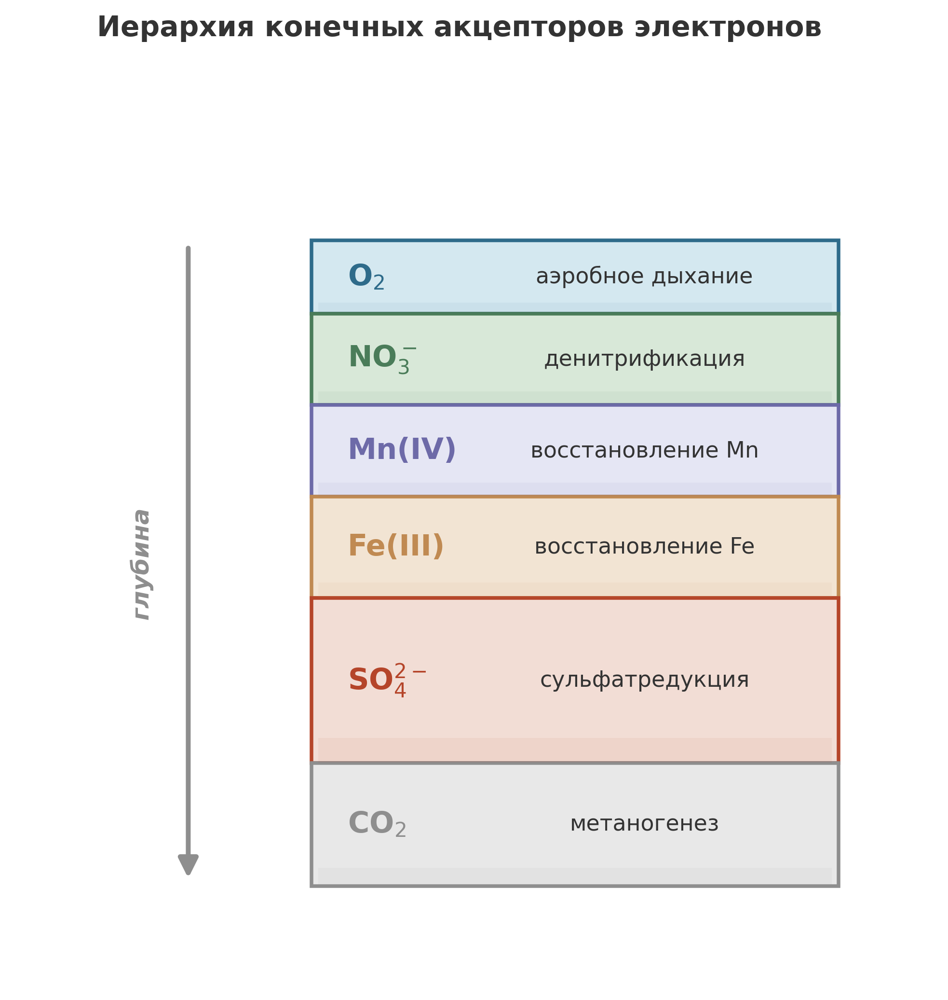

В 2002 году в воде, отобранной на глубине 2,8 километра в Южной Африке, обнаружили микробную популяцию с необычайно медленным предполагаемым темпом жизни: обновление биомассы занимало десятилетия или столетия. Лин и коллеги вывели эту оценку из химических запасов, истории воды и допущений о росте и гибели.[^lin2006] Это то самое сообщество из главы 1, в среде которого достаточно химической энергии. Реакция водорода с сульфатом была энергетически выгодной, однако долговременная активность оказалась крайне низкой. Что эти наблюдения говорят о затратах на поддержание жизни?

В центре этой истории стоит *Candidatus* Desulforudis audaxviator. Пробы воды из трещин горных пород были взяты в 2002 году в золотом руднике Мпоненг (Mponeng) в Южной Африке на глубине 2,8 километра. Lin и коллеги сообщили о геохимии и преобладающем бактериальном филотипе в 2006 году; Chivian и коллеги реконструировали и назвали его геном в 2008 году.[^lin2006][^chivian2008]

Вода была горячей: сначала выше 60 градусов Цельсия, позднее около 52 градусов при отборе проб. Она была щелочной и богатой растворённым сульфатом, молекулярным водородом, метаном и небольшими органическими молекулами, такими как формиат и ацетат. Вмещающая порода представляла собой архейский метабазальт. Благородные газы и химический состав указывали на древние подземные воды, возраст которых нужно было интерпретировать с учётом смешения.[^lin2006]

И там была жизнь.

Не изобилие жизни и не джунгли. Но когда Li-Hung Lin и коллеги проанализировали воду из этих трещин, они обнаружили микробное сообщество, где преобладал один бактериальный филотип, относящийся к термофильным сульфатредукторам.[^lin2006] Изотопы растворённых лёгких углеводородов согласовывались с абиогенным происхождением. Предполагаемое геологическое снабжение включало водород радиолитической химии и сульфат, связанный с минеральными источниками, в том числе с окислением пирита и растворением барита. Данные свидетельствовали о поддержке со стороны химии породы и воды, без видимой опоры на субстраты фотосинтетического происхождения, и не доказывали, что каждое органическое соединение имеет абиотическое происхождение.

## Отважный странник

В отфильтрованном образце ДНК из воды в трещинах, полученном Chivian, преобладал один организм. По оценке авторов на основе метагеномных прочтений, он составлял более 99.9 процента микроорганизмов в этом конкретном образце флюида. Он получил одно из самых литературных названий в микробиологии: *Candidatus* Desulforudis audaxviator. Название восходит к латинской фразе из романа Жюля Верна *Путешествие к центру Земли*: «Descende, audax viator, et terrestre centrum attinges», «Спустись, отважный путник, и достигнешь центра Земли».[^chivian2008]

Вывод Chivian относился к жидкой фазе, задержанной на фильтре 0.2 микрометра; авторы не могли исключить организмы на поверхностях трещин или более мелкие, чем поры фильтра.[^chivian2008]

Название заслужено. Реконструированный геном кодировал впечатляющий потенциал самодостаточности: сульфатредукцию, использование водорода, ассимиляцию неорганического углерода и фиксацию азота. Гены указывают на возможности, а не на скорости, измеренные в трещине. В частности, авторы отметили, что имеющийся растворённый аммиак мог обеспечивать азот без его фиксации. Расчёты Lin ставили сульфатредукцию на водороде впереди остальных сравниваемых реакций в условиях отобранных проб, с энергетическим выходом, значительно превышавшим выбранный авторами порог сопряжения с АТФ. Мпоненг не был для них примером реакции, едва оплачивающей жизнь.[^lin2006][^chivian2008]

Информативно и то, чего в геноме нет. Чивиан и коллеги обнаружили неполную систему устойчивости к кислороду и интерпретировали её как признак, согласующийся с длительным существованием вдали от кислорода.[^chivian2008]

Лин и Чивиан использовали разные способы отбора проб и анализа ДНК, поэтому их оценки обилия описывают разные срезы водного сообщества. Лин сообщил о небольших бактериальных и архейных сигналах с неясной экологической ролью; Чивиан отфильтровал гораздо больший объём воды с 27 по 30 сентября 2002 года.[^lin2006][^chivian2008] Эти различия важны для сравнения проб, а активность организмов на окружающей породе остаётся отдельным вопросом.

Лин обсуждал возможный интервал изоляции или колонизации от 3 до 25 миллионов лет на основании возраста воды и её смешения. Это геологический масштаб водной системы, отличный от времени обновления биомассы или срока жизни отдельной клетки.[^lin2006] Здесь порода, вода и тепло связаны с продолжающимся поступлением химической энергии.

История *D. audaxviator* уже не ограничивается Южной Африкой. Вестмейер и коллеги обнаружили родственную преобладающую популяцию в воде из трещины на глубине 975 метров в Швеции, отобранной в сентябре 2022 года. Метагеномика с реконструкцией отдельных геномов и анализ маркерных генов показали её в составе разнообразного сообщества.[^westmeijer2024] Теперь организм можно изучать в разных подземных условиях.

Выражение «экосистема из одного вида» описывает поразительное преобладание в отфильтрованной воде Мпоненга вместе с геномным потенциалом метаболической самостоятельности. Границы пробы существенны: прикреплённое сообщество и организмы мельче пор фильтра не были полностью учтены.[^chivian2008] Шведская находка показывает родственный организм в иной экологической обстановке.[^westmeijer2024]

## Что считать «глубоким»

Открытие в Мпоненге драматично, но не является изолированным курьёзом. К середине 1990-х годов накапливались данные, что микробная жизнь проникает в земную кору гораздо глубже, чем кто-либо предполагал. Вопрос состоял в том, как осмыслить это систематически.

Derek Lovley и Francis Chapelle предложили подход, который остаётся полезным и сегодня.[^lovley1995] Для микробиологических исследований водонасыщенных систем они утверждали, что «глубокое» не следует определять одной лишь глубиной. Например, образец с 500 метров в одной геологической обстановке может быть теснее связан с поверхностью, чем образец с 50 метров в другой. Важна гидрология: как вода движется через недра.

Lovley и Chapelle описали три масштаба течения подземных вод, с типичными диапазонами, а не фиксированными классификационными порогами:

- **Локальные системы течения**: типичное питание с поверхности 1--30 cm/yr и относительно быстрое движение подземных вод 1--100 m/yr. Влияние поверхности сильное, хотя локальные системы могут простираться на сотни метров под землю.
- **Промежуточные системы течения**: более слабая связь с поверхностью, с типичным питанием 0.01--1 cm/yr и движением подземных вод 0.1--1 m/yr.
- **Региональные системы течения**: питание вблизи водораздела подземных вод и разгрузка вблизи дна бассейна, с очень низким питанием и часто вялым течением. Влияние поверхности слабее.

Для исследований водонасыщенных систем Lovley и Chapelle предложили ограничить «глубокие недра» промежуточными и региональными системами течения. Определение носит функциональный, а не геометрический характер: оно подчёркивает более слабую связь с поверхностью, а не фиксированную глубину. Оно не подразумевает нулевого питания или независимости от захороненного органического вещества.

Lovley и Chapelle утверждали, что в большинстве местообитаний глубоких недр доминируют микроорганизмы, поскольку типичные поровые пространства ограничивают более крупные формы жизни.[^lovley1995] Пора, пропускающая бактерию, может остановить нематоду, не говоря о любом существе с кровеносной системой. В таких порах малый размер не служит недостатком. Он служит входным билетом.

И одно отсутствие абсолютно: «Свет в глубоких недрах недоступен».[^lovley1995] Фотосинтеза нет. Местное снабжение энергией должно поступать из химических реакций: из окисления органического вещества, захороненного вместе с осадком, из восстановленных соединений, таких как Fe(II), Mn(II), аммиак или сульфид, приносимых питающей водой, или, возможно, из восстановленных минералов, поставляющих абиотические доноры электронов.[^lovley1995_serpentin]

## Иерархия конечных акцепторов электронов

Без солнечного света глубокие недра живут по тому же основному принципу, что и окислительно-восстановительная лестница из предыдущих глав, но сведённому к самому необходимому. Организмы окисляют доноры электронов (органический углерод, водород, восстановленные металлы) и передают электроны любому доступному акцептору. Наиболее распространённые конечные акцепторы электронов, в порядке энергии, которую они обычно дают:

$$
\text{O}_2 > \text{NO}_3^- > \text{Mn(IV)} > \text{Fe(III)} > \text{SO}_4^{2-} > \text{CO}_2
$$

{#fig-redox-ladder}

Каждый акцептор поддерживает особое метаболическое сообщество: организмы с аэробным дыханием, денитрификаторы, восстановители марганца, восстановители железа, сульфатредукторы, метаногены. Их называют процессами с участием конечных акцепторов электронов (Terminal Electron Accepting Processes, TEAP), и в идеализированной системе они выстраиваются последовательно по мере исчерпания более энергетически выгодных акцепторов. Восстановление нитрата включает пути, выходящие за рамки метки денитрификации, использованной на схеме.[^lovley1995] Bethke и коллеги сравнивают энергию, сохраняемую в АТФ на моль донора электронов, а не реакционные энергии Гиббса. Такое сравнение не устанавливает единого отношения энергий для каждого полевого сообщества.[^bethke2011]

На практике глубокие недра запутаннее. Lovley и Chapelle критиковали геохимические модели, которые рассматривают микроорганизмы как катализаторы и выводят их реакции из термодинамической выгодности, как будто бактерии служат всего лишь чёрными ящиками, ускоряющими любую химию, которой требует ландшафт энергии Гиббса.[^lovley1995] Это упрощение работает на удивление часто, но в важных случаях подводит.

Причина в том, что термодинамическая выгодность необходима, но недостаточна. Реакция может быть выгодной на бумаге и всё же не идти, потому что ни у одного присутствующего организма нет нужных ферментов. Реакция может быть выгодной и быстрой в стакане, но голодать в поре, потому что перенос не доставляет реагенты. Lovley и Chapelle утверждали, что одни лишь равновесные модели могут не объяснять и не предсказывать важные геохимические процессы, даже в сравнительно стабильных древних подземных обстановках.[^lovley1995]

Практический вывод суров: в обсуждаемых ими системах подземных вод микробный катализ и клеточное сохранение энергии ограничивают скорости и степень важных окислительно-восстановительных процессов.[^lovley1995] В этих системах биология не является деталью, наложенной поверх химии. Клетки помогают решить, какая химия действительно происходит на наблюдаемых временных масштабах.

## Дыхание на глубине

Выражения Моно с двумя лимитирующими субстратами из главы 8 дают одну из возможных отправных точек для описания дыхания в глубоких недрах.[^jin2005_deep][^thullner2007_deep] Для их применения нужно задать местные донор и акцептор, биомассу, основу параметров и условия переноса.

В хорошо снабжаемых кислородом поверхностных слоях глубоководных осадков, где поступление органического вещества мало, на аэробное дыхание приходится разложение большей части органического углерода.[^rabouille1991] Но во многих более глубоких обстановках кислород становится дефицитным. В аноксичных осадочных обстановках, истощённых по нитрату, может возникнуть разделение труда: гидролиз и ферментация поставляют небольшие субстраты, такие как ацетат и водород, которые другие микробы могут использовать как доноры электронов, восстанавливая оставшиеся акцепторы.[^lovley1995] Продукты одной группы могут питать метаболизм другой, хотя взаимодополняющие роли не исключают конкуренции.

Во многих описанных здесь сообществах партнёры делят между собой работу по переработке органического вещества. Мпоненг даёт другое предостережение: преобладание генома с потенциалом метаболической независимости не устанавливает всех реакций, происходящих во всей трещине, но и малые сигналы ДНК не устанавливают необходимых партнёров. Нужны свидетельства активности и обмена, прежде чем распределять экологические роли организмам, которых обнаруживает секвенирование.[^lin2006][^chivian2008]

## Когда электроны переходят напрямую

Не всякое партнёрство в недрах опосредовано диффундирующей молекулой, такой как водород или ацетат. В некоторых сообществах организмы обмениваются электронами напрямую.

Электромикробиология изучает такой обмен. *Geobacter* и родственные линии могут передавать электроны минералам железа и марганца вне клетки, используя проводящие пили и цитохромы, чтобы вынести дыхание за пределы клеточной мембраны.[^rotaru2014] В смешанных сообществах эта способность может стать социальной технологией. Вместо выделения водорода для потребления партнёром один организм может передавать электроны непосредственно другому, и этот процесс называют прямым межвидовым переносом электронов (direct interspecies electron transfer, DIET).[^rotaru2014]

DIET продолжает логику синтрофии из глав 7 и 8 до буквального электрического контакта. Отходы одного организма по-прежнему служат топливом для другого, но передачей может быть ток, а не молекула, диффундирующая через поровую воду. В осадочных средах тот же принцип проявляется в больших масштабах у кабельных бактерий, которые связывают окисление сульфида на глубине с восстановлением кислорода у поверхности, перемещая электроны на расстояния в сантиметры. Старая окислительно-восстановительная лестница по-прежнему здесь. Её соединяет больше проводов, чем мы когда-то знали.

## Энергетический выход, мощность и затраты на выживание

В главе 1 мы разделили энергию одной реакции и скорость, с которой клетка может её получать. В глубокой биосфере это различие особенно важно: энергетически выгодная реакция может сопровождаться медленным оборотом субстрата, тогда как другие реакции идут близко к пределу доступной энергии. Прежде чем сравнивать поступление энергии с затратами на выживание, нужно знать обе величины.

В наблюдаемый диапазон входит очень медленное обновление биомассы. Дуглас ЛаРоу и Ян Аменд собрали оценки для водоносных горизонтов, осадочных пород, морских осадков и ледяных кернов, в которых обновление биомассы может занимать более 1000 лет.[^larowe2015_deep] В их сводке есть и поверхностный пример, антарктические фотосинтетические сообщества, с оценками до 19 000 лет.

Сообщество может сохранять метаболическую активность в совокупности и при этом обновлять свою биомассу раз в тысячу лет. Это время обновления биомассы не показывает, сколько живёт отдельная клетка. Остаётся открытым вопрос, непрерывно ли отдельные клетки активны с исчезающе малыми скоростями или чередуют покой с редкими всплесками активности.

Диапазон скоростей метаболизма поражает даже в пределах одной среды. По измеренным и смоделированным скоростям, которые LaRowe и Amend собрали для морских сред на границе между осадком и водой и ниже неё, катаболические скорости изменяются на двенадцать порядков величины, примерно от $6 \times 10^{-9}$ до $6.66 \times 10^{3}$ nmol cm$^{-3}$ day$^{-1}$.[^larowe2015_deep] Двенадцать порядков величины. Самые быстрые осадочные сообщества перерабатывают субстрат в триллион раз быстрее на единицу объёма, чем самые медленные. И всё же самые медленные живы.

Медленное обновление биомассы оставляет отдельный вопрос: сколько энергии нужно клетке, чтобы просто оставаться живой без роста? Здесь важны затраты энергии на единицу времени, то есть мощность, необходимая для поддержания жизнедеятельности. В лабораторных культурах эти затраты можно оценить: культуру морят голодом, следят за её угасанием и рассчитывают энергетическую цену того, чтобы не гас свет.

Чтобы сопоставить эти потребности с условиями глубоких недр, нужна мощность в расчёте на клетку. В глубоких недрах такие потоки оказываются «на несколько порядков ниже энергий поддержания, предсказанных по лабораторным культурам».[^larowe2015_deep]

Это сравнение превращает лабораторные оценки затрат на поддержание жизни в предмет проверки. ЛаРоу и Аменд связывают эти затраты с условиями роста, температурой и стрессами, действующими на клетки.[^larowe2015_deep] Поэтому в модели нужно установить, подходит ли выбранный член затрат для описываемой подземной популяции и временного масштаба.

Следствие меняет представление о моделировании глубокой жизни. Лабораторная оценка затрат на поддержание жизнедеятельности не обязана без изменений подходить для условий воды в трещинах. Важны температура, химический стресс и поступление субстратов. Но работы по Мпоненгу не измеряли полный расход на поддержание отдельных клеток и не показали, что большая часть затрат исчезла. Сочетание выгодной химии и медленной предполагаемой активности оставляет вопрос о лимитирующих процессах открытым.[^lin2006]

Такова идея поиска достаточно хорошего решения (satisficing) в том смысле, в каком я использую этот термин в книге. Simon ввёл его для ограниченного выбора, а не для микробов.[^simon1956_deep] Позднее экологи использовали это понятие против строгих моделей оптимального поиска пищи, а Carmel и Ben-Haim обнаружили, что модель устойчивого satisficing согласуется с большей частью этой полевой литературы лучше, чем оптимизация.[^carmel2005] Затем Brennan и Lo показали в формальной эволюционной модели, что отбор может сохранять ограниченные стратегии, когда информация и вычисления имеют цену.[^brennanlo2012] Я расширяю этот словарь на микробные сообщества.

*D. audaxviator* совместим с интерпретацией satisficing, но не доказывает её. Закодированный в его геноме сульфатредуцирующий аппарат соответствует субстратам, найденным в трещине, и сравнение Lin тоже энергетически отдавало предпочтение сульфатредукции на водороде. Эти наблюдения не выявляют измеренного правила оптимизации и не показывают, что эрозия генома оставила лишь минимальный набор инструментов. Вместо этого геном содержит значительный репертуар, включая возможности, приобретённые горизонтальным переносом генов.[^lin2006][^chivian2008]

Геном содержит гены жгутиковой подвижности, хемотаксиса и спорообразования. Chivian и коллеги предположили, что такие возможности могут помогать колонизации, сохранению популяции и движению вдоль химических градиентов. Такие роли правдоподобны, но не являются поведением, непосредственно наблюдавшимся в отобранных пробах воды из трещин. Геном подсказывает, что проверять, но не всё, что делали клетки.[^chivian2008]

## Соперничество или сотрудничество?

Один из устойчивых вопросов микробиологии глубоких недр: соперничают ли организмы этих сообществ за скудные ресурсы или каким-то образом сотрудничают, оптимизируя общий сбор энергии. Ответ важен для моделирования, потому что соперничество и сотрудничество ведут к разным предсказаниям о том, какие организмы сохраняются и с какими скоростями.

Craig Bethke и коллеги рассмотрели этот вопрос через призму термодинамической лестницы.[^bethke2011] Они отметили кажущийся парадокс: восстановители железа и сульфатредукторы сохраняют в своих запасах АТФ в четыре-пять раз больше энергии на моль потреблённого донора электронов, чем метаногены. Если бы соперничество определялось только выходом энергии, метаногены постоянно проигрывали бы везде, где есть железо или сульфат. Однако восстановление железа и восстановление сульфата наблюдали вместе в осадках водоносных горизонтов, а три группы не укладываются в фиксированную термодинамическую последовательность.

Bethke и коллеги разрешили парадокс с помощью полезной энергии, то есть энергии сверх той, которую клетка должна удерживать в собственных запасах. В подземных водах, близких к нейтральным, три группы получают примерно равные количества, отчасти потому, что метаногены улавливают мало энергии на моль донора. В их биореакторах восстановители железа и сульфатредукторы уравновешивали своё дыхание во взаимовыгодных отношениях мутуализма, а не соперничали, и авторы заключили, что экологические и физиологические факторы, а не одна лишь термодинамика, определяют, где эти группы активны.[^bethke2011] Другим мыслимым разрешением служит то, что сообщество в целом стремится к состоянию, максимизирующему суммарную полезную энергию, извлекаемую из всех доступных реакций: своего рода коллективная оптимизация. С этой точки зрения состав сообщества определяется не только попарным соперничеством, но и глобальной задачей оптимизации: при заданных доступных донорах и акцепторах электронов какое сочетание метаболизмов извлекает больше всего энергии?

Satisficing позволяет сформулировать ещё одну гипотезу: сообщество может существовать благодаря стратегиям, достаточным в местных условиях, без общей цели максимизации. В таком описании группа должна получать доступную энергию, покрывать затраты на поддержание жизни и восполнять потери клеток при действующих ограничениях переноса и экологии. Эти условия помогают построить модель, но одна жизнеспособность не отличает её от оптимизации. Биореакторы Бетке также показывают, почему энергетическая возможность не гарантирует сохранения популяции.[^bethke2011]

Это активная область исследований, и модели ещё не устоялись. Критики satisficing выдвигают справедливое возражение: стоит включить затраты на поиск и информацию в целевую функцию, и вы, возможно, снова получите оптимизацию под другим именем.[^callebaut2007] Отсутствие общей цели у сообщества не исключает оптимизации приспособленности отдельных организмов или эволюционных линий, а отбор не требует, чтобы организм обозревал весь ландшафт. Эмпирическая проверка состоит в том, предсказывает ли явно заданное правило satisficing наблюдения лучше, чем конкретные модели оптимизации, при независимо установленных ограничениях на затраты, ресурсы и временные масштабы.[^brennanlo2012] Если эта рамка не объясняет размытое сосуществование, полевые скорости и стойкие метаболизмы с низким выходом энергии лучше, чем истории об оптимизации, она не заслуживает своего названия.

## Рост, распад и смысл выхода биомассы

Чтобы связать микробную энергетику с количественными моделями, нужно уравнение для биомассы:

$$
\frac{d[B]}{dt} = Y \cdot R_{\text{resp}} - \mu_{\text{dec}} \cdot [B]
$$

Биомасса растёт пропорционально скорости дыхания (с множителем в виде коэффициента выхода $Y$) и распадается со скоростью, пропорциональной текущей биомассе (с множителем в виде константы распада $\mu_{\text{dec}}$).[^thullner2007_deep][^dale2010]

Коэффициент выхода $Y$, то есть биомасса, образующаяся на моль потреблённого донора электронов, когда $R_{\text{resp}}$ выражена в молях донора на единицу объёма в единицу времени, не является константой. По 123 опубликованным определениям выхода, охватывающим 38 катаболических путей, Roden и Jin обнаружили, что выход растёт примерно линейно с катаболической свободной энергией, доступной на моль донора, причём большинство путей лежит в пределах двукратного отклонения от подогнанной прямой.[^roden2011_yield] Теоретические подходы выводят выход из термодинамических первых принципов;[^rittmann2001][^heijnen1992] LaRowe и Amend связывают катаболическую мощность с биомассой через энергетический коэффициент выхода, зависящий от условий, в которых синтезируются биомолекулы.[^larowe2015_deep]

Но в глубоких недрах рост составляет лишь половину истории. Значительная часть биомассы в любой момент может находиться в покое: быть живой, но метаболически неактивной. Модели, явно отслеживающие покоящиеся и активные доли клеток, показывают, что переход между состояниями может сильно влиять на динамику сообщества и кажущиеся геохимические скорости.[^stolpovsky2011] Клетки реагируют на изменения среды не мгновенно; между возмущением и метаболическим ответом существует лаг-фаза.[^blanch1981_deep] Для стабильных обстановок глубоких недр допущения квазистационарного состояния могут выполняться. Для возмущённых систем они не выполняются.

Честный итог: выход биомассы, скорость роста и энергетические затраты на поддержание жизнедеятельности не являются константами. Они зависят от термодинамики, среды и истории.

## Масштаб скрытого мира

Сколько жизни там, внизу? Оценки неоднократно пересматривались по мере улучшения отбора проб, а недавние сводки дают меньшие значения, чем ранние. Современные оценки позволяют предположить, что глубокие недра, то есть порода, осадки и водоносные горизонты ниже досягаемости солнечного света, могут содержать значительную долю всей микробной биомассы Земли. Числа неопределённы, но даже консервативные оценки дают миллиарды тонн углерода в подземных микроорганизмах.[^magnabosco2018_deep]

Объём пригодных для жизни пород огромен. Даже редкие и неравномерно распределённые популяции в сумме могут давать значительную биомассу. Поэтому оценки зависят от мест отбора проб и от того, как численность клеток экстраполируют на разные геологические обстановки.

Глубокая биосфера представляет и другой способ существования. Поверхностные пищевые сети часто быстро перерабатывают солнечную энергию. У некоторых глубоких популяций предполагаемое обновление биомассы идёт очень медленно, возможно в масштабе столетий или дольше, тогда как другие получают более активное снабжение углеродом и энергией. Обновление популяции, оценённое по химическим балансам, не служит секундомером для деления отдельной клетки. Медленной тёмной экономике по-прежнему нужно сводить баланс: энергия должна течь, а электроны двигаться.[^lin2006]

## Чему учит отважный странник

Вернёмся на мгновение к подземным водам рудника Мпоненг. Конкретный образец воды с глубины 2,8 километра был подавляюще представлен одним геномом. Вода несла свидетельства длинной геологической истории, а её водород и сульфат могли поддерживать микробный метаболизм. В трещине нет солнечного света. Но ни возраст воды, ни преобладание в образце флюида не говорят нам, как долго жила конкретная клетка и как полно была опробована окружающая порода.[^lin2006][^chivian2008]

*Desulforudis audaxviator* помещает различие из главы 1 в полевые условия: энергетически выгодные реакции, закодированные метаболические возможности и медленное предполагаемое обновление популяции существуют вместе.[^lin2006][^chivian2008] Химия объясняет, как жизнь может получать энергию без солнечного света. Чтобы установить процесс, ограничивающий скорость, нужны потоки субстратов, активная биомасса и затраты на поддержание жизни, определённые в сопоставимых масштабах.

Законы скорости из главы 8 и приведённый выше баланс роста и выхода биомассы показывают, как поставить следующие количественные вопросы. Как быстро может расти популяция при измеренном потоке водорода? Какую долю энергии реакции она может сохранить? Какая часть поступления идёт на поддержание жизни, а какая на новую биомассу?

Это вопросы, на которые можно ответить. Модели существуют. Параметры измеряются. И ответы, когда они придут, скажут нечто глубокое не только о жизни в глубинах Земли, но и о жизни везде, где её допускают химия и термодинамика, включая, возможно, подповерхностные океаны Европы или древние водоносные горизонты Марса.

Отважный странник спустился во тьму и нашёл способ там жить. Уравнения позволяют нам последовать за ним вниз.

## Главное

- Некоторые глубокие микробные сообщества, включая изученную популяцию в воде в трещинах горных пород в руднике Мпоненг, по-видимому, поддерживаются геологическими источниками водорода и сульфата без видимой опоры на фотосинтетические субстраты; утверждение не распространяется на все глубокие местообитания.[^lin2006]
- Для водонасыщенных систем Lovley и Chapelle предложили гидрологическое определение «глубокого»: промежуточные и региональные системы течения с более слабой связью с поверхностью, а не фиксированная глубина.
- Иерархия конечных акцепторов электронов управляет энергетическим метаболизмом в недрах, но биология не служит пассивным катализатором: организмы определяют, какие термодинамически выгодные реакции действительно происходят.
- Электромикробиология расширяет синтрофию за пределы общих метаболитов: в лабораторных сокультурах и инженерных метаногенных системах некоторые микробы обмениваются электронами напрямую через проводящие пили, цитохромы или проводящие материалы; насколько это распространено в глубоких недрах, остаётся открытым.
- Катаболические скорости в морских осадках охватывают двенадцать порядков величины; у некоторых подземных популяций время обновления биомассы превышает 1 000 лет, а доступная мощность на клетку значительно ниже лабораторных оценок мощности, необходимой для поддержания жизнедеятельности.
- Количественные модели (кинетика Моно с двумя лимитирующими субстратами, уравнения роста и распада биомассы, коэффициенты выхода) связывают биологию с измеримыми геохимическими процессами, но параметры, такие как выход биомассы и энергетические затраты на поддержание жизнедеятельности, нужно рассматривать как переменные, а не как константы.

[^lin2006]: Li-Hung Lin et al., "Long-Term Sustainability of a High-Energy, Low-Diversity Crustal Biome," *Science* 314 (2006): 479-482, [doi:10.1126/science.1127376](https://doi.org/10.1126/science.1127376). Таблица 1 определяет образцы воды 2002 года; с. 481 и таблица 2 охватывают состав сообщества, интерпретации возраста флюидов и энергетику реакций; с. 482 содержит интерпретации минеральных источников и условную оценку оборота от 45 до 300 лет. [@Lin2006]

[^chivian2008]: Dylan Chivian et al., "Environmental Genomics Reveals a Single-Species Ecosystem Deep Within Earth," *Science* 322 (2008): 275-278, [doi:10.1126/science.1155495](https://doi.org/10.1126/science.1155495). Рисунок 1 и с. 276-277 различают метагеномное преобладание, охват флюида и фильтра и закодированные метаболические возможности. Supporting Online Material, "Collection of DNA," с. 7, датирует сбор с 27 по 30 сентября 2002 года. [@Chivian2008]

[^lovley1995]: Derek R. Lovley and Francis H. Chapelle, "Deep Subsurface Microbial Processes," *Reviews of Geophysics* 33 (1995): 365--381. [@Lovley1995] Предложенное гидрологическое определение и типичные диапазоны течения приведены на с. 366; ограничения, связанные с порами, и свет на с. 367; критика геохимических моделей на с. 365--366; TEAP и их разделение на с. 367 и 370--371; ферментация на с. 369.

[^larowe2015_deep]: Douglas E. LaRowe and Jan P. Amend, "Catabolic rates, population sizes and doubling/replacement times of microorganisms in natural settings," *American Journal of Science* 315 (2015): 167--203. Таблица 2 сводит катаболические скорости в морских средах на границе между осадком и водой и ниже неё, охватывающие двенадцать порядков величины (с. 171); длительные времена оборота рассмотрены на с. 170, а энергии поддержания на с. 177-178. [@LaRowe:2015dt]

[^bethke2011]: Craig M. Bethke et al., "The thermodynamic ladder in geomicrobiology," *American Journal of Science* 311 (2011): 183--210. [@Bethke2011]

[^lovley1995_serpentin]: Lovley и Chapelle обсуждали возможные абиотические доноры электронов, включая водород, образующийся при реакциях с восстановленными минералами в базальте (с. 375). Их обсуждение не устанавливает этот механизм для каждого глубокого местообитания. [@Lovley1995]

[^jin2005_deep]: Qusheng Jin and Craig M. Bethke, "Predicting the Rate of Microbial Respiration in Geochemical Environments," *Geochimica et Cosmochimica Acta* 69 (2005): 1133--1143. [@Jin2005]

[^thullner2007_deep]: Martin Thullner, Pierre Regnier, and Philippe Van Cappellen, "Modeling Microbially Induced Carbon Degradation in Redox-Stratified Subsurface Environments: Concepts and Open Questions," *Geomicrobiology Journal* 24 (2007): 139--155. [@Thullner2007]

[^rabouille1991]: C. Rabouille and J.-F. Gaillard, "A coupled model representing the deep-sea organic carbon mineralization and oxygen consumption in surficial sediments," *Journal of Geophysical Research* 96 (1991): 2761--2776. [@Rabouille1991]

[^dale2010]: A. W. Dale et al., "Pathways and regulation of carbon, sulfur and energy transfer in marine sediments overlying methane gas hydrates on the Opouawe Bank (New Zealand)," *Geochimica et Cosmochimica Acta* 74 (2010): 5763--5784. [@Dale2010]

[^rittmann2001]: Bruce E. Rittmann and Perry L. McCarty, *Environmental Biotechnology: Principles and Applications* (McGraw-Hill, 2001). [@Rittmann2001]

[^heijnen1992]: J. J. Heijnen and J. P. Van Dijken, "In search of a thermodynamic description of biomass yields for the chemotrophic growth of microorganisms," *Biotechnology and Bioengineering* 39 (1992): 833--858. [@Heijnen1992]

[^roden2011_yield]: Eric E. Roden and Qusheng Jin, "Thermodynamics of Microbial Growth Coupled to Metabolism of Glucose, Ethanol, Short-Chain Organic Acids, and Hydrogen," *Applied and Environmental Microbiology* 77 (2011): 1907--1909, [doi:10.1128/AEM.02425-10](https://doi.org/10.1128/AEM.02425-10). Рис. 1A даёт $Y = 2.08 + 0.0211\,(-\Delta G')$ при $r^2 = 0.949$, где $Y$ выражено в граммах сухих клеток на моль донора электронов, а $-\Delta G'$ измеряется в kJ на моль донора электронов; влияние скорости роста и поддержания не учитывается. [@Roden2011]

[^stolpovsky2011]: Konstantin Stolpovsky et al., "Incorporating dormancy in dynamic microbial community models," *Ecological Modelling* 222 (2011): 3092--3102. [@Stolpovsky2011]

[^blanch1981_deep]: Harvey W. Blanch, "Invited Review: Microbial Growth Kinetics," *Chemical Engineering Communications* 8 (1981): 181--211. [@Blanch1981]

[^magnabosco2018_deep]: Cara Magnabosco et al., "The biomass and biodiversity of the continental subsurface," *Nature Geoscience* 11 (2018): 707--717. [@Magnabosco2018]

[^westmeijer2024]: George Westmeijer et al., "Candidatus Desulforudis audaxviator dominates a 975 m deep groundwater community in central Sweden," *Communications Biology* 7 (2024): 1332, [doi:10.1038/s42003-024-07027-2](https://doi.org/10.1038/s42003-024-07027-2). Таблица 1 датирует образцы 3 сентября 2022 года; результаты по сообществу и методы отбора подземных вод и ДНК позволяют отличать геномный потенциал и обилие от измеренных метаболических скоростей или скоростей деления. [@Westmeijer2024]

[^rotaru2014]: Alexandra-Elena Rotaru et al., "Direct interspecies electron transfer between Geobacter metallireducens and Methanosarcina barkeri," *Applied and Environmental Microbiology* 80 (2014): 4599--4605. Ключевая экспериментальная демонстрация DIET между металловосстанавливающей бактерией и метаногеном. [@Rotaru2014]

[^simon1956_deep]: Herbert A. Simon, "Rational Choice and the Structure of the Environment," *Psychological Review* 63 (1956): 129--138. Simon ввёл satisficing для ограниченного принятия решений в реальных пределах. [@Simon1956]

[^carmel2005]: Yohay Carmel and Yakov Ben-Haim, "Info-gap robust-satisficing model of foraging behavior: do foragers optimize or satisfice?," *The American Naturalist* 166 (2005). Carmel и Ben-Haim сопоставили робастное satisficing с предсказаниями оптимального поиска пищи по полевым исследованиям и нашли более сильную поддержку модели satisficing. [@CarmelBenHaim2005]

[^brennanlo2012]: Thomas J. Brennan and Andrew W. Lo, "An evolutionary model of bounded rationality and intelligence," *PLOS ONE* 7 (2012): e50310. Brennan и Lo показывают, как ограниченные стратегии могут сохраняться при отборе, когда информация и вычисления имеют цену. [@BrennanLo2012]

[^callebaut2007]: Werner Callebaut, "Herbert Simon's silent revolution," *Biological Theory* 2 (2007): 76--86. Callebaut рассматривает попытку вернуть ограниченную рациональность в оптимизацию и утверждает, что такое сведение упускает то, что Simon пытался объяснить. [@Callebaut2007]
